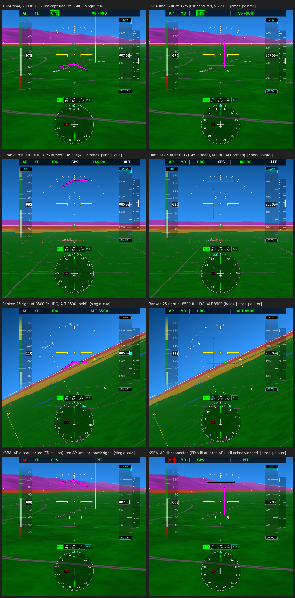

# AFC4 + AFC5 together on the Pi 5 (AER-5808, AER-6052)

The display-crowding review (brief section 8). It shows the AFC4 mode strip and tape
cues and the AFC5 flight director, together on the attitude display, at the Pi bench's
live screen geometry.



`pi5/contact.png` is at half scale. The columns are the two `fd_style` values,
single_cue and cross_pointer. Each row is one scene:

| Scene | Pose | FD command | Autopilot state |
|---|---|---|---|
| `ksba_final` | KSBA, 1.5 NM west of RWY 7, 700 ft, hdg 75, pitch -2 | pitch -4, roll 8 | AP YD, GPS just captured (boxed), VS -500 |
| `mtn_climb` | east of the Front Range, 8500 ft, hdg 270, pitch 4 | pitch 8, roll -15 | AP YD, HDG with GPS armed, IAS 90 with ALT armed |
| `bank_turn` | same spot, hdg 200, pitch 2, roll 25 right | pitch 0, roll 10 | AP YD, HDG, ALT 8500 held (`APALTREF`) |
| `ksba_disc` | the KSBA pose | pitch 1.5, roll 8 | AP disconnected, red `AP` until acknowledged; FD still on |

`pi5/top_band.png` is the top 280 px at full size (1:1): the strip, the bank scale, the
FD cue and both target boxes. The top row is `mtn_climb` and the bottom row is
`ksba_final`.

## How each frame is made

1. **The SVS and the FD bars are a real Pi 5 GL frame.** `tools/svs_capture.py
   --offscreen` ran on the Pi 5 (eglfs, V3D 7.1) alongside the live `pyefis.service`,
   using AFC5's `cap_live.py` and `guarded_cap.sh` (`docs/aer-6052-evidence/pi5/`).
   The frame is 1248x1200, the live `MAP_CTL_TEST` `virtual_vfr`, with its options
   applied. The service had 0 restarts. The V3D buffer growth peaked at 73 to 76 MB
   per capture. The GL sidecars are in `pi5/gl/`.
2. **Everything the live screen lays over the SVS is drawn by the real screen
   builder** (`joint.py`). That is the airspeed tape, the altimeter tape, the trend tape
   and the HSI, at their live `MAP_CTL_TEST` rows, columns and options, plus
   `ap_annunciator`. The values come from an in-memory FIX database. Each instrument
   is rendered at its own position onto a transparent layer, and the layer is drawn
   over the GL frame. That is the same stacking the live screen does, but it is not a
   grab of the live glass. The Pi has no screen grab under eglfs.
3. **Where the strip goes is this sheet's choice.** The live screen has no strip yet.
   Here it spans row 0, column 15, 5 rows by 109 columns: 1046x55 px, from the airspeed
   tape's left edge to the trend tape's right edge, above the tapes. A panel can move
   it in the configurator.
4. The strip's clock is frozen on a flash ON phase, so a mode that just changed shows
   boxed with its text. A still frame caught mid-blink shows an empty box.

## Things to know when reading it

- The yellow vertical line in the KSBA frames is the KSBA airport flag pole from the
  SVS. The flag itself is above the frame top, with or without the strip. AFC5's own
  `ksba_final` frame has the same line at the same pixels.
- The live screen's VS indicator is `altimeter_trend_tape`, which has no `VSSEL` bug.
  AFC4 draws `VSSEL` on a VS tape and on `vsi_pfd`. So in `ksba_final` the VS target
  shows only in the strip, as `VS -500`.
- The FD magenta against the near-airport magenta terrain is AFC5's 1.86:1 blend case.
  See `docs/aer-6052-evidence/pi5/README.md`.

## Provenance

The source is a local merge of #519 at `ba85bcec` (AFC5) and #499 at `cb43976d` (AFC4),
made as merge commit `e00d1882`. It merged cleanly, and 828 tests passed on it in the
sandbox: screens, editor, autopilot, the FD tests and the svs_capture tests. The GL
sidecars say `e00d1882-dirty`: the only uncommitted files were this directory's
scripts. The merge commit is not pushed, because each PR carries its own half.

## Regenerate

On the Pi, with `~/bench-scratch/aer5808/pr` a checkout of that merge and `venv` a
Python with PyQt6, numpy and PyOpenGL, plus AFC5's `cap_live.py` and `guarded_cap.sh`
beside it:

```sh
./joint.sh                     # 8 GL frames under the bench lock, then joint.py on each
QT_QPA_PLATFORM=offscreen venv/bin/python pr/docs/aer-5808-evidence/joint/make_sheet.py sheet
```
