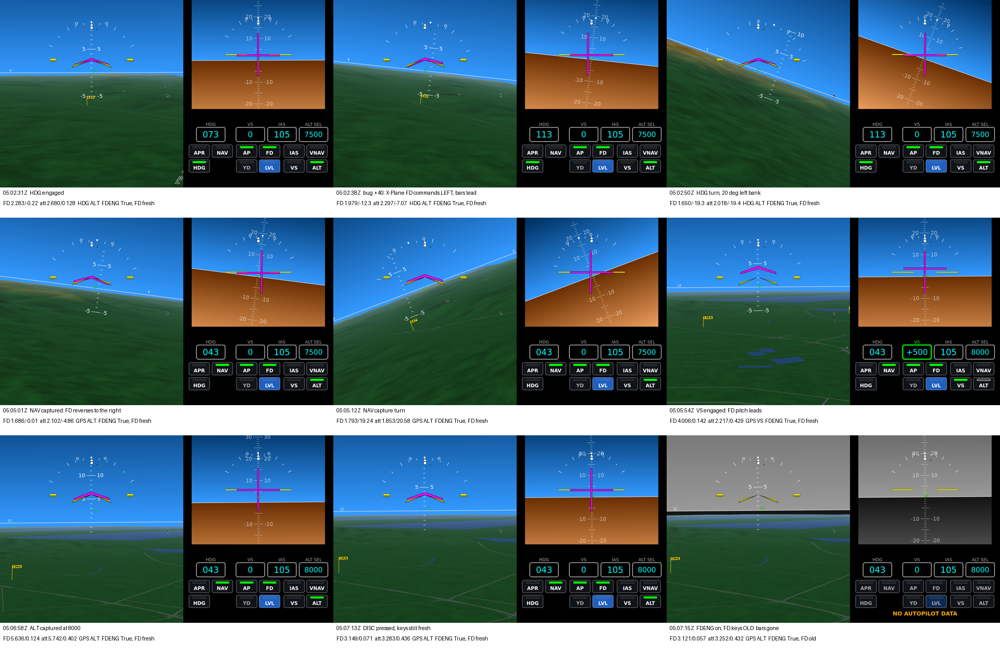

# AFC5 live X-Plane bench run (AER-6052)

Sim-bench session **f7d6b79e7fb9**, flown 2026-11-22 05:00-05:07Z (X-Plane on
the sim bench, C172 G1000, the AFC2 route `rig/profile.yaml`). During the
session, the Beelink ran a private fix-gateway (dev 16282cd, the AFC2 autopilot
adapter) and this branch (af54d44f) on Xvfb :6. The SVS `virtual_vfr` with
`fd_style: single_cue` is on the left, and a plain `atitude_indicator` with
`fd_style: cross_pointer` plus the AFC3 autopilot panel is on the right. None
of it touched the live gateway, `pyefis.service`, display :0 or the live
config trees.

`rig/seq.py` pressed the autopilot through the private gateway, as the control
head does, and grabbed the screen once a second. `run1/frames.jsonl` records
the bus values at each grab, and `run1/steps.jsonl` records each step.



`strip.png`: nine frames at a third of full size, each captioned with the time,
FD and attitude (pitch/roll), modes, and whether the FD keys were fresh.

## What happened

1. **HDG** at 05:02:31.
2. **Bug +40** (73 to 113) at 05:02:36. X-Plane's own flight director
   commanded a **left** turn (FDROLL -19), and the autopilot flew 320 deg the
   long way round to the bug. That is X-Plane's known behaviour on a direct
   heading-bug write (fix-gateway `XPLANE_BEHAVIORS.md`, XPB-018). The bars
   followed X-Plane's command, which is their job.
3. **Intercept bug 43, then NAV** at 05:04:59. The loop had brought the
   aircraft back almost onto the course line (EXTCDI -0.12), so X-Plane
   captured GPS at once and never showed an armed phase. The capture turn was
   a 78 deg right turn onto the next leg (course 73 to 134), with FDROLL
   reversing from -8.6 to +19.
4. **VS to ALT:** VS +500 at 05:05:53. ALT 8000 was captured at 05:06:58.
5. **DISC** at 05:07:13. X-Plane's servo guard paused the sim. FDENG stayed
   **True**, while FDPITCH, FDROLL, PITCH and ROLL went old at 05:07:14. That
   is the frozen-bar case.

## Scored over every frame (`score.py`)

```
frames by (should draw, (drawn SVS, drawn AI)): {(False, (False, False)): 88, (True, (True, True)): 326}
frames where drawn != should: 0 []
cross_pointer fit over 326 frames:
  roll bar x = 3.95 px/deg * (FDROLL-ROLL) + 431.5, r = 0.986, error -5.6..4.9 deg
  pitch bar y = -12.50 px/deg * (FDPITCH-PITCH) + 313.5, r = -0.997, error -1.2..3.7 deg
```

- **All 414 frames match.** Bars appear in both panels exactly when FDENG is
  True and every input is fresh.
- **The 88 frames without bars:** 62 came before any data arrived. In 9,
  X-Plane reported FDENG False while the driver coupled. The other 17 came
  after the disconnect, with FDENG still True and the command old.
  `run1/f00397.png` (fresh) and `run1/f00398.png` and `f00399.png` (old) are
  the full-size frames at that edge.
- **The bars move with the command.** The cross-pointer gains match the code.
  The roll bar's full deflection is 0.16 of the widget width at 30 deg, which
  gives 4.10 px/deg on this 768 px widget (3.95 measured). Pitch is the widget
  height over `pitchDegreesShown` 50, which gives 12.57 px/deg (12.50
  measured).

`score.py` reads only `frames.jsonl` and the frames. To re-run it, fetch the
frames from the Beelink's `~/bench-scratch/aer6052/run1/frames/`, which holds
414 PNGs and 94 MB, so they are not committed:

```sh
python3 docs/aer-6052-evidence/bench/score.py <run1 dir>
```

## Re-flying it

The rig lives in `rig/`. On the Beelink, in `~/bench-scratch/aer6052`:

1. `setup.sh` clones fix-gateway dev and this branch, then builds the private
   config trees.
2. `rehearse.sh` brings the private stack up with no sim and feeds it keys.
3. Submit `profile.yaml` with `sim-session.sh`.
4. Arm `sim_follow.py` with `--on-start "sh session.sh start" --on-end "sh session.sh stop"`.

`run1/bus.jsonl.gz` is the private gateway's full bus log for the session.
