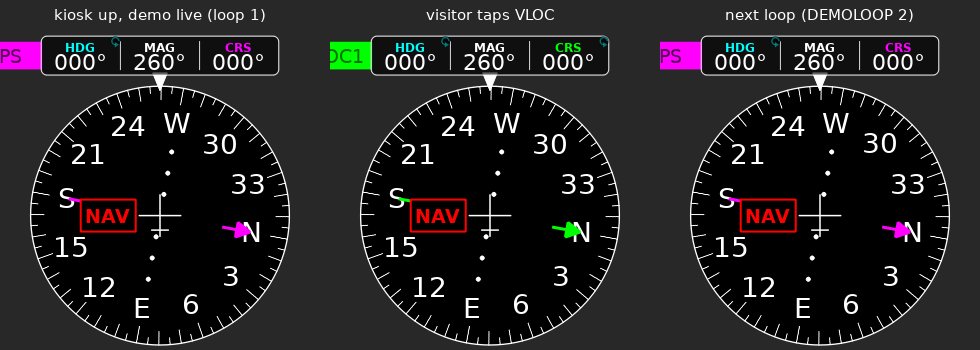
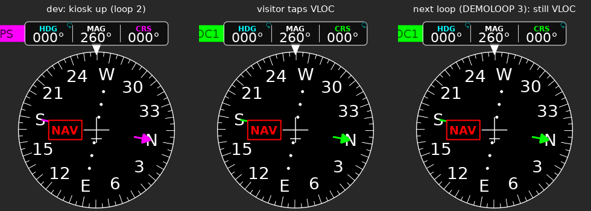

# DEMO12 (AER-6077): visitor settings reset each demo loop

Sandbox end-to-end evidence, not the bench strip. The show unit (Beelink) was
held by the DEMO6 72 h soak (AER-5995) when this was made; the bench strip
follows once the soak ends.

What runs:

- **fix-gateway** at branch `aer-6077/demo-loop-key` (DEMOLOOP), only netfix
  on a private loopback port and the demo plugin flying
  `turn4-kmic-r32-faf30.yaml` (a 275 s route, so a loop comes round in about
  4 minutes). Config: `gateway.yaml`, with `preferences.yaml` and
  `preferences.yaml.custom` copied beside it from `src/fixgw/config`.
- **pyEfis** (`e2e_loop_reset.py`): a real pyavtools netfix client, the kiosk
  with `defaults: {NAVSRC: 2, BARO: 29.92, ALTSEL: 3000, MAPRANGE: 2}`, and
  an HSI rendered offscreen. The visitor's VLOC tap is the HSI source tab's
  own write (`HSI._send_key("NAVSRC", 0.0)`). NAVSRC and DEMOLOOP are read
  back on a separate raw netfix socket, so each line reports what the
  gateway holds.

The gateway runs no compute stage, so COURSE/CDI are not routed and the HSI
shows its NAV flag and HDG 000 in every frame. The thing to read is the
source label at top left: magenta GPS, green VLOC1.

## With this change



```
t=   4.2s kiosk up, demo live: gateway NAVSRC=2.0 (GPS) DEMOLOOP=1  -> 1_show_default.png
t=   6.8s visitor taps VLOC: gateway NAVSRC=0.0 (NAV1 (VLOC)) DEMOLOOP=1  -> 2_visitor_vloc.png
t=   6.8s waiting for the demo's next loop (DEMOLOOP 1 -> ?)
t= 245.5s next loop: gateway NAVSRC=2.0 (GPS) DEMOLOOP=2  -> 3_next_loop.png
t= 245.5s resets=2 result=PASS
```

## Baseline: same script, same gateway, pyEfis `dev` at 4146d4ca



```
t=   4.5s kiosk up, demo live: gateway NAVSRC=2.0 (GPS) DEMOLOOP=2  -> 1_show_default.png
t=   7.0s visitor taps VLOC: gateway NAVSRC=0.0 (NAV1 (VLOC)) DEMOLOOP=2  -> 2_visitor_vloc.png
t=   7.0s waiting for the demo's next loop (DEMOLOOP 2 -> ?)
t= 263.1s next loop: gateway NAVSRC=0.0 (NAV1 (VLOC)) DEMOLOOP=3  -> 3_next_loop.png
t= 263.1s resets=n/a result=FAIL
```

## Reproduce

```sh
# fix-gateway checkout on aer-6077/demo-loop-key; Qt needs a display or offscreen
cd <scratch> && cp <fgw>/src/fixgw/config/preferences.yaml* . && cp <this dir>/gateway.yaml .
PYTHONPATH=<fgw>/src python3 -c "import sys; sys.argv=['fixgw','--config-file','gateway.yaml']; \
  from fixgw.server import main; main()" &
QT_QPA_PLATFORM=offscreen PYTHONPATH=<pyEfis>/src \
  python3 <this dir>/e2e_loop_reset.py 127.0.0.1 34977 .
```

Exit 0 is PASS (the gateway's NAVSRC is back on GPS after the loop), 1 FAIL,
2 no loop within 600 s. The strips put the three saved frames side by side.
