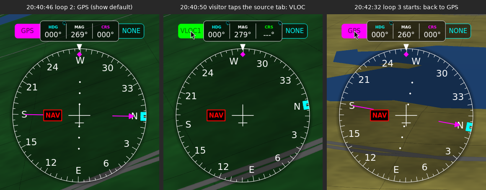

# DEMO12 (AER-6077): bench strip, a VLOC tap reverting at the next demo loop

Beelink bench (X11, 1920x1080), 2026-11-21, after the DEMO6 soak released it.
Stack: fix-gateway `dev` @ 16282cd and pyEfis `dev` @ d9f7066 (both carry
fix-gateway#212 and pyEfis#525), run from a scratch clone in
`~/bench-scratch/aer6077` with the show unit's venvs and its frozen panel
copy. The gateway used the shipped config, with netfix on 3492 and the demo
flying `turn4-kmic-r32-faf30.yaml` (275 s, so a loop comes round in under 5 min;
the show route is 4,008 s). The kiosk config was the show unit's, plus
`defaults: {NAVSRC: 2, BARO: 29.92, ALTSEL: 3000, MAPRANGE: 2}`.

For this run only, `idle_return_s` was 900 instead of 60. The tap would
otherwise start the 60 s idle return, which also resets the settings and
would have fired before the loop did; this isolates the loop trigger.



Left to right, crops of the live glass around the HSI: loop 2 on the show
default (GPS, magenta); 4 s after a real tap on the HSI source tab (xdotool on
`:0`), VLOC1 (green); 2 s after DEMOLOOP stepped to 3, back on GPS. The
cursor in frames 2 and 3 is the xdotool pointer. The NAV flag and HDG 000
are the same in all three frames; they belong to the scratch gateway's state,
not to this change.

`strip.log` (NAVSRC and DEMOLOOP read from the gateway over netfix at each grab):

```
20:40:46 b1_before: NAVSRC=2.0 DEMOLOOP=2 pyEfis=d9f7066 fgw=16282cd
20:40:50 b2_tapped: NAVSRC=0.0 DEMOLOOP=2 pyEfis=d9f7066 fgw=16282cd
20:42:32 b3_next_loop: NAVSRC=2.0 DEMOLOOP=3 pyEfis=d9f7066 fgw=16282cd
```

pyEfis log, same run:

```
INFO:20261121-20:40:18:pyefis.kiosk - kiosk: on, idle return 900 s
INFO:20261121-20:40:20:pyefis.kiosk - kiosk: visitor settings reset (demo live)
INFO:20261121-20:42:29:pyefis.kiosk - kiosk: visitor settings reset (loop restart)
```

`b2_tapped.png` is the full frame after the tap. `setup.sh` builds the scratch
clones and configs; `run_strip.sh` restarts pyEfis with the longer idle time,
taps, waits for the loop and grabs. Both expect the bench's
`pyefis.service` stopped and a `~/.bench-session` claim held; the bench was
restored afterwards (pyefis.service active, 0 restarts, claim removed).
