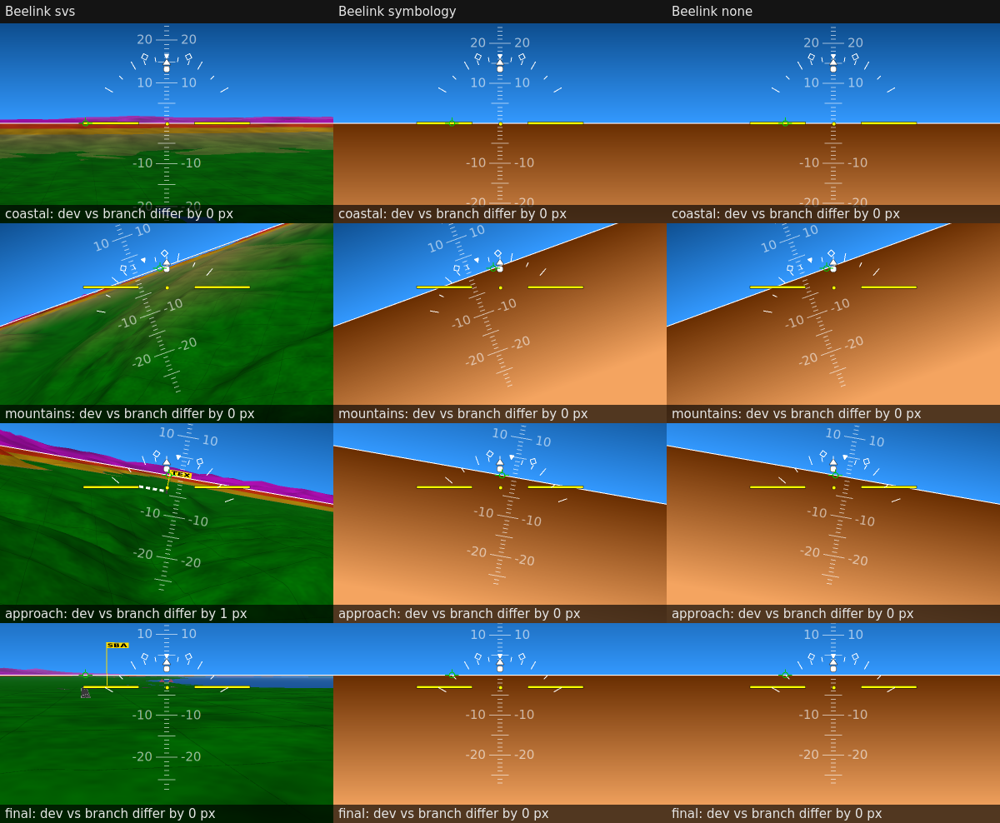
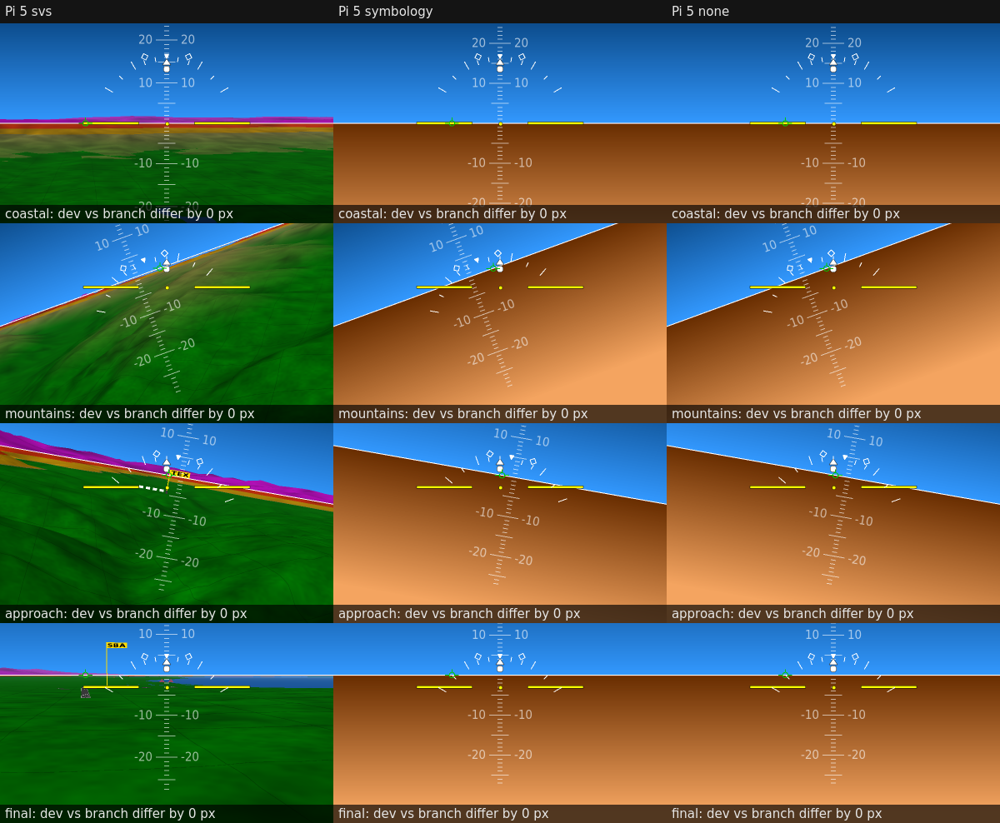

# AER-6080 (CERT12b): bench strips, SVS on and off, dev vs branch

The seam must not change a pixel. Each bench renders the attitude widget at
four pinned poses in three modes, once from `dev` and once from the branch,
and the pairs are compared pixel for pixel. The strips below compare `dev`
at 0e958c7d (with SVSTFC1 traffic) with the branch at 7a86613c, which has
that `dev` merged in.

| Mode | What it is |
|---|---|
| `svs` | SVS plugged in, drawing terrain (`tools/svs_capture.py` unchanged) |
| `symbology` | SVS plugged in, disabled (`--symbology-only`) |
| `none` | No renderer: `set_svs_config` never runs. On the branch this AI loads no SVS module |

Poses (lat, lon, ft MSL, heading, pitch, roll, magvar, horizon_position):
coastal 34.4275 -119.8546 2500 0 0 0 -12 50; mountains 39.20 -106.85 12500
150 -5 20 0 68; approach 37.96933 -107.98168 10500 105 -3 -10 0 68; final
34.42721 -119.87481 611 89 -3 0 -12 68. Heading and magvar vary so the true
heading the AI hands the renderer is exercised; horizon_position 68 (the
deployed SVS panels' value) exercises the lens shift and roll pivot.

All frames are 800x480, rendered offscreen (QOffscreenSurface + FBO, no
window, no DRM master) with the bench's own GL stack and the
`/data/makerplane-data` terrain, water, airport and obstacle packs.

## Beelink (X11, Intel ADL-N) -- 2026-11-21



23 of 24 pairs are identical. `approach/svs` differs at one pixel, (480,
330): `dev` has 0x6aa16a and the branch 0x6ba26b. That is the pixel the
earlier runs found flipping on `dev` alone, between the same two values
(`beelink/repeat-approach-svs.txt`), so it is run-to-run variation in the
renderer, not this change. Here are the Beelink runs:

| Run | Commits (`dev` vs branch) | Identical pairs |
|---|---|---|
| 2026-11-20 | 4146d4ca vs 08901ad8 | 23 of 24 (this pixel) |
| 2026-11-21 | ea09204f vs 236b08ea | 24 of 24 |
| 2026-11-21 | 0e958c7d vs 7a86613c, first run | 24 of 24 |
| 2026-11-21 | 0e958c7d vs 7a86613c, the run committed here | 23 of 24 (this pixel, values swapped) |

## Pi 5 (eglfs, V3D 7.1) -- 2026-11-21



24 of 24 pairs are identical. The frames were rendered under
`QT_QPA_PLATFORM=eglfs` while the bench's live `pyefis.service` held the
display. The service kept the same MainPID (1391847), and its restart count
stayed at 0 before and after (`pi5/run.log`). The run at ea09204f vs 236b08ea
was also 24 of 24. Its journal showed no
traceback, segfault or GL out-of-memory error. The probe frame ran first,
on its own, to check this before the full set.

## Regenerate

On the bench, with two clones (`dev` at the base, `branch` at the head) side
by side and this directory copied next to them:

```sh
export DISPLAY=:0                       # Beelink; on the Pi instead:
# export QT_QPA_PLATFORM=eglfs QT_QPA_EGLFS_KMS_CONFIG=$HOME/eglfs_hdmi.json
D=/data/makerplane-data
flock -w 900 /tmp/pyefis-bench.lock sh run_strips.sh <venv-python> dev branch out \
  $D/terrain/tiles $D/navdata/current/airports.sqlite \
  $D/obstacles/current/obstacles.sqlite $D/water/current/water.sqlite
QT_QPA_PLATFORM=offscreen <venv-python> compare_strips.py out strip.png <label>
```

`run_strips.sh` writes `out/manifest.txt` with each tree's SHA and every
capture's exit code; `strip_capture.py` is the per-frame driver (it adds the
`none` mode and `--horizon-position` around `tools/svs_capture.py`).
