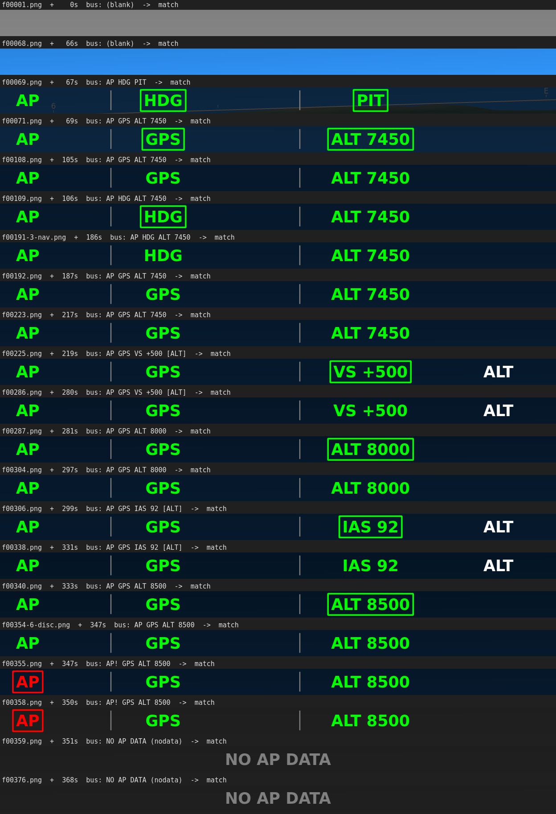
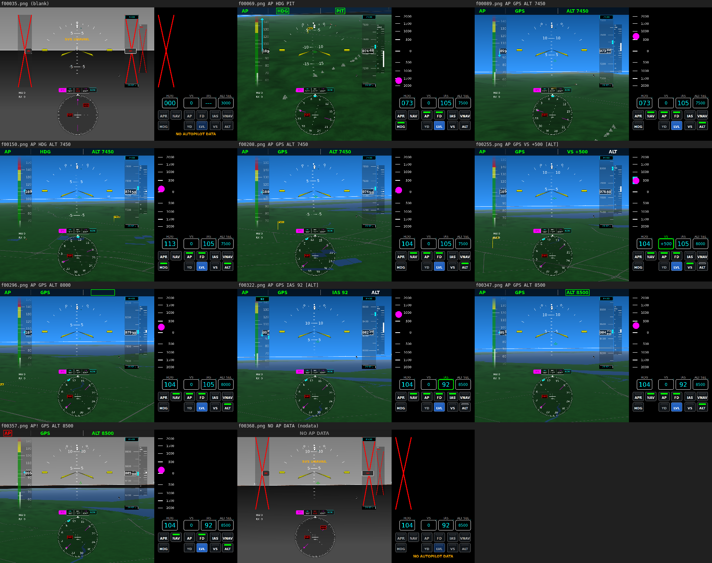

# AFC4 live X-Plane session: the mode strip on a running screen (AER-6288)

AER-5808 proved `ap_annunciator` by replaying a recorded AFC2 session into an
offscreen render. This run puts it on a running pyEfis `dev` screen, fed live
by X-Plane through the AFC2 adapter, and scores every frame against the bus.

Sim-bench session **16dfbb9a74a7**, flown 2026-11-23 05:00-05:06Z (X-Plane
on the sim bench, nav cycle 2611, the driver's `sr22`, the AFC2 route
`rig/profile.yaml`). Private fix-gateway `dev` 7df2e19 and pyEfis `dev`
ee356988 on Xvfb :7. The session ended on the disconnect, as planned: the
driver reports `aborted: autopilot servos dropped`.



`run1/sheet.png`: for each state the bus reported, the first frame with the
text showing and the last frame, cut to the strip at full size. Each caption
gives the frame, the session time, the strip the bus called for, and the
verdict.



`run1/glass.png`: whole frames, one per state, so the tape cues can be seen.
They show the IASSEL box on the airspeed tape during the IAS climb (`92`) and
the VSSEL bug on the VSI during VS.

## Results (`run1/score.out`)

**All 376 frames match the bus.** No `edge` and no `MISMATCH` frames.

| Frames (text showing) | Strip the bus called for | What happened |
|---|---|---|
| 68 (68) | blank | before the driver coupled |
| 1 (1) | `AP HDG PIT` | the driver engaging |
| 71 (67) | `AP GPS ALT 7450` | coupled on the route |
| 83 (83) | `AP HDG ALT 7450` | HDG pressed, a 40 deg offset, then the intercept |
| 63 (58) | `AP GPS VS +500 [ALT]` | NAV (GPS captured at once, no armed phase), then VS with ALTSEL 8000 |
| 18 (16) | `AP GPS ALT 8000` | the capture: `APALTREF` 8000 |
| 34 (32) | `AP GPS IAS 92 [ALT]` | the IAS climb, IASSEL 92, ALTSEL 8500 |
| 16 (13) | `AP GPS ALT 8500` | the second capture: `APALTREF` 8500 |
| 4 (4) | `AP! GPS ALT 8500` | DISC: the red, boxed, flashing AP |
| 18 (18) | `NO AP DATA` (grey) | the servo guard paused the sim and every key went old |

- **Text hidden.** In 16 frames, a slot was in a flash's off phase. Those
  frames show the box where the mode goes and no text, so they prove the
  place, not the words. The other 360 frames show every slot's text.
- **NO AP DATA is grey, not amber.** The disconnect cleared `APENG` while the
  data was still fresh, so the autopilot was not engaged at the last fresh
  reading. `run1/f00358.png` (the red AP) and `run1/f00359.png` (NO AP DATA)
  are the full frames at that edge.
- **Mutation check on the live frames** (`run1/mutation_score.out`). The same
  376 frames were scored against a bus log with HDG renamed TRK, APALTREF
  8000 changed to 8100, and IASSEL 92 changed to 97. Every corrupted frame
  with its text showing was flagged: TRK 84 of 84, ALT 8100 16 of 18, IAS 97
  32 of 34. The rest are the hidden-phase frames.
- **Margins.** The narrowest win of the expected look over any other look in
  a slot was 0.021, in the vertical slot (`ALT 8000`), where a one-digit
  change moves only a few pixels. A one-digit change (8000 to 8100) was still
  caught in every frame where the text showed.

**Not shown live:**
- `ALT CAP` and the ALTSEL box's capture look: X-Plane never set
  `APALTCAP` (558 updates, all False), so both captures went straight from
  VS or IAS to ALT. The replay sheet (`docs/aer-5808-evidence/replay.png`) and
  the unit tests cover them.
- An armed lateral mode: GPS captured on the NAV press, with no armed phase,
  as in AFC5.
- The tape cues were checked by eye in `glass.png`, not scored per frame.

`run1/` also holds `frames.jsonl` (the bus values and grab times for each
frame), `steps.jsonl`, `score.jsonl` (the per-frame detail) and
`bus.jsonl.gz` (the private gateway's full bus log with flags, 7.7 MB
unpacked). The 376 frames (on the Beelink in
`~/bench-scratch/aer6288/run1/frames/`) are not committed. To re-score,
fetch the frames, unpack the bus log beside them, and run `score.py`.

## The rig (`rig/`)

On the Beelink, in `~/bench-scratch/aer6288`. Nothing touches the live
gateway, `pyefis.service`, display `:0` or the live config trees.

- A **private fix-gateway** (`dev`, the AFC2 adapter with `APALTREF`) on its
  own `udp_in` 49104 and netfix port 3594. It reads X-Plane over its own RREF
  subscriptions. `mkconfig_fgw.py` is AER-6052's builder, unchanged.
- A **private pyEfis `dev`** on Xvfb `:7`, 1920x1080. `mkconfig_pyefis.py`
  takes the bench's live PFD screen (`managed.yaml` PFD) with its options
  unchanged, drops the tab section, and adds `ap_annunciator` across the top
  of the attitude display, a `vsi_pfd` (the VSSEL bug) and the AFC3 autopilot
  panel. The airspeed and altimeter tapes keep their shipped cue defaults
  (IASSEL box and bug, ALTSEL box with the capture look). It also writes
  `strip_geometry.json`, the strip's pixel rectangle from pyEfis's own layout
  code.
- **`seq.py`** presses the autopilot through the private gateway the way the
  control head does: HDG, a 40 deg offset, a 30 deg intercept and NAV, then
  VS to ALT, then an IAS climb to a second ALT capture, then DISC. It grabs
  the screen once a second on average and logs every bus update with its
  flags (`bus.jsonl`). Each frame record carries the bus values and the
  grab's start and end times (`frames.jsonl`).
- `session.sh start|stop` are the hooks `sim_follow.py` runs around the
  session. `setup.sh` clones both `dev` trees and builds the configs.

Re-fly: run `setup.sh`, then `rehearse.sh` (no sim), then submit
`profile.yaml` with `sim-session.sh` and arm
`sim_follow.py --sid <id> --dir run1 --on-start "sh session.sh start" --on-end "sh session.sh stop"`
from a `run1/` directory holding a copy of `session.sh`.

## Scoring (`score.py`)

```sh
cd <pyEfis checkout>
QT_QPA_PLATFORM=offscreen python3 <this dir>/score.py <run dir> [strip_geometry.json]
```

- **Expected**, from the bus log alone. The strip text follows the spec,
  written out in the scorer, not taken from the widget's model.
- **Seen**, from the pixels, slot by slot. Each slot is compared with the
  expected text and with every plausible alternative, painted by the real
  widget: every mode name, the expected number's neighbours, both colours,
  every flash look, and the empty slot. The whole strip is also compared
  with NO AP DATA in both colours.
- **Verdicts:** `match`, `edge` (a frame on a state change that shows a state
  the bus held within the grab's window), and `MISMATCH`. Frames where a
  flash's off phase hides a slot's text are counted separately, because they
  prove only where the box is.

## Rehearsal (no sim)

`rehearse.sh` feeds a scripted state sequence (HDG with GPS armed, VS +500
with ALT armed, ALT CAP, ALT 8000, IAS 90 with ALT armed, YD, a disconnect)
and then stops writing, so the keys go old. 110 frames: 108 `match`, 2 `edge`,
0 `MISMATCH`. The NO AP DATA frames scored 0.929 against their own look and
at most 0.002 against any rival.

**Mutation check.** The same frames were scored against a corrupted bus log:
HDG renamed ROL, IASSEL 90 changed to 80, APALTREF 8500 changed to 8400. All
three corrupted states were flagged (`MISMATCH`), except in frames where a
flash's off phase hid the text, and those frames are reported. Three faults
in the rig were found and fixed on the way:

1. The bus log lost its last seconds, which is the stale tail. The process
   exits on STOP without joining the logger thread, so the log is now
   line-buffered. AER-6052's `seq.py` has the same exposure.
2. A whole-strip classifier that chose only among states the bus had visited
   passed most of the corrupted frames, because the true glass state was not
   a candidate. Hence the per-slot open lexicon.
3. A steady 1.0 s grab is two half-periods of the 0.5 s flash, so every grab
   during a flash landed in the same phase, the text hidden. Grabs now
   alternate 1.25 s and 0.75 s apart, which is still once a second on
   average.
