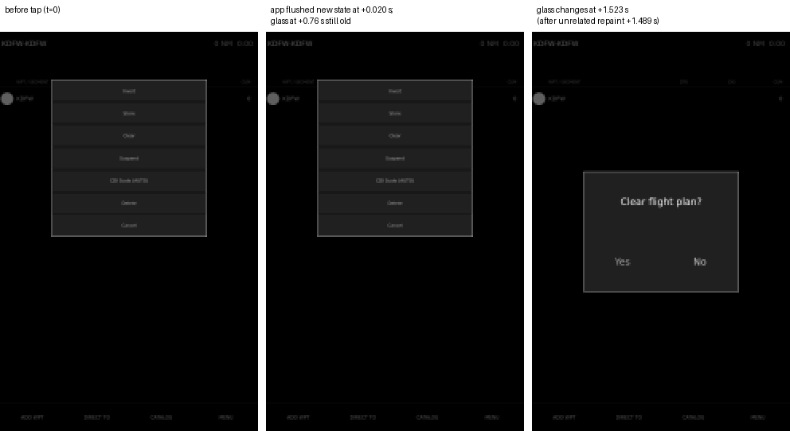
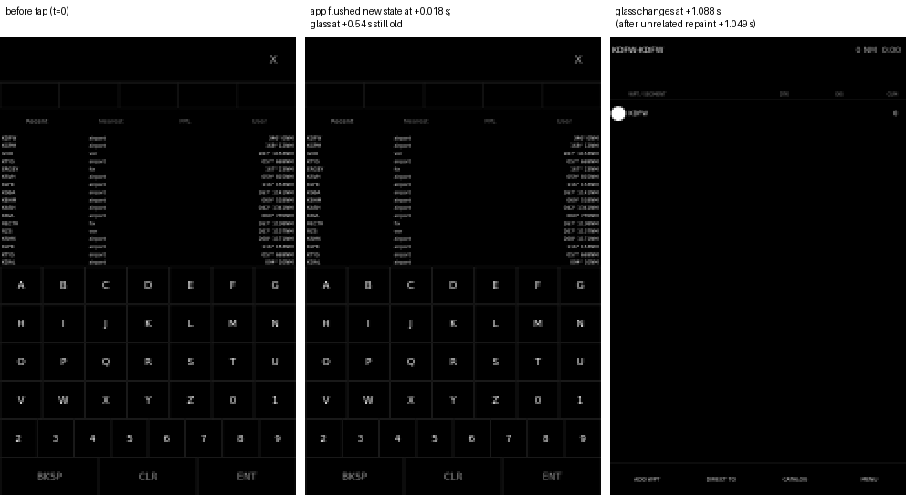

# G79 / pyEfis #328: paint timestamps vs glass, flight_plan taps

Measured 2026-11-10 on the Beelink (X11/xcb kiosk, 1920x1080), pyEfis `dev`
`4fd2af42` plus the probe commit `6f8c227d` on branch
`aer-5326/g79-paint-probe` (not for merge). AER-5326.

## What was measured, per tap

| field | source |
|---|---|
| send | `tap.py`: `time.time()` just before `xdotool click 1` |
| press | probe app-level event filter: Qt delivered `MouseButtonPress` |
| cb | `FlightPlan` tap callback returned |
| paint | first `FlightPlan.paintEvent` after the callback |
| flush | top-level `UpdateRequest` handled (repaint + flush returned; the filter delivers the event itself and times it) |
| glass | first x11grab frame (30 fps, recorder reads the X server image) at least half-way from the pre-tap frame to the settled frame |

A 10 ms GUI-thread heartbeat logs any gap over 60 ms (`stall`).

Sequence per cycle (nothing committed, the bench plan was left as found):
ADD WPT, two keypad keys, CLR, X (close entry page), MENU, Clear, No.
12 cycles = 96 taps per condition, random 1.2-2.5 s spacing.

## Results

| condition | taps | click-to-flush max | glass median | glass p90 | glass max | taps on glass > 0.2 s |
|---|---|---|---|---|---|---|
| stale (no position source; tapes XXX, NO POS) | 96 | 0.051 s | 0.076 s | 0.103 s | **1.523 s** | **4** (0.290, 0.465, 1.088, 1.523 s) |
| live (`feeder.py`: position, attitude, air data at 10 Hz over netfix) | 96 | 0.067 s | 0.103 s | 0.129 s | 0.153 s | 0 |

No GUI-thread stall over 60 ms in any stale tap window; in the live run the
largest was 81 ms. The app was never slow: in all 192 taps the flight_plan
paint and the window flush finished within 67 ms of the click.

The late taps were: Clear (twice), X closing the entry page, MENU. In each one
the recorder was producing frames at 30 fps throughout (no recorder gap), the
window had flushed the new state within 30 ms, and the X server image did not
change until about 45 ms after the NEXT, unrelated, window repaint:

| tap | flushed new state | next unrelated repaints | glass changed |
|---|---|---|---|
| 14 Clear | +0.016 s | +0.423 s | +0.465 s |
| 54 Clear | +0.020 s | +0.479, +1.475, +1.489 s | +1.523 s |
| 60 X (close entry) | +0.018 s | +1.033, +1.049 s | +1.088 s |
| 93 MENU | +0.021 s | +0.242, +0.258 s | +0.290 s |

With data stale the window repaints about once a second (median gap between
background flushes 1.00 s, max 2.02 s), so a held frame waits up to that long.
With data live it repaints 48 times a second, which is why live taps look
prompt and why #328 saw prompt DTO taps with X-Plane connected.



Tap 54, Clear. Left to right: the pane before the tap; the X server image at
+0.76 s (byte-identical to the first, the recorder saw no change); the first
changed frame at +1.523 s. Recorder frames are 4x box-downsampled grayscale,
shown 2x nearest-neighbour (half the panel's real resolution).



Tap 60, X closing the entry page, same layout.

## Not covered

- The recorder reads the X server's image, not the panel. A page-flipped
  fullscreen GL window can in principle scan out content the root image does
  not have. The two human sightings in #328 (the Clear dialog appearing only
  after two further taps) match the held-frame pattern, but this run has no
  camera on the glass.
- Which layer holds the frame (Qt's GL composition of the window that holds the
  SVS `QOpenGLWidget`, Mesa/DRI3 Present, or the X server) is not isolated.
- The Pi 5 (eglfs) was not measured.
- The fix-gateway-restart / SVS-heightmap-rebuild condition of the KTYS
  incident was not reproduced; with data stale it is not needed to show the
  delay.

## Regenerate

On the Beelink, with `aer-5326/g79-paint-probe` staged
(`bench-deploy.sh --ref aer-5326/g79-paint-probe --owner AVIONICS --issue <KEY>`)
and the Flight Plan tab open, from a directory holding `tools/*`:

```
flock -w 900 /tmp/pyefis-bench.lock sh run.sh stale 12
setsid -f python3 feeder.py 600 >feeder.out 2>&1 </dev/null
flock -w 900 /tmp/pyefis-bench.lock sh run.sh live 12
```

Copy `/tmp/g79_probe.log` next to the outputs as `probe.log`, then
`python3 analyze.py <dir> stale` and `... live`. `probe_windows.jsonl` is the
probe log cut to the two measurement windows (idle `fp_update` lines dropped);
`rows_*.json` are the per-tap rows `analyze.py` printed.
