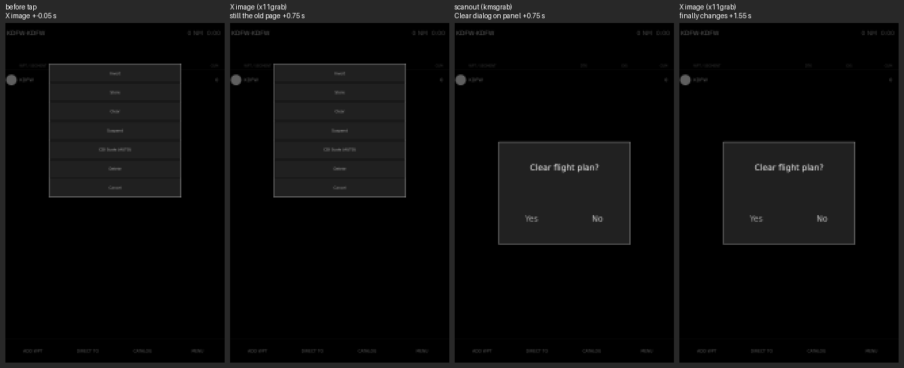

# G82 / pyEfis #449: the held frame is in the X image, not on the panel

Measured 2026-11-12 on the Beelink (X11/xcb, modesetting + glamor, Intel ADL-N,
1920x1080 at 60 Hz, Qt 6.8.1) and read on the Pi 5. AER-5478, follow-up to
G79 / AER-5326 (`../g79_paint_timestamps` on branch `aer-5326/g79-paint-probe`).

## Result

G79 found that after a flight_plan tap, pyEfis painted and flushed the new
state within 51 ms, but the X server's image sometimes did not change until
the next unrelated repaint, up to 1.5 s later. This run adds a second
recorder that reads the **scanout buffer** (`ffmpeg -f kmsgrab`, the DRM
framebuffer the display controller is sending to the panel) beside G79's
x11grab recorder (the X server's root-window image).

- **The panel was always on time.** In every tap where the X image was late,
  the scanout showed the new state at the normal latency. Across the 382 taps
  recorded on the scanout, no raw scanout time exceeds 0.243 s, and that
  includes the recorder's own delay of about 0.1 s.
- **The hold is in the X server's root image while the fullscreen GL window
  is page-flipped.** With a 4x4 always-on-top window in the screen corner,
  which clips the fullscreen window so the X server cannot page-flip it,
  the X image was late on **0 of 96** taps (max 0.114 s). The same instance
  with flips allowed was late on 16 of 96 (max 1.500 s).
- **The layer is below Qt and below Mesa's DRI3 loader.** DRI2 instead of
  DRI3 and EGL instead of GLX did not remove it. `vblank_mode=0` made it much
  worse (37 of 95). Every flush in every run was prompt.



Tap 22 of run `base2`, MENU > Clear, the #328 case. Left to right: the X image
just before the tap; the X image at +0.75 s, still the menu; the **scanout** at
+0.75 s, already showing the Clear dialog; the X image at +1.55 s, which has
only now changed. pyEfis flushed the dialog at +0.015 s. The scanout recorder
had it at +0.169 s, which includes that recorder's own pipeline delay of about
0.1 s (below). Frames are the flight_plan pane, 4x box-downsampled grayscale
shown 2x nearest-neighbour (half the panel's resolution).

## Runs

All runs used the G79 probe build (`6f8c227d`) with data stale, the G79
sequence (ADD WPT, two keys, CLR, X, MENU, Clear, No; 12 cycles, 96 taps,
random 1.2-2.5 s spacing, nothing committed) and G79's recorder (x11grab, 30
fps, 648x1004 pane). "Cold" runs restarted pyEfis first, so tap 0 hits a
first-build stall (its own flush takes 0.5 s) and is left out. "Warm" runs
reused the running instance, all 96 taps.

| run | condition | taps | click to flush, max | X image late > 0.2 s | X image max (taps that changed) | scanout raw max | scanout late > 0.3 s raw | scanout minus X, on-time taps |
|---|---|---|---|---|---|---|---|---|
| stale0 | baseline, cold | 95 | 0.049 | 9 (3 no change before next tap) | 1.368 | - | - | - |
| vb0 | `vblank_mode=0` | 95 | 0.052 | 37 (8 no change) | 1.609 | - | - | - |
| dri2 | `LIBGL_DRI3_DISABLE=1` | 95 | 0.040 | 10 | 1.373 | - | - | - |
| egl | `QT_XCB_GL_INTEGRATION=xcb_egl` | 95 | 0.046 | 5 | 1.098 | - | - | - |
| base1 | baseline, cold, + scanout | 95 | 0.063 | 3 | 1.888 | 0.243 | 0 | 0.041-0.105 |
| noflip1 | flips prevented, cold, + scanout | 95 | 0.055 | **0** | 0.122 | 0.188 | 0 | 0.044-0.100 |
| base2 | baseline, warm, + scanout | 96 | 0.043 | 16 (3 no change) | 1.500 | 0.217 | 0 | 0.046-0.135 |
| noflip2 | flips prevented, warm, + scanout | 96 | 0.049 | **0** | 0.114 | 0.226 | 0 | 0.084-0.139 |

"No change before next tap" means the X image never moved inside the tap's
window, so the tap counts as late with no latency. The last column is the
scanout recorder's delay behind the X recorder on taps where the X image was on
time. It is the kmsgrab pipeline (VA-API map, scale and download per frame),
0.04-0.14 s. Raw scanout times therefore overstate the panel latency by about
that much, and no raw scanout time in any run is outside the on-time band.

The baseline rate varies from run to run (3 to 16 of 96, G79 had 4). The
isolated instance ran fullscreen over the bench's own kiosk pyEfis, which kept
running underneath.

## The synthetic reproducer did not reproduce it

`tools/repro.py` is a fullscreen window shaped like the panel: a QGraphicsView
on a QOpenGLWidget viewport (MSAA 2, as the AI), a raster pane toggled at
random 1.2-2.5 s, and a clock label repainted at 1 Hz. A 60 fps 32x32 x11grab
patch on the pane timed each toggle. 0 late in 500 toggles: base (max 0.071
s), windowed (0.047), a press flush then the toggle 8 ms later (0.054), and
base with G79's heavy recorder running too (0.067). The `nogl1` run is a
measurement fault: the patch straddled the pane's edge, so the light state
never registered (rows kept in `repro/` for the record). What pyEfis does
that the reproducer does not, to make a flip leave the root image stale, is
not identified.

## The Pi 5

Read once, 2026-11-12 16:53Z, no screenshot. `pyefis.service` and
`fixgw.service` (user units) active, NRestarts 0, `dev` `578c0056`. pyEfis
runs `QT_QPA_PLATFORM=eglfs` and holds `/dev/dri/card*` itself. No X server
runs (0 Xorg, 0 Xwayland), so there is no root image to hold a frame.
`journalctl --user-unit pyefis.service` since start: 504 lines, 0 lines
matching traceback, error, segfault, critical or GL_OUT_OF_MEMORY. Tap timing
was not measured on the Pi, and its scanout cannot be read there (kmsgrab
needs root, and the bench user has no sudo).

## What this means

- **#449 is not a pilot-visible delay on the Beelink.** The panel showed every
  tap at the normal latency. What lagged is the image that x11grab, and any
  other XGetImage reader, sees.
- **#328's observations came from an agent bench session (FP8, AER-809)**,
  which sees the panel only through grabs. Its text says "Using x11grab
  polling". So the KTYS append there was a tap made against a stale grab, not
  against a stale panel.
- **The same applies to other bench evidence taken with x11grab** of the
  fullscreen kiosk. AER-3914 measured the baro box "0.5-8 s late" with a
  continuous x11grab, and its fix, a synchronous `repaint()` in
  `altimeter/__init__.py`, was proven on x11grab too. Whether the panel ever
  showed that box late is unmeasured. The G82 done-when asks for the
  workaround's removal only if the fix is a shared repaint primitive, and
  there is no pyEfis fix here.

## Not covered

- The fix on the X image is shown only by preventing flips with a clip
  window. A persistent version (modesetting `Option "PageFlip" "off"`) needs
  an X server restart and was not tried. Whether copy mode then tears on fast
  motion is unmeasured.
- The bench's own kiosk instance was not measured: a review held the bench,
  so these runs used an isolated pyEfis over it (below).
- The X server mechanism (why the root pixmap catches up only on a later
  present) is inferred from the flip/no-flip A/B, not traced in the server.

## Regenerate

On the Beelink, from `~/bench-scratch/aer5478` with `tools/*` copied in (G79's
`cycle.py`, `tap.py`, `glassrec.py`, `analyze.py` go in `g79/`, beside
`kmsrec.py`, `tiny.py`, `tab.py` and the `*.sh` files):

```
sh stack_setup.sh        # scratch clone of the probe branch; configs copied;
                         # fix-gateway on 127.0.0.1:3492, XPLANE and KNOBSTER off
# hold /tmp/pyefis-bench.lock for the whole session, then:
sh stack.sh up           # isolated fixgw + probe pyEfis, fullscreen over the kiosk
cd g79
sh variant.sh stale0                      # cold baseline (opens the FPL tab itself)
sh variant.sh vb0 vblank_mode=0           # and dri2 / egl likewise
KMS=1 sh variant.sh base1                 # + scanout recorder (needs sudo -n)
sh noflip.sh noflip1                      # 4x4 clip window on top, + scanout
sh warm.sh                                # base2 then noflip2 on the warm instance
python3 tab.py base2 noflip2
~/pyefis-venv/bin/python strip.py base2 22 g82_tap22_clear_x_vs_scanout.png
cd .. && sh stack.sh down
```

The reproducer: `env [VAR=...] sh run_repro.sh <label> 100 [repro opts]`, or
`sh batch_repro.sh <name> "<label>|<ENV=V,...>|<opts>" ...` under the lock.

`runs/` holds the per-tap rows (`rows_<run>.json` for the X image,
`rows_<run>k.json` for the scanout), the sends and provenance per run, and the
probe log cut to the base2 and noflip2 tap windows (idle `fp_update` lines
dropped). The probe logs for the other runs were not kept.
