# Flight plan validation

The record of the flight plan stack verified end to end: route block,
fix-gateway `flightplan` engine, `GPSSRC`/`NAVSRC` selects, and the pyEfis
displays. FP7 (billmallard/pyEfis#189) started this file with the HSI check;
FP8 (billmallard/pyEfis#190) owns it and adds the bench flight against X-Plane
and the playback fixture. Spec: `makerplane/briefs/flight_plan_plan.md`
sections 3.3, 3.6 and 6 (maos-workspace).

Each item carries a verdict: **PASS**, **FAIL** (with the defect filed), or
**NOT RUN** (with what it is waiting on), or **MOVED TO** another item
(with the item that now owns it).

## 1. HSI driven by the internal plan (`NAVSRC = 2`, `GPSSRC = 0`)

The HSI is not modified by the flight plan epic. It reads only `COURSE`,
`CDI`, `TOFROM`, `NAVSRC` and `NAVTYPE`. This checks that those keys carry the
engine's guidance with the right sense.

**Setup (2026-10-04).** A real fix-gateway with only
`netfix`, `compute` and `flightplan` enabled; the real pyEfis `HSI` and
`nav_status` widgets connected to it and rendered offscreen. Route KSBA > GVO >
RZS > KSMX published as the route block. Position, `GS = 120`, `MAGVAR = 0`
and `HEAD` written over netfix at known offsets from the active leg. Nothing
between the route block and the HSI is mocked. Driver, renders and the full
key dump: `docs/images/fp7_hsi/` (README has the commands).

First run against `dev` @ `aebde02`: the course pointer turned to the
reciprocal past KSMX (billmallard/fix-gateway#35). Re-run against the fix,
branch `aer-2672/fplcrs-past-to` @ `aa794ab`; the table and renders below are
from that run. The four points before KSMX are byte-identical between the two
runs.

This is not the Beelink bench. X-Plane was not feeding the bench gateway at
the time (`LAT`/`LONG` old), and the bench was holding another branch for
review. The engine, selects and widgets are the same code; the display stack
is offscreen Qt rather than the kiosk.

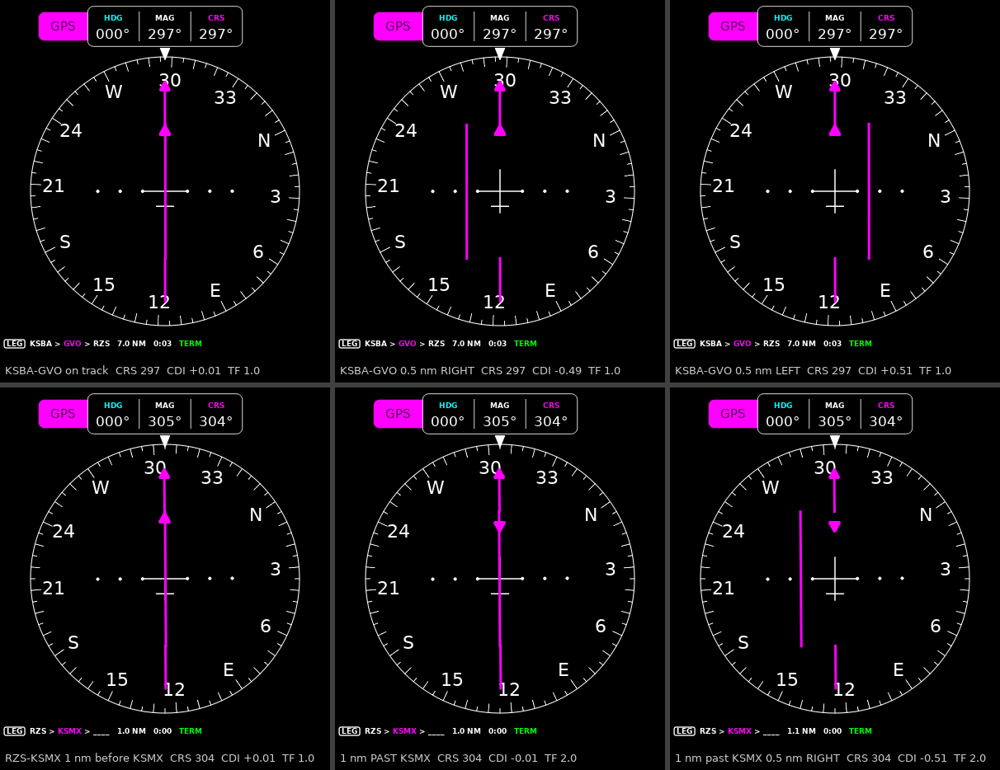

| Point | `FPLCRS` | `COURSE` | `FPLXTK` (nm) | `FPLCDI` | `CDI` | `TOFROM` | HSI shows |
|---|---|---|---|---|---|---|---|
| KSBA-GVO on track | 296.98 | 296.98 | -0.005 | +0.005 | +0.005 | 1 TO | bar centred |
| KSBA-GVO 0.5 nm right | 296.98 | 296.98 | +0.495 | -0.495 | -0.495 | 1 TO | bar left of centre (fly left) |
| KSBA-GVO 0.5 nm left | 296.98 | 296.98 | -0.505 | +0.505 | +0.505 | 1 TO | bar right of centre (fly right) |
| KSBA-GVO 1.0 nm right | 296.98 | 296.98 | +0.995 | -0.995 | -0.995 | 1 TO | full scale left (TERM, 1.0 nm) |
| KSBA-GVO 2.0 nm right | 296.98 | 296.98 | +1.995 | -1.000 | -1.000 | 1 TO | pegged left |
| RZS-KSMX 1 nm before KSMX | 304.41 | 304.41 | -0.007 | +0.007 | +0.007 | 1 TO | bar centred |
| 1 nm past KSMX | 304.39 | 304.39 | +0.007 | -0.007 | -0.007 | 2 FROM | bar centred, pointer holds 304 |
| 1 nm past KSMX, 0.5 nm right | 304.39 | 304.39 | +0.507 | -0.507 | -0.507 | 2 FROM | bar left of the 304 pointer (fly left) |

`FPLPHASE` was `TERM`, `CDISCALE` 1.0, throughout (every point is inside 30 nm
of KSBA or KSMX).

| Check | Verdict |
|---|---|
| Course pointer follows `FPLCRS` (`COURSE == FPLCRS == GPSCRS`) | **PASS** |
| `CDI == FPLCDI == -FPLXTK / CDISCALE`, clamped at +-1 | **PASS** |
| Sense: right of track -> bar left of centre (fly left), and the reverse | **PASS** |
| TO/FROM flips after the last waypoint, no sequencing | **PASS** (flag) |
| Course and sense hold FROM the last waypoint | **PASS** -- after billmallard/fix-gateway#35. On `aebde02` this was a FAIL: `FPLCRS` swung to the reciprocal (124.39) once along-track went negative, so the needle reversed. The fix keeps the extended leg course (304.39; the 0.02 deg from 304.41 is great-circle convergence over 2 nm). The same path runs at the MAP and in SUSP past a fix; both are pinned by fix-gateway engine tests rather than this render. |

## 2. Internal plan vs X-Plane's FMS (`GPSSRC = 1`)

Moved here from FP7 on 2026-10-11 (AER-808 thread). Acceptance (brief
section 6): DTK within 2 deg; CDI the same sign and within 0.1 of full scale
at 1 nm cross-track; sequencing point within 0.3 nm.

**Setup (2026-10-29, session 2).** X-Plane 12, SR22, flown by the pilotless
sim bench (`billmallard/xplane-bench`, session `cbbeafe57646`, profile
`fp8-ksmx-rnav30-missed`, outcome `complete`, 1304 s). X-Plane's own FMS and
GPSS flew the KSMX RNAV (GPS) RWY 30 from 2 nm before PAMJI, the missed
approach to WINCH, +1 nm then -1 nm offsets on HANNU-WINCH, and five minutes
in the WINCH hold. Its GPS course and deviation reach the Beelink gateway as
`EXTCRS`/`EXTCDI` over RREF. The internal plan is the same procedure,
published as the route block by `fixgw.sim.fplroute` from CIFP 2611 and
activated at PAMJI on `GPSSRC = 0`, `NAVSRC = 2`. Bench: pyEfis `49628ed`,
fix-gateway `2666bc4`. X-Plane flew its own nav data (cycle 2406; the KSMX
R30 fixes are identical), in live weather (wind under 5 kt). Both systems
are logged on the same 1 Hz bus row, so the comparison needs no time
alignment. X-Plane's 5 Hz navigator record (`truth.jsonl`) is the
independent cross-check, aligned on the fix sequence.

**Procedure change (Bill, 2026-10-28).** The brief's KSBA GVO RZS KSMX A/B
route backtracks once GVO is the IAF, and X-Plane's FMS dropped RZS in
session 1. The A/B is flown on the approach's GVO transition instead. Route
entry (section 3) still uses KSBA GVO RZS KSMX, as a pure entry test.

Rows excluded from the leg statistics: the 5 s either side of either
system's sequence, and the last 0.5 nm to WINCH, where X-Plane already shows
its hold course. The deliberate SUSP over HANNU (section 3) is also
excluded.

| Leg (phase) | rows | max DTK diff (deg) | max CDI diff (full scale) | CDI sign | Verdict |
|---|---|---|---|---|---|
| ELZUS-PAMJI (TERM) | 47 | 0.003 | 0.0024 | same | **PASS** |
| PAMJI-CIMSO (TERM, LNAV) | 79 | 0.015 | 0.0036 | same | **PASS** |
| CIMSO-ANIBY (LNAV) | 25 | 0.012 | 0.0069 | same | **PASS** |
| ANIBY-RW30 (LNAV) | 129 | 0.026 | 0.0107 | same | **PASS** |
| missed, RW30-HANNU (TERM) | 147 | 0.010 | 0.0016 | same | **PASS** |
| HANNU-WINCH incl. both offsets (TERM) | 390 | 0.001 | 0.0049 | same | **PASS** |
| WINCH hold, as flown on `2666bc4` | - | 178.6 | - | **opposite** | **FAIL** -- billmallard/fix-gateway#45, fixed by #49 after this flight (see below) |
| WINCH hold inbound leg, the same flight replayed through `dev` with #49 | 5 Hz trace | 1.4 | 0.07 | same | **PASS** -- on the replay, accepted by Bill as closing this line (2026-10-29, below) |

| Check | Result | Verdict |
|---|---|---|
| CDI at 1 nm cross-track (the +/-1 nm offsets, 76 rows at 0.90-0.95 nm) | max diff 0.0041 full scale, same sign throughout; TERM, so 0.947 nm reads 0.947 | **PASS** -- the driver held the offsets at 0.90-0.95 nm, not a full 1.00 |
| Sequence point PAMJI (fly-by) | ours 0.096 nm before the fix, X-Plane 0.195; 0.100 nm apart | **PASS** |
| Sequence point CIMSO (FAF) | ours 0.010, X-Plane 0.195; 0.204 nm apart | **PASS** |
| Sequence point ANIBY | ours 0.017, X-Plane 0.199; 0.215 nm apart | **PASS** |
| RW30 (MAP) | no sequence: auto-SUSP 0.014 nm from the fix, FROM after; X-Plane switched to its missed 0.029 nm from it | **PASS** |
| Sequence point WINCH (hold fix) | ours 0.018, X-Plane 0.195; 0.212 nm apart | **PASS** |
| `GPSSRC = 1` swap in LNAV | `COURSE`/`CDI` = `EXTCRS`/`EXTCDI` exactly (318.692 / -0.0060), 13 s, then back | **PASS** |

X-Plane anticipates every turn by about 0.2 nm; the engine's anticipation
is its turn-radius `d_ta`, near zero at these small course changes. Both are
inside the 0.3 nm line. Session 1 (2026-10-28, hand-flown, see section 3)
agreed the same way over 18 points on six legs: within 0.23 deg and 0.015 of
full scale.

**The WINCH hold.** On `2666bc4` the engine showed 301.4 for the whole hold.
X-Plane showed the inbound course, 120.0. The deflections had the same size
(0.546 vs 0.614, 0.993 vs 1.000 full scale) and opposite sign: the engine
was guiding on the reciprocal, which is fix-gateway#45. #49 (hold entries
and the racetrack) merged at 02:21Z, after the bench was frozen for the
session. Replaying this flight's recorded trace through `dev` with #49, the
inbound leg shows 121.4 against X-Plane's 120.0, same sign, within 0.07 of
full scale. That replay is the playback fixture's
`test_hold_inbound_leg_matches_xplane`, and it fails on `2666bc4`. The entry
minute and the turns differ by design: the engine flies the AIM entry and
turns the course with the aircraft (Bill's call on AER-4076), while X-Plane
holds 120. The live-flown verdict stays FAIL. The fix is proven on the
replay, not on a second flight.

**Ruling (Bill, 2026-10-29, AER-809):** the replay closes the hold line
if it meets this section's acceptance. It does: DTK 1.4 deg, the same sign,
and within 0.07 of full scale through the inbound leg, out to pegged. It was
re-run on fix-gateway `dev` @ `686e382`: 9 of 9 pass. No second flight was
queued.

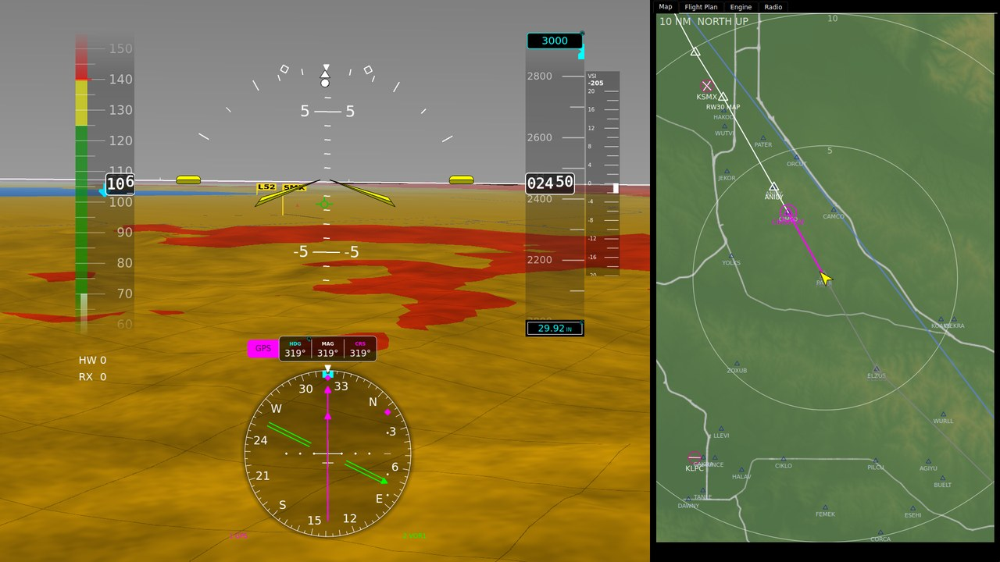
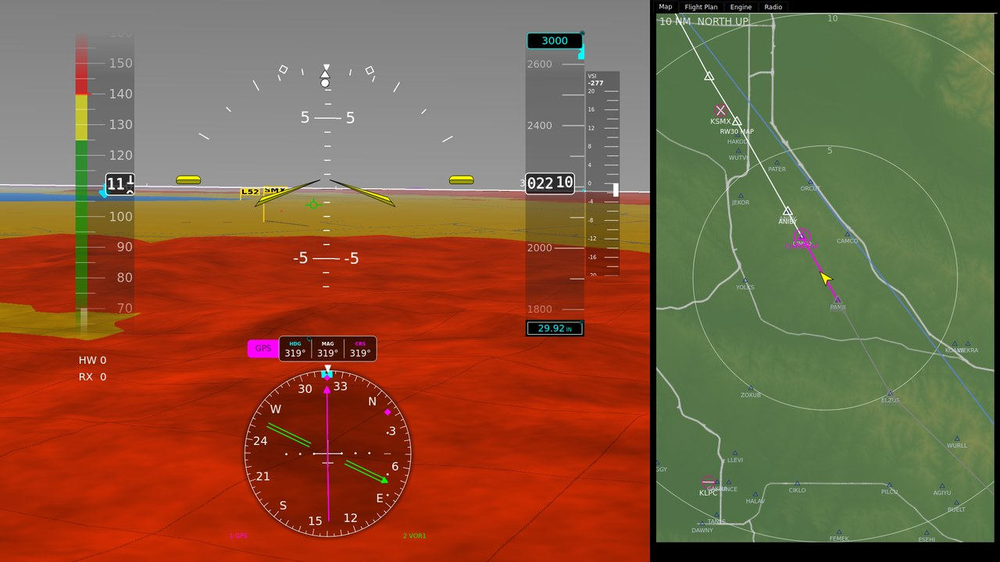

## 3. Bench flight (FP8)

Two sim sessions against the Beelink bench:
- **Session 1** (2026-10-28 01:31-01:55Z): hand-flown by Bill in X-Plane's FMS from KSBA via GVO, ending 0.24 nm short of RW30.
- **Session 2** (2026-10-29): flown by the pilotless sim bench, from 2 nm before PAMJI through the hold.

Session 2 was flown twice. The first attempt (`33758e63080f`) aborted at 648 s on the driver's low-airspeed guard: a 700 fpm missed-approach climb at full power bled the SR22 to 78 kt. It lost its plan at restart #1 (see the table). The second attempt (`cbbeafe57646`) completed. In it, restart #1 was skipped, because its verdict was already known.

| Item | Result | Verdict |
|---|---|---|
| Keypad entry, KSBA GVO RZS KSMX | Route block read back `FPLCOUNT 4`, the four idents. FastFind completed each early: 12 taps + 3 ADD WPT | **PASS** |
| USB keyboard entry, same route | Same readback. Virtual HID through evdev -> libinput -> X11 (no physical dongle) | **PASS** (virtual device) |
| Direct-To mid-leg, then DTOX | Session 1, 01:42Z: Direct-To RZS from the DTO page, DTOX, Direct-To ELZUS. Each activated and guided | **PASS** |
| SUSP over a fix (HANNU, missed approach) | SUSP 1 nm before HANNU. The engine held HANNU, went FROM 0.30 nm past, and did not sequence. RESUME went to WINCH | **PASS** |
| Gateway restart mid-route | Plan lost. With position live during startup, the empty engine state overwrites `flightplan_state.json` before the 2 s restore. Reproduced on the bench with a netfix position writer; without one, the plan survives | **FAIL** -- billmallard/fix-gateway#50 |
| pyEfis restart in the hold | The display came back with the plan, the hold course and the map overlay | **PASS** |
| LNAV 2 nm before the FAF | `FPLPHASE` LNAV at 1.993 nm from CIMSO (replay, 5 Hz). Session 1: 1.998 | **PASS** |
| The ramp | `CDISCALE` 0.651 / 0.476 at 1.0 / 0.5 nm from the FAF, then 0.3 to the MAP | **PASS** |
| No sequence at the MAP, auto-SUSP | Auto-SUSP 0.014 nm from RW30, then FROM; the leg stayed RW30 until RESUME | **PASS** |
| RESUME to the missed approach, TERM scaling | `FPLAPR 3` (MISSED), TERM 1.0, guidance to HANNU then WINCH | **PASS** |
| Manual scale 0.3 / AUTO | `CDISCALE` 0.3, then back to 1.0 in the hold | **PASS** |
| Loss of integrity | Not reachable: `GPS_ACCURACY_HORIZ` is clamped to 200 ft (0.033 nm), below every HAL. A write of 2000 read back 200, `FPLINTEG` stayed True | **FAIL** -- billmallard/fix-gateway#52 |
| X-Plane data on the bench after an X-Plane restart | RREF is subscribed once at fixgw start, so nothing arrives until fixgw restarts | **FAIL** -- billmallard/fix-gateway#51 (bench plumbing, not guidance) |
| Playback fixture | The recorded X-Plane trace replayed through the engine against X-Plane's navigator; it lands on the live bench's sequence points | **PASS** -- `tests/sim/test_fp8_xplane_replay.py` (fix-gateway) |

Earlier display findings from this item, filed separately:
- pyEfis#325: FPL DTK shows true course.
- pyEfis#326: a stale "SELECT A WAYPOINT" prompt.
- pyEfis#327: the auto-name freezes at the first waypoint.
- pyEfis#328: touch-to-glass lag, to be measured.

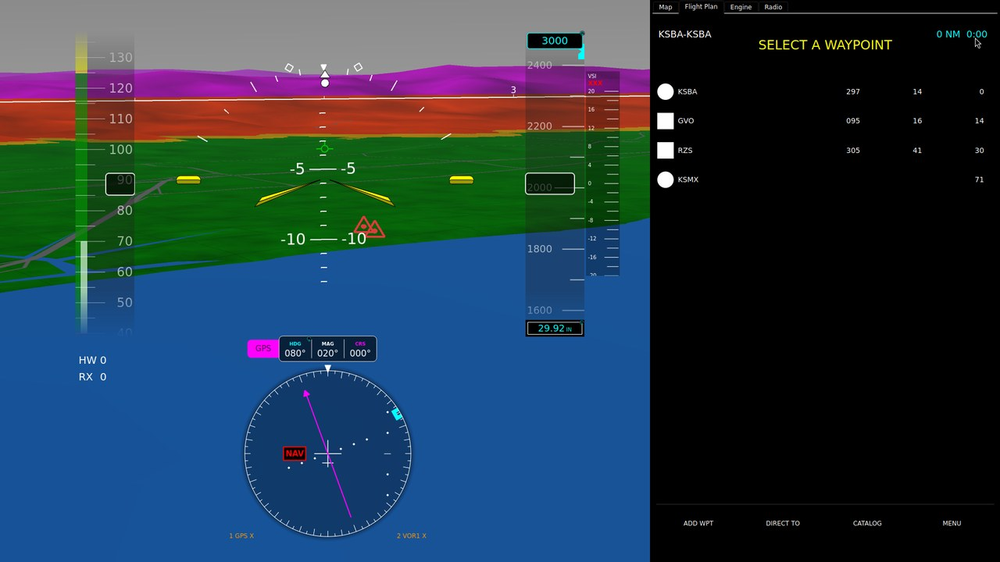
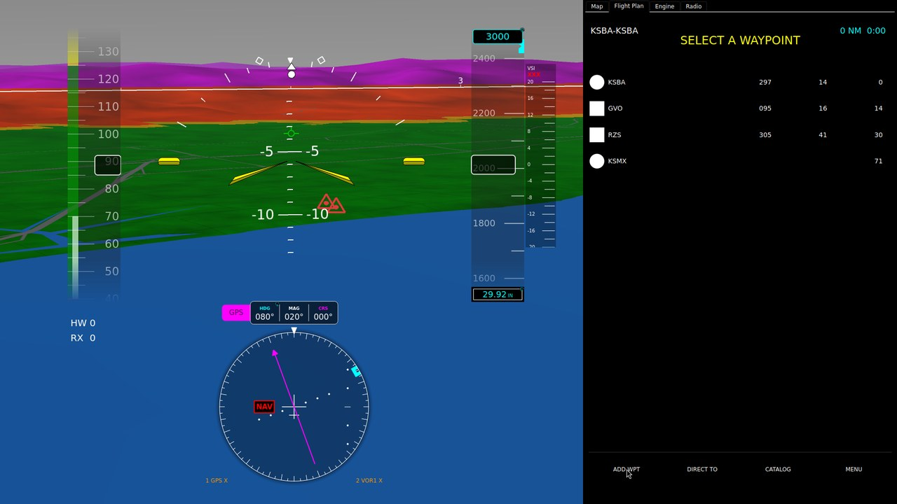
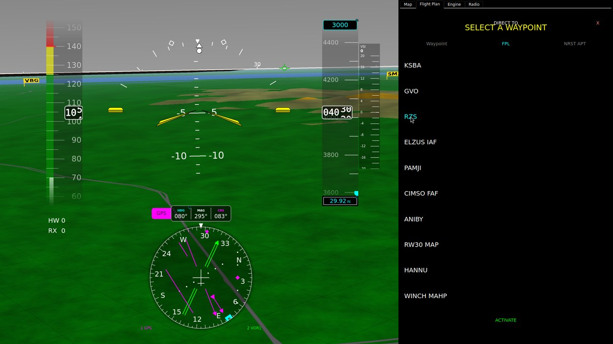
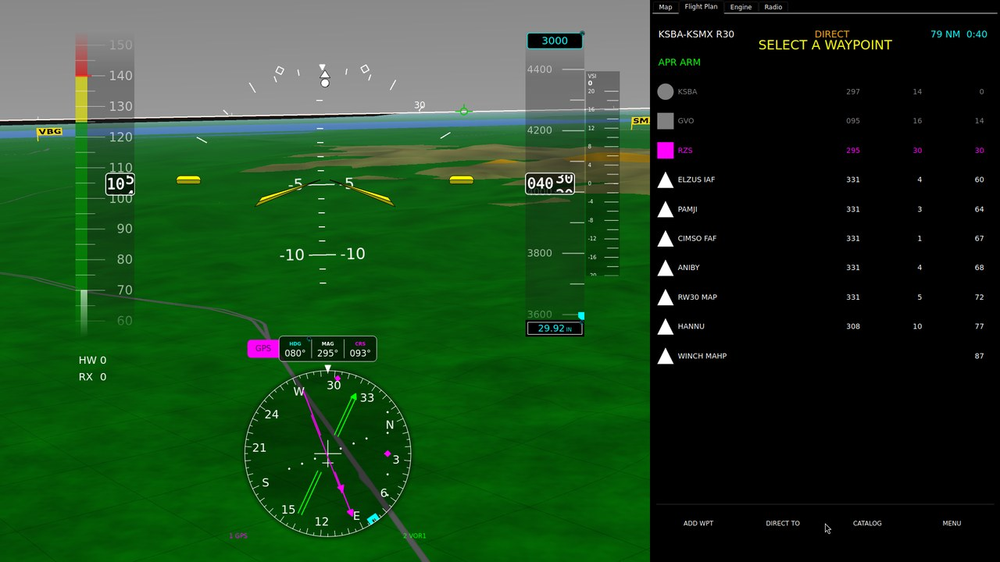
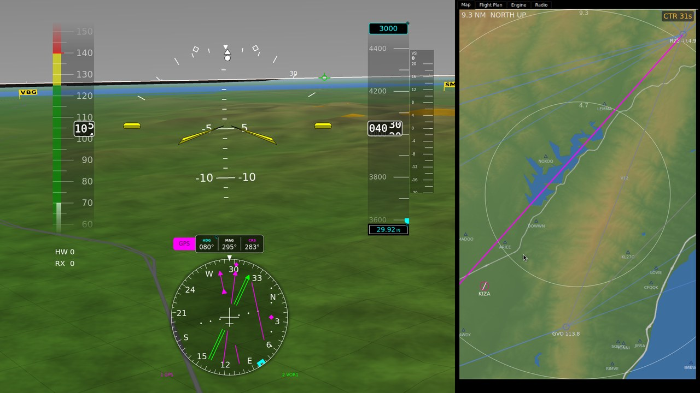
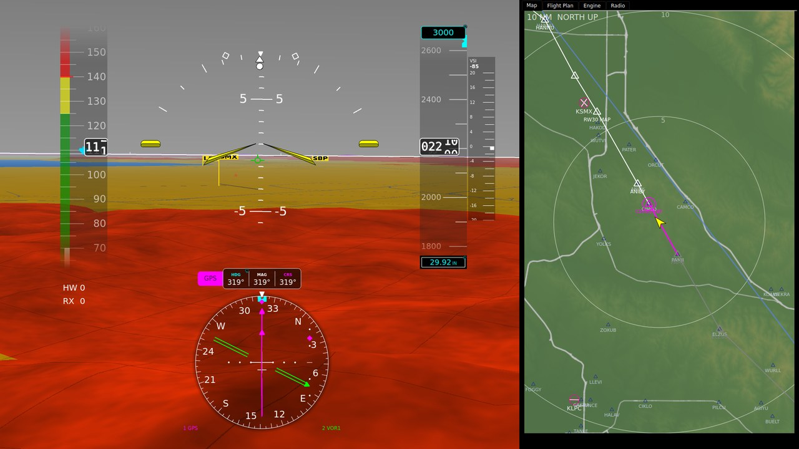

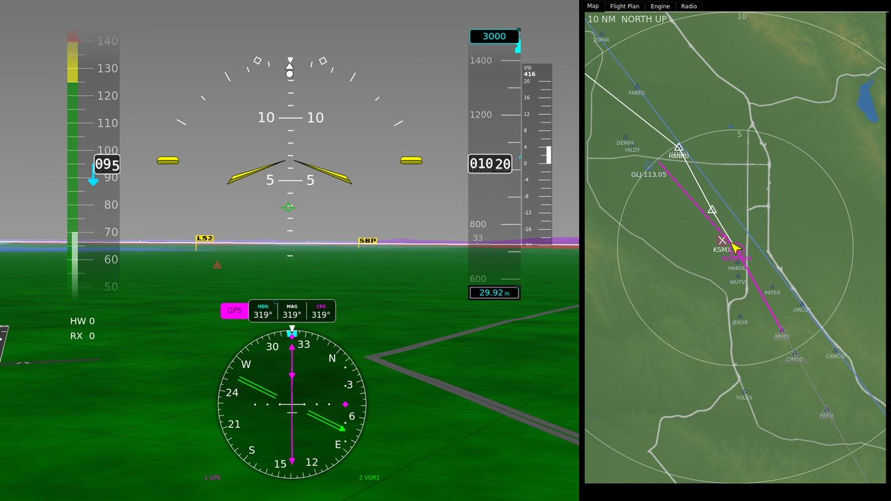
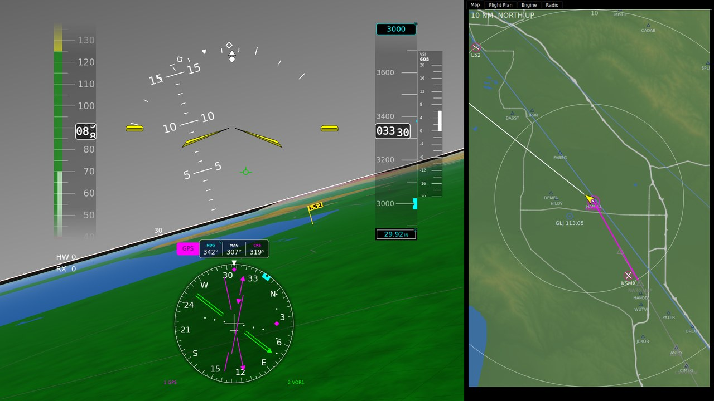
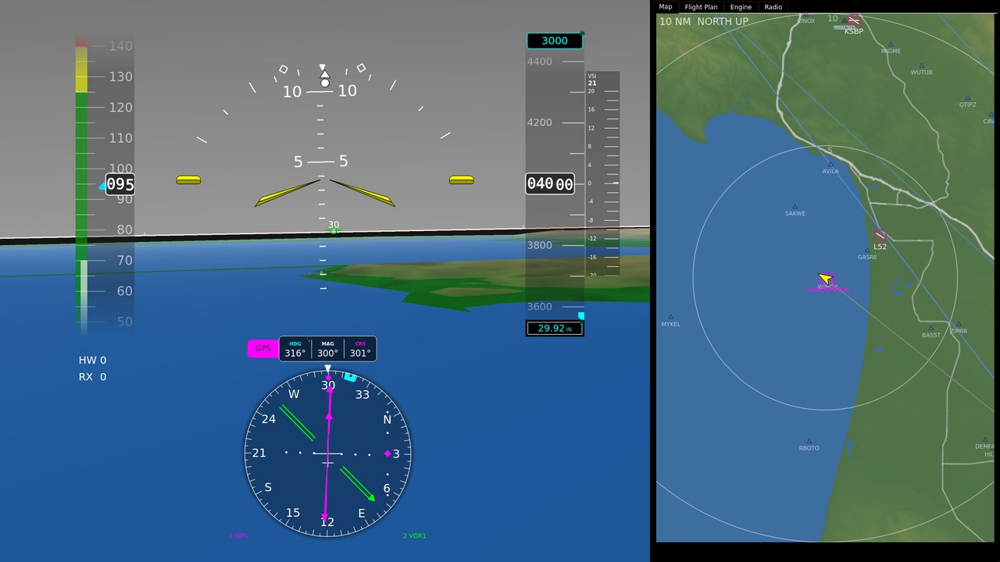
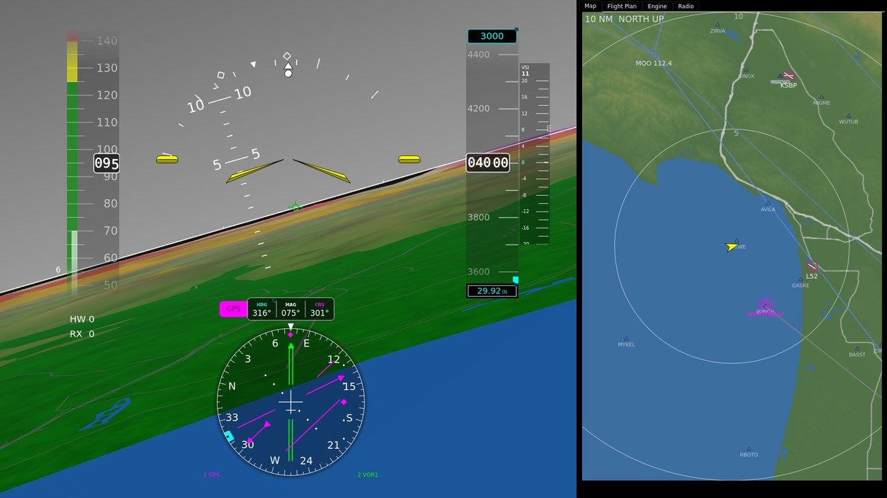
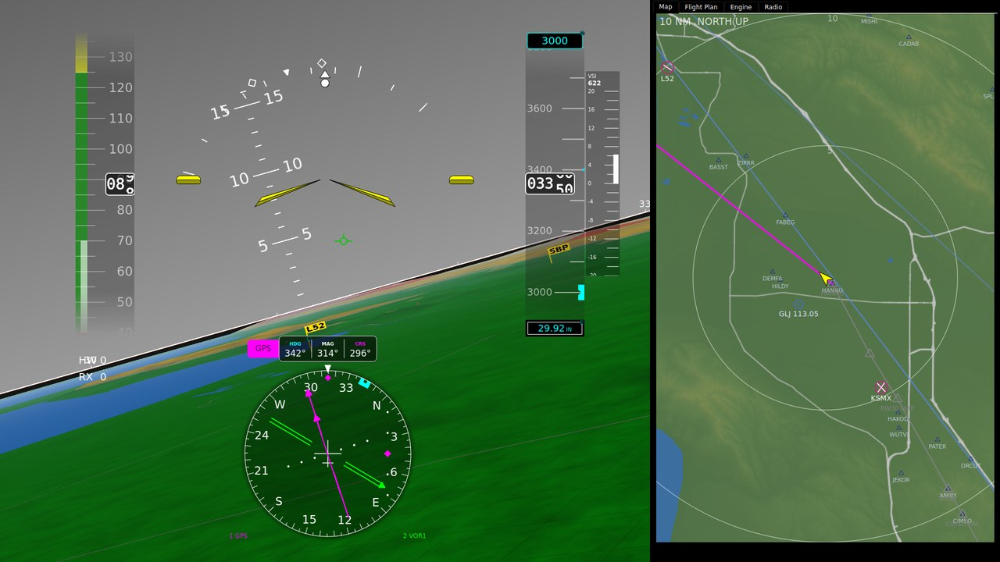
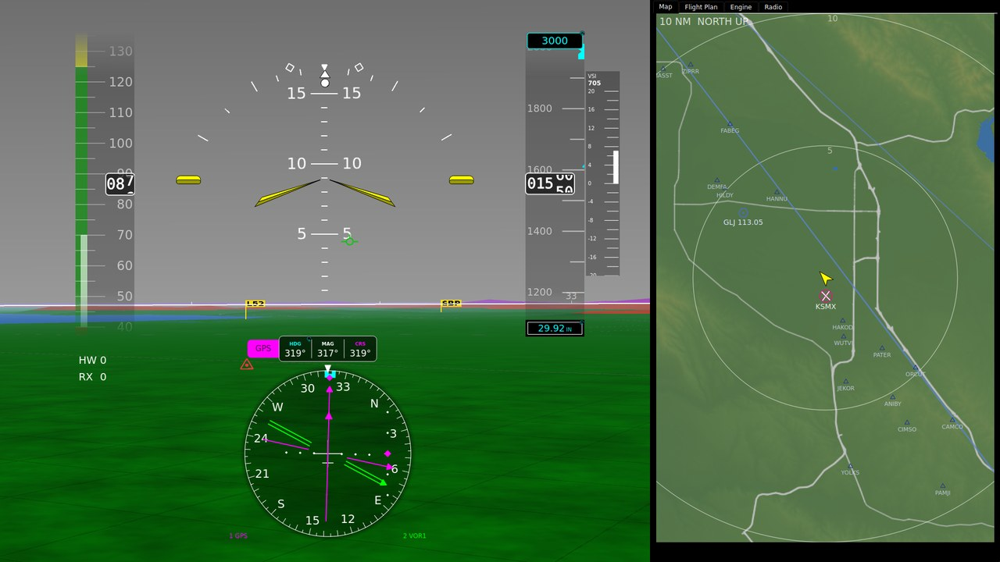

Artifacts and commands: `docs/images/fp8_bench/README.md`.
