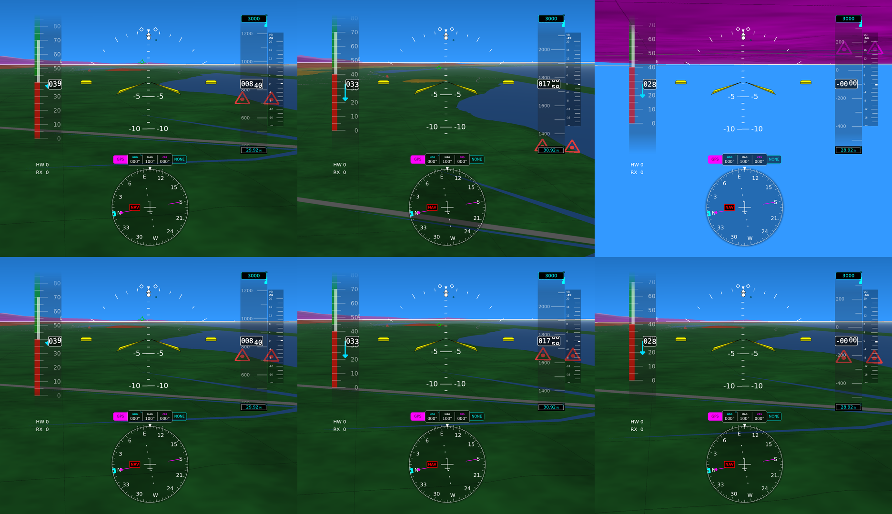

# SVSALT1: the SVS camera height is TALT, not ALT (AER-6458)



`svs_strip.png`: the PFD half of the Beelink glass in cruise, about 840 ft
MSL near KSBA. The frames are 1920x1080 x11grab captures scaled to 50%. Top
row is pyEfis dev (`ec4bb1d2`), bottom row is the branch (`350abc36`). From
left to right the BARO setting is 29.92, 30.92 and 28.92.

On dev the SVS camera rides indicated `ALT`. At 30.92 it sits about 900 ft
high and the runway drops away. At 28.92 it sits below the terrain, which
fills the screen in magenta. On the branch the camera reads `TALT` and the
terrain picture is the same at all three settings while the altimeter reads
842, 1754 and -99 ft.

| BARO | `ALT` | `TALT` | dev SVS | branch SVS |
|---|---|---|---|---|
| 29.92 | 842.13 | 843.57 | terrain | terrain |
| 30.92 | 1754.45 | 843.01 | terrain seen from about 900 ft too high | same as 29.92 |
| 28.92 | -98.91 | 839.60 | under the terrain (magenta) | same as 29.92 |

The values come from `<side>/session.txt`, and both runs logged identical
values because SITL is deterministic. The upper PFD (rows 0-640, columns
260-1000) relative to the 29.92 frame: on dev, 21% of pixels change by more
than 30 at 30.92, and 99% at 28.92, where 33% of the region is magenta. On
the branch the figures are 11% and 8%, and no magenta. The branch's
remainder is the aircraft's own motion during the 3 s between samples.

## How it was made

ArduPlane 4.7.3 SITL under the real fix-gateway `mavlink` plugin (fix-gateway
dev `66dc8eb`, which carries MAVALT1) in a private fixgw on netfix
127.0.0.1:3492. fix-gateway's `tools/mavlink_sitl/baro_session.py` turns
`BARO` over netfix and grabs the screen 3 s after each setting. pyEfis ran
from a clone at each SHA, on a copy of the bench's live config with
`FixPort: 3492`, fullscreen over the kiosk. The live services kept running.

`setup.sh` builds `~/bench-scratch/aer6458` on the Beelink, and `run.sh
<dev|branch>` runs one side. Run each side under the bench lock:

```sh
cd ~/bench-scratch/aer6458
sh setup.sh && git -C pye-dev checkout -q ec4bb1d2
flock -o -w 120 /tmp/pyefis-bench.lock sh run.sh dev
flock -o -w 120 /tmp/pyefis-bench.lock sh run.sh branch
```

`<side>/cruise-<BARO>.png` are the full frames, and `<side>/prov.txt` holds
the SHAs and times.
