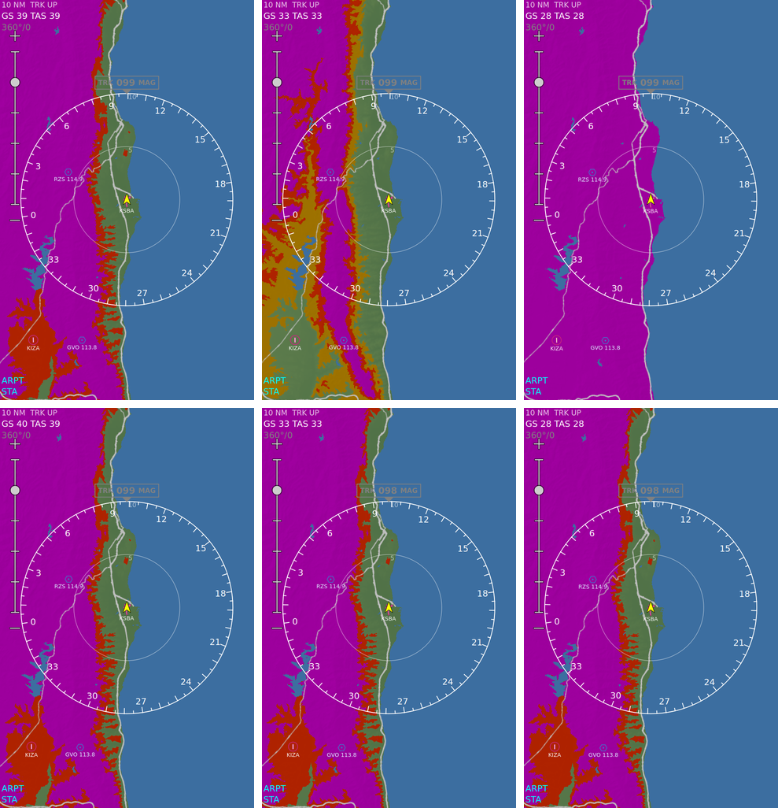

# MAPALT1: the map's caution bands are measured from TALT, not ALT (AER-6591)



`map_strip.png`: the moving-map half of the Beelink glass in cruise, about
840 ft MSL over KSBA, track 099. The frames are 1920x1080 x11grab captures;
the map region (x 1262-1908, y 24-1040) is scaled to 50%. Top row is pyEfis
dev (`48ac6d7b`), bottom row is the branch (`f95d1e23`). From left to right
the BARO setting is 29.92, 30.92 and 28.92.

On dev the bands ride indicated `ALT`. At 30.92 the map thinks the aircraft
is about 900 ft higher: the red band shrinks to the ridge tops and amber
appears where there was none. At 28.92 `ALT` reads -99 ft and everything
above sea level turns magenta, the coastal plain and the airport included.
On the branch the bands follow `TALT` and are the same at all three
settings.

| BARO | `ALT` | `TALT` | dev map | branch map |
|---|---|---|---|---|
| 29.92 | 842.13 | 843.57 | bands for 840 ft | bands for 840 ft |
| 30.92 | 1754.45 | 843.01 | bands for about 1,750 ft | same as 29.92 |
| 28.92 | -98.91 | 839.60 | all land magenta | same as 29.92 |

The values are dev's, from `dev/session.txt`; the branch logged the same to
within 2 ft. Measured over the map region against each side's 29.92 frame:

| | changed at 30.92 | changed at 28.92 | magenta at 29.92 / 30.92 / 28.92 |
|---|---|---|---|
| dev | 22.9% | 15.3% | 32.3% / 17.5% / 45.3% |
| branch | 2.6% | 4.1% | 32.2% / 32.2% / 32.2% |

"Changed" is a pixel moving more than 30 in any channel. The branch's
remainder is the aircraft's own motion and the GS/track readouts in the 3 s
between samples; its magenta and red fractions do not move.

`talt_fail.png`: an offscreen grab (sandbox, no terrain tiles, DejaVu Sans)
of the map in caution mode with `TALT` failed. The status chip reads
`TERR UNAVAIL`, and the layer paints plain relief. On a panel with no `TALT`
writer it reads the same.

## How it was made

ArduPlane 4.7.3 SITL under the real fix-gateway `mavlink` plugin (fix-gateway
dev `bfb7e0a`, which carries MAVALT1) in a private fixgw on netfix
127.0.0.1:3492. fix-gateway's `tools/mavlink_sitl/baro_session.py` turns
`BARO` over netfix and grabs the screen 3 s after each setting. pyEfis ran
from a clone at each SHA, on a copy of the bench's live config with
`FixPort: 3492`, fullscreen over the kiosk. The live services kept running.

The copy differs from the live config in the map block only: `terrain_mode:
caution`, `map_style: standard` (the live map is `nav_only`, which draws no
relief and so no bands) and `layer_airways`/`layer_fixes` off so the terrain
is not hidden under them.

`setup.sh` builds `~/bench-scratch/aer6591` on the Beelink from the AER-6458
SITL stack, and `run.sh <dev|branch>` runs one side:

```sh
cd ~/bench-scratch/aer6591
sh setup.sh
flock -o -w 120 /tmp/pyefis-bench.lock sh run.sh dev
flock -o -w 120 /tmp/pyefis-bench.lock sh run.sh branch
```

`<side>/cruise-<BARO>.png` are the full frames, `<side>/prov.txt` holds the
SHAs and times, and `<side>/session.txt` the samples.
