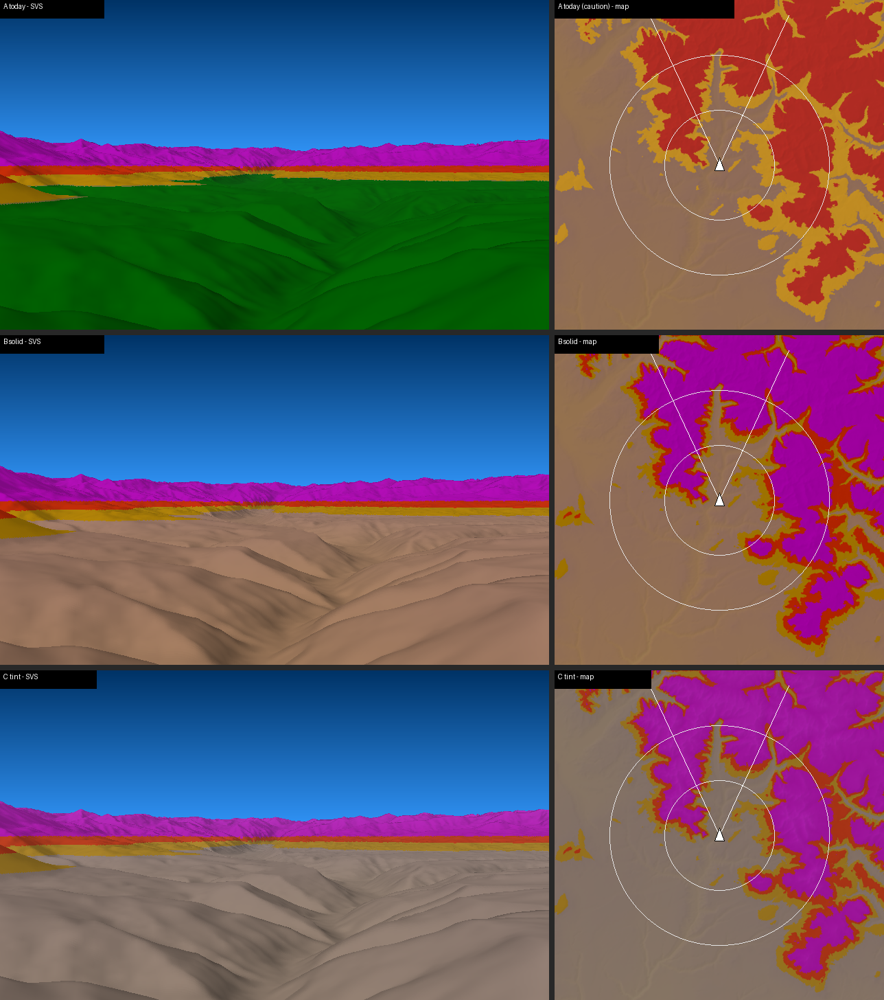
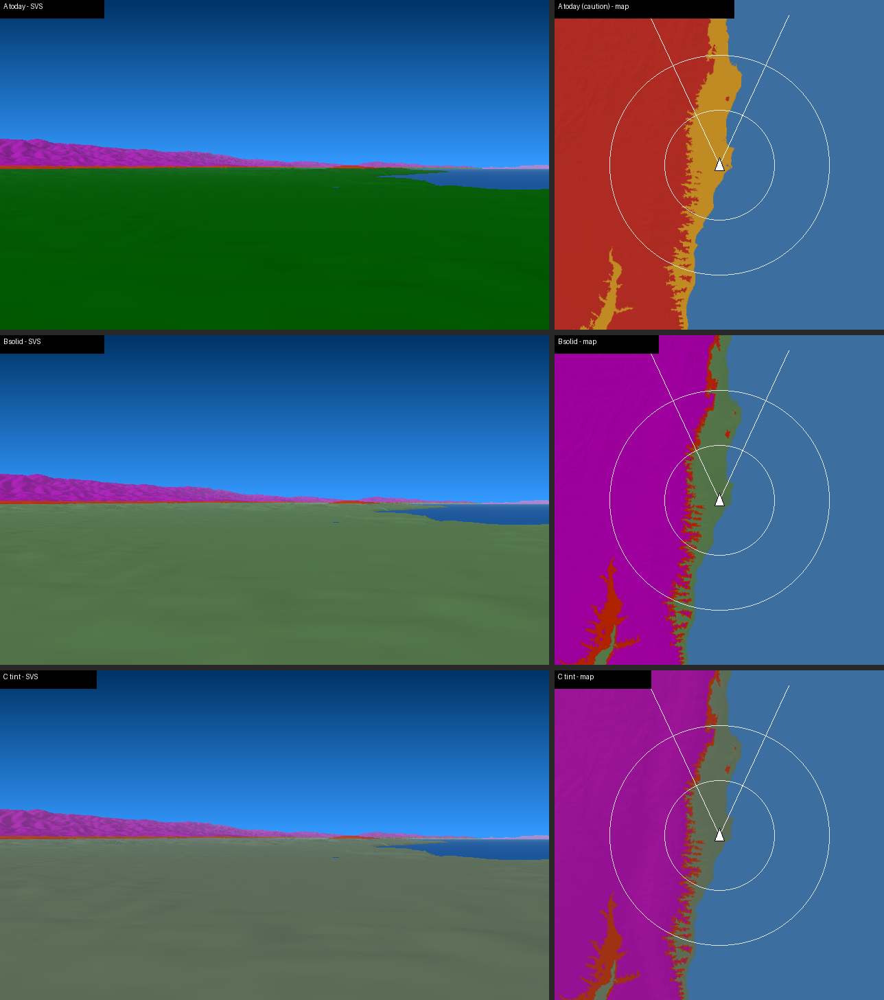
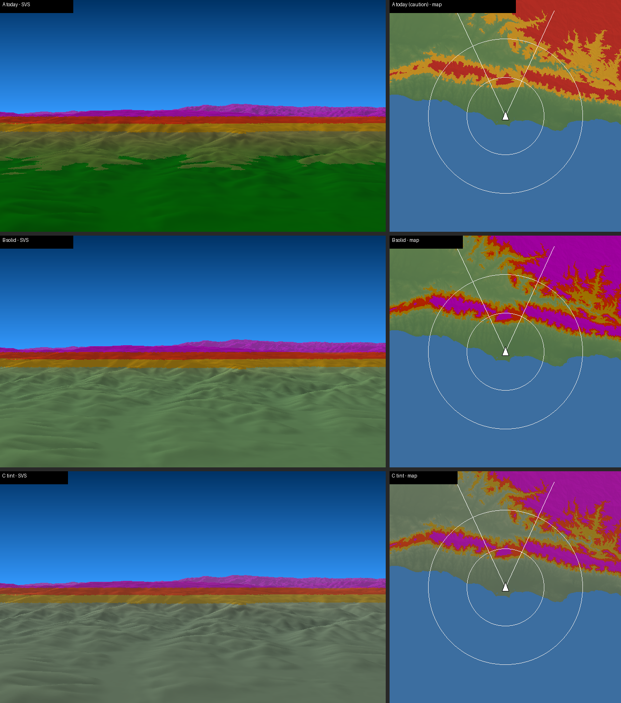
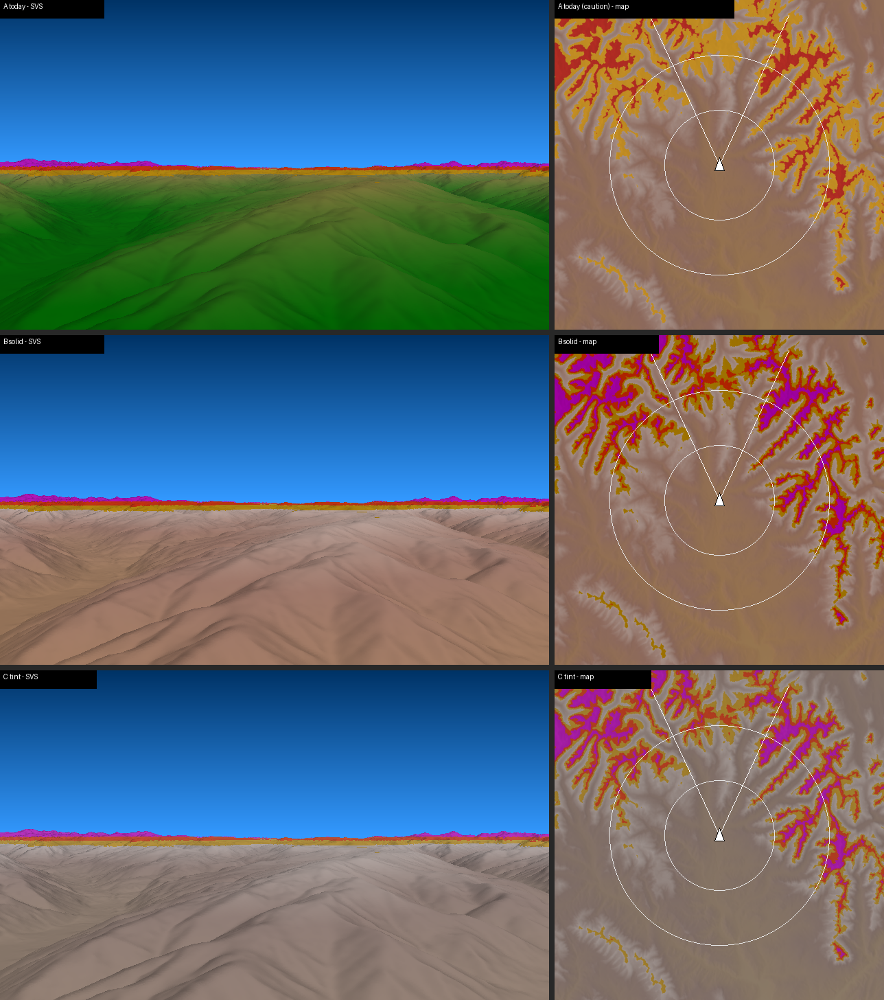
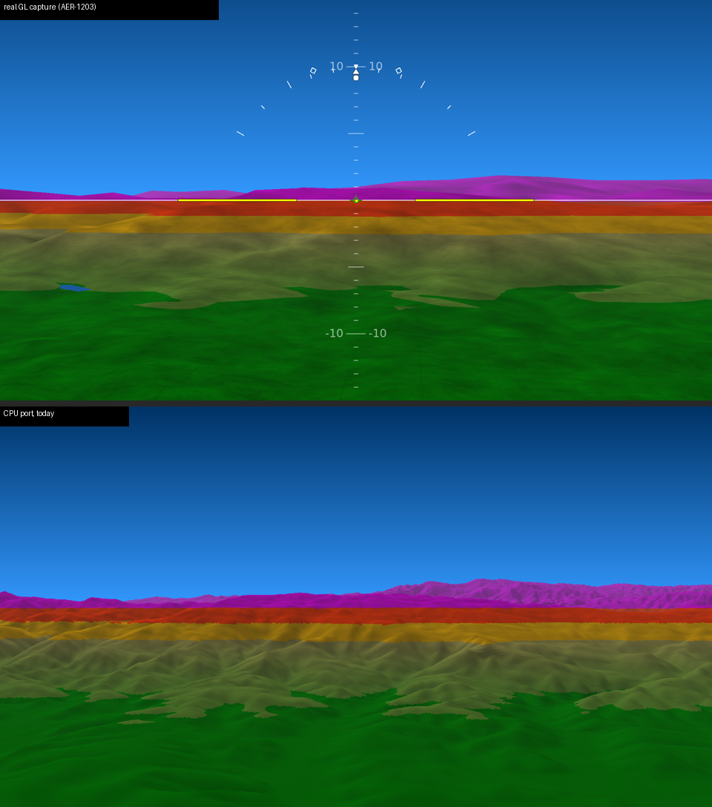

# SVSSHADE1: one terrain shading for the SVS and the map, with the hazard colours kept

Design brief for BACKLOG `SVSSHADE1` (board AER-6140, 2026-11-20). It changes no
code. The implementation is a follow-on item sized from the decision below.

## Decision (Bill, 2026-11-21)

Bill accepted the recommendation on AER-6140:

- **The look:** candidate B, solid hazard bands on the map's natural relief
  base in both views, with the 0.7 lighting floor on hazard bands.
- **The thresholds:** the SVS numbers in both views. That is amber under
  1,000 ft, red under 500 ft, magenta above ownship, and the airport-proximity
  collapse. The map's red start moves from 100 ft to 500 ft.
- **The default:** B is the default, and today's all-over clearance colouring
  stays available as `terrain_shading: clearance`.

Implemented by SVSSHADE2 (AER-6401): `ai/terrain_shading.py` holds the
shared rule, `svs_gl.py` paints it, and the map's `caution` mode reads it.

The rest of this note is the brief as it was put to him.

## What the pilot sees today

You are on a 3 NM final to Telluride RWY 9 at 10,500 ft. The field is at 9,070 ft.

- **SVS:** every patch of ground is green, olive, amber, red or magenta,
  according to its height below you. The valley floor and the ridges you are
  well clear of are painted saturated green. The green has nothing to do with
  the colours on the map beside it.
- **Moving map (`caution` mode):** the same terrain is tan and brown relief.
  The hazard colours use different numbers from the SVS. Red starts 100 ft
  below you, not 500. Nothing above you is magenta. The area around the
  airport stays amber, where the SVS suppresses it.

So the two views disagree about the base colour of the ground and about where
amber and red start. Bill, 2026-11-17: he wants the two to correspond. He wants
to keep the terrain hazard depiction for now. He finds the all-over hazard
colouring unpleasant to look at.

## The proposal in one paragraph

Both views paint the same **base**: the map's hypsometric colours (the
sectional-style tan, brown and green by elevation), lit by each view's own
lighting. The **hazard bands** are painted over that base only where clearance
is low. They use one set of thresholds and one airport-proximity rule in both
views. Terrain you are well clear of looks like the map. Terrain that matters
turns amber, red or magenta, the same in both views.

## Decisions for Bill

1. **The look.** Candidate B (solid bands on the natural base) or C (translucent
   bands on a muted base). A is today, for reference. **Recommendation: B.**
   Its base is exactly the map's relief, so the two views match without changing
   how the map looks today. With the lighting floor below, B separates the
   hazard colours from the base as well as C does.
2. **The shared thresholds.** Unifying means one of the two views changes its
   numbers, so this is a threshold call (guardrail: his). **Recommendation:
   use the SVS numbers in both views:** amber under 1,000 ft, red under 500 ft,
   magenta above you, and the airport-proximity collapse. This leaves the SVS,
   the primary terrain depiction, unchanged. It moves the map's red start from
   100 ft to 500 ft and adds magenta. The alternative is the Garmin and Dynon
   map convention: red within 100 ft below or above, amber from 100 to 1,000 ft
   below. That would move the SVS's red band. Both thresholds stay configurable.
3. **Default.** **Recommendation:** the new shading becomes the default. Today's
   all-over clearance colouring stays available as an option (`terrain_shading:
   clearance`) for anyone who prefers it.

## Mock-ups

Four preview poses from `tools/export_svs_preview_patch.py` `SCENES`. Each sheet
has three rows: A (today), B (solid) and C (tint). The left column is the SVS
view at 800x480, the panel aspect, with a 50 deg terrain field of view. The
right column is the moving map, track-up, ownship centred, 15 NM to the edge,
with rings at 5 and 10 NM. The two white lines on the map mark the SVS's field
of view.

**Telluride, 3 NM final RWY 9, 10,500 ft** (the most hazard terrain):

**KSBA, 1 NM final RWY 7, 600 ft AGL.** Today the map paints the whole
airport area amber, while the SVS suppresses it. In B and C both views apply
the same airport rule:

**Santa Barbara coast, 2,500 ft, heading north at the Santa Ynez ridge:**

**Elk Mountains south of Aspen, 12,500 ft.** At this height the hazard terrain
is a thin strip at the SVS horizon. The pose mainly shows the base colours:

Today's map in `relief` mode for the same four poses is in
`images/svsshade1/<scene>_A_today_map_relief.png`. It is the base that B uses
in both views.

### How the mock-ups were made, and what they are not

- **Map: the real layer code.** The map column runs `TerrainLayer` from
  `map/layers/terrain.py` (`_window`, `_sample_window`). Today's map is the
  layer's own `_render` in `caution` mode. B and C recolour the elevations and
  hillshade the layer itself sampled.
- **SVS: a CPU port of the GL shader.** The SVS column ports the GL terrain
  shader in `svs_gl.py`:
  - the colour logic, including the safe-band gradient and the elevation-gated
    airport collapse;
  - the vertex lighting (AMBIENT 0.35 + DIFFUSE 0.65, same sun vector);
  - the altitude-scaled haze and the earth curvature;
  - the AER-1973 terrain field-of-view pin.

  It leaves out the clipmap LOD, ground texture, fishnet grid, water polygons,
  runways, roads and obstacles.
- **Port check against a real capture.** It was checked against a real
  on-device GL capture of the coastal pose (AER-1203, Beelink, commit
  `261bbef`):
  
  The band colours, band order and the airport collapse match. The real frame
  has smoother distant ridges (coarser far LOD) and a small pond, which the port
  does not draw.
- **Pitch scale.** The SVS column uses `pitchDegreesShown` 40, the Beelink
  panel's value. The Pi panel was last measured at 25 (AER-3865), which
  makes the relief taller. The colours are the same either way.
- **Data.**
  - Terrain: GLO-30 tiles from the published `terrain-us-west-2024edr4` pack.
  - Airport position and field elevation: the named airport's NASR cycle 2611
    record. `svs.py` takes the nearest record in range, which at Aspen can be a
    heliport about 300 ft higher. That moves the collapse gate, not the look.
- **Not yet seen on glass.** Both benches are under the 72 h show soak
  (AER-5995) until 2026-11-21. The look should be confirmed on the real panel
  before the implementation merges. That check belongs in the follow-on's
  definition of done.
- **Reproducing them.** `tools/svs_shading_mockups.py` regenerates every image
  here. `images/svsshade1/README.md` has the commands.

## Today's two rules, side by side

| | SVS (`svs.py`, `svs_gl.py`) | Map `caution` (`map/layers/terrain.py`) |
|---|---|---|
| Base | Clearance colour everywhere. Green at or above 1,000 ft clearance, graded olive-to-green over the next 2,500 ft (`safe_gradient`). | Hypsometric `_STOPS` by elevation, with hillshade. |
| Amber | 500 to 1,000 ft below ownship (`clearance_yellow_ft`, `clearance_green_ft`) | 100 to 1,000 ft below, hard-coded |
| Red | 0 to 500 ft below | Within 100 ft below, **and everything above** |
| Above ownship | Magenta (`COLOR_CONFLICT`) | Red |
| Near an airport | Within 5 NM, terrain below field elevation + 400 ft loses its bands (issue #32) | No suppression: the airport area goes amber on every approach |
| Colours | The selected `palette` (G69, issue #394) | Hard-coded `(220,160,40)` and `(200,50,40)` |
| Hazard drawn as | The base itself | Opaque replacement, then hillshade |

Every row differs. In B and C they become one rule.

## The shared rule (B and C)

1. **Base.** Use the map's hypsometric stops, moved into one shared module so
   that both views read the same table. The SVS keeps its own directional
   lighting (it is the 3D shape cue), and the map keeps its softer hillshade.
   Water stays the palette's water colour in both.
2. **Bands, over the base, only where clearance is low:**
   - conflict (magenta) where terrain is above ownship;
   - warning (red) under `clearance_yellow_ft`;
   - caution (amber) under `clearance_green_ft`.

   The colours come from the selected `palette`, so `subdued` and
   `high_contrast` keep working, and now apply to the map as well.
3. **Airport proximity.** The same collapse in both views. Within
   `airport_proximity_nm` (5 NM), terrain below field elevation +
   `airport_gate_agl_ft` (400 ft) gets no band. Honeywell's EGPWS terrain
   display uses the same idea, blanking terrain within 400 ft of the nearest
   runway elevation (EGPWS Pilot Guide 060-4314-000 Rev C, pp. 31-33).
4. **One set of thresholds.** The map's `caution` mode reads the same
   `clearance_green_ft` / `clearance_yellow_ft` defaults as the SVS, from one
   constant pair. A test pins that the two widgets' defaults are equal, so they
   cannot drift apart again.
5. **Lighting floor on hazard bands: 0.7.** See the next section.

`safe_gradient` only applies to `terrain_shading: clearance`; the relief base
replaces it.

### How the bands stay unmistakable on a natural base

The risk with a natural base is that amber looks like tan, and red like brown.
To measure it, I took the smallest colour difference (CIE76 delta-E, in Lab)
between each hazard colour and **any** colour the candidate paints on unhazarded
terrain. The comparison covers 0 to 14,000 ft and every lighting level the SVS
shader produces, from AMBIENT 0.35 to full sun, on both sides. So it includes
an amber slope in shadow next to a sunlit tan one. Below about 10 is easy to
confuse at a glance. Above about 25 is clearly another colour.

| | Floor | Caution (amber) | Warning (red) | Conflict (magenta) |
|---|---|---|---|---|
| A today | none | **11.6** | 28.8 | 53.4 |
| B solid | 0.7 | 24.7 (14.6 without the floor) | 45.0 (24.4) | 67.2 (42.1) |
| C tint | 0.7 | 24.4 (13.8) | 40.6 (22.6) | 61.7 (37.1) |

(`images/svsshade1/mockups.json`, `separation`.)

What this says:

- **Amber is the weak band, and it is already weak today.** Today's amber in
  shadow sits 11.6 from the olive end of the safe gradient. Moving to a
  hypsometric base does not make it worse (14.6 without a floor).
- **The lighting floor fixes it.** A hazard band is never lit below 0.7 of full
  sun, while the base still goes down to 0.35. That puts amber at about 24 from
  every base colour and red at 40 or more. The relief inside a hazard band
  still reads, compressed into the 0.7-1.0 range. On the map it changes
  nothing, because the map's hillshade never goes below 0.75.
- **Tint strength.** B paints the band colour outright. C mixes it at 0.70 /
  0.80 / 0.85 over a base muted 50% toward grey. They measure about the same.
  The choice between them is taste: B keeps the base's colour, C keeps more of
  the ground texture under the band.
- **Saturation.** The `high_contrast` palette raises all three band colours
  further. It is a palette choice, not part of the base.
- **Where amber starts.** At `clearance_green_ft`, 1,000 ft by default, in
  both views, with a hard edge rather than a fade. A fade would make the
  threshold impossible to read.

## What others do

Sources: the manufacturers' pilot guides.

- G1000 NXi Pilot's Guide 190-02177-00 Rev A.
- G3X Touch Pilot's Guide 190-01754-00 Rev AB.
- SkyView HDX Pilot's User Guide 102949-013 Rev M.
- Honeywell MK VI/VIII EGPWS Pilot Guide 060-4314-000 Rev C.
- ETSO-C151b.

Page numbers are the printed ones.

- **Garmin G1000 NXi, synthetic vision.** The base is the topographic map
  colours (p.372). Yellow and red shading appear **only during a
  forward-looking terrain alert**: "These yellow or red areas represent
  potential impact areas" (p.382).
- **Garmin G1000 NXi, map.** Topo shading or relative-terrain colouring,
  selected with the TER softkey. The relative-terrain bands are fixed:
  - red: above, or within 100 ft below;
  - yellow: 100 to 1,000 ft below;
  - green: 1,000 to 2,000 ft below;
  - black: lower (p.292).

  FLTA alerts are inhibited within 0.5 NM of the destination runway when less
  than 200 ft above it (pp.298-299).
- **Garmin G3X Touch.** The same model as the G1000: topographic base, with red
  and yellow from terrain alerts (p.222, pp.263-264). On the map, red is within
  100 ft below or above. Yellow runs from a user-set caution elevation (1,000 ft
  default; 500 or 750 selectable) down to 100 ft below (pp.222-225).
- **Dynon SkyView HDX.**
  - **Synthetic vision:** a sectional-chart elevation base (p.4-22). The
    terrain-alert overlay is optional and uses a threat algorithm "different
    from" the map's vertical-proximity colouring; its thresholds are not
    published (p.4-23).
  - **Map:** terrain colouring defaults to red within 100 ft below or above and
    yellow from 100 to 1,000 ft below. Both are pilot-adjustable (RED START,
    YELLOW START, pp.5-8, 5-35).
- **EGPWS and ETSO-C151b.**
  - EGPWS shows bands relative to aircraft altitude as dot-density patterns.
    Alerting terrain turns solid yellow or red. Terrain within 400 ft of the
    nearest runway elevation is blanked (pp.31-33).
  - ETSO-C151b requires hazard terrain to be visually distinct from
    non-hazardous terrain. It sets no colours or numbers (Appendix 1,
    section 3.5).

**How this proposal compares.** It matches the industry on the base: every one
of these products draws natural elevation colour under the hazard colours. It
differs in when the bands show. Garmin's synthetic vision shows red and yellow
only while an alert is active. This proposal keeps them on all the time
wherever clearance is low, which is closer to the maps of all three products.
That follows Bill's guardrail: the hazard depiction stays. Alert-only shading
would need a terrain-awareness engine publishing alert state on the FIX bus
(roadmap section 9 rule: the display does not infer engine state). No such
engine exists, and this brief does not propose one.

Our red band starts at 500 ft. Garmin and Dynon start red at 100 ft. That is
decision 2 above.

## Guardrails

- **The terrain hazard depiction stays.** The bands are drawn in both views,
  all the time, wherever clearance is under the thresholds.
- **No threshold change without Bill's call.** Unifying needs one, so it is
  decision 2. The recommended option leaves every SVS threshold as it is
  today.
- **The configurable palettes (G69) keep working.** All three band colours and
  water still come from `palette`. `COLOR_SAFE` still paints terrain under
  `terrain_shading: clearance`, so the stock look is still available.

## Follow-on implementation (candidate B, as decided)

Rough size: **M**, one repo (pyEfis), plus the configurator twin in
makerplane-data. The pieces:

1. **Shared module** with the hypsometric stops and the band rule. The map
   imports its stops from it, and the SVS uploads them to the shader as a
   uniform array.
2. **`svs_gl.py` fragment shader:** relief base, bands over it, and the 0.7
   hazard lighting floor. The vertex shader passes elevation as well as
   clearance.
3. **`svs.py`:** the `terrain_shading` option (`relief` | `clearance`), plus a
   `svs_terrain_shading` Prop in `screenbuilder_factory.py`, and the schema
   regenerated.
4. **`map/layers/terrain.py` `caution` mode:**
   - read the shared thresholds and the palette colours;
   - add magenta above ownship;
   - add the airport-proximity collapse, using the map's airport source.
5. **Tests:**
   - the two widgets' threshold defaults are equal;
   - the band edges are pinned at a closed-form clearance;
   - the lighting floor is pinned;
   - each palette still reaches the shader;
   - an `apply_options` round trip for the new option.
6. **Configurator twin.** `renderSVS()` in makerplane-data
   `configurator/public/editor.html` is a port of this shader and must follow.
   That is AVIONICS-DATA's repo, so it needs its own item. Regenerate the
   preview patches and fallback captures.
7. **Bench strips** of the four preview poses on the Beelink, and one on the
   Pi, before merge.
