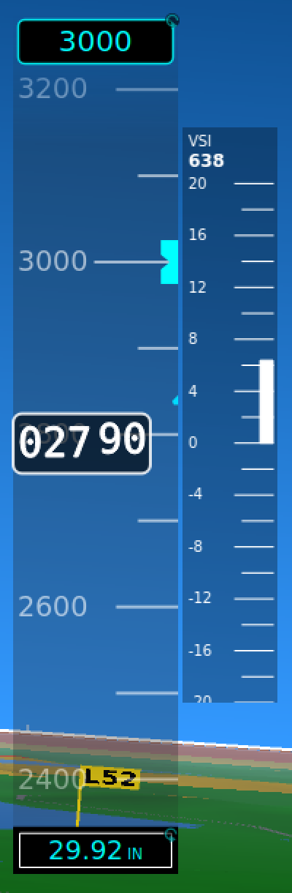
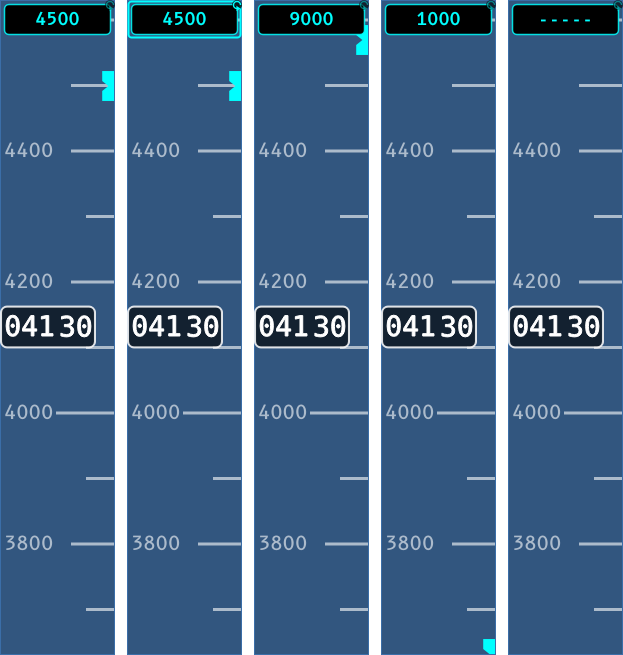
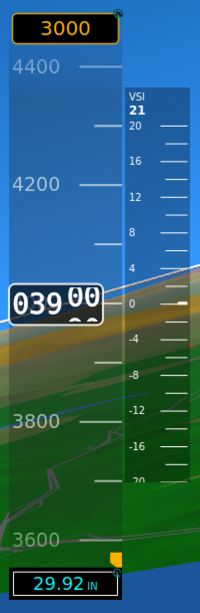
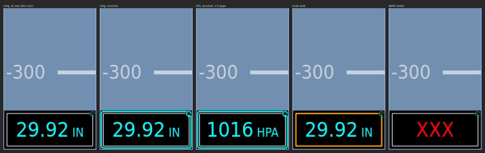

# Airspeed, Altitude and Vertical Speed

The panel's air data is three instruments. An airspeed tape sits on the left
and an altitude tape on the right, with a vertical speed scale beside the
altitude tape. Their instrument types are `airspeed_tape`, `altimeter_tape`
and `altimeter_trend_tape`.

 

Both tapes scroll behind a fixed readout box. The pictures are from the
simulator bench; its panel sets **Fade tape edges** on, so the scales fade into
the synthetic vision at top and bottom.

## Airspeed tape

The tape shows indicated airspeed (`IAS`) in knots. The readout's last digit
rolls like a drum.

**Colour bands** run up the left edge of the tape:

| Band | From | To |
|---|---|---|
| Red | 0 | Vs0 |
| White (half width) | Vs0 | Vfe |
| Green | Vs0 | Vno |
| Yellow | Vno | Vne |
| Red | Vne | top of the tape |

A red line marks Vne. The scale runs from 0 to 1.25 times Vne. The low red band
appears only when Vs0 is set. The green band starts at Vs0, not at the clean
stall speed Vs: Vs is not drawn on the tape today
([#396](https://github.com/billmallard/pyEfis/issues/396)).

**Where the V-speeds come from.** They are the aircraft's numbers, not the
panel's. Enter them once under
[Aircraft parameters](Designing-Your-Panel#aircraft-parameters) in the
configurator, and copy the `aircraft.ini` it produces to the device as that
section describes. They land as the `Vs`, `Vs0`, `Vfe`, `Vno` and `Vne` values
on fix-gateway's `IAS` item, and every airspeed instrument on every display
reads them from there. Unset, Vne is 200 kt and the rest are 0.

**Trend arrow.** A cyan arrow from the readout box shows where the airspeed
will be in 6 seconds at the present acceleration. It is worked out from the
last 3 seconds of `IAS`, and it hides when the projected change is under
0.5 kt.

**TAS box.** By default a box at the bottom of the tape shows true airspeed
(`TAS`), labelled `TAS`, or `---` when TAS is flagged. The bench panel turns
it off.

## Altitude tape

The tape shows indicated altitude (`ALT`). The labels are every 1000 ft and
every **Major division** (200 ft by default), with ticks at each **Minor
division** (100 ft). The last two digits of the readout roll in steps of 10.

A cyan **trend arrow** works the same way as the airspeed one: altitude in 6
seconds, from the last 3 seconds. It hides when the projected change is under
20 ft.

### Selected altitude

The box at the **top** of the tape is the selected altitude, `ALTSEL`: the
target you tell the autopilot to capture. A **bug** on the right edge of the
tape marks the same altitude. When the target is beyond the part of the tape
you can see, the bug parks **half-visible** at that edge, pointing the way to
go.



- **Touch the box** to select it: the cyan ring and knob icon from
  [The Panel at a Glance](The-Panel-at-a-Glance#touch-a-value-then-turn-the-knob).
- **Inner knob:** 100 ft per click. **Outer ring:** 1000 ft per click. Each
  click is sent at once; there is nothing to confirm.
- **Push** sets the target to your current altitude, rounded to the nearest
  100 ft (4,130 ft sets 4,100), and ends the selection. If altitude is flagged,
  push does nothing.
- **Dashes (`-----`)** mean no selected altitude is set. The first click starts
  from your current altitude, rounded to 100 ft.
- **Amber box and bug** mean fix-gateway is flagging an altitude deviation. In
  the picture below the bench is holding at 4,000 ft with 3,000 selected.
  pyEFIS sets no threshold of its own and makes no sound. It colours the box
  while fix-gateway's annunciate plugin sets the `ALTSEL` item's annunciate
  flag. The deviation rule is configured there, in
  [fix-gateway](https://github.com/billmallard/fix-gateway/wiki).
- **Grey** means `ALTSEL` is old or bad.



The selected altitude is a target only. pyEFIS does not fly to it.

### Altimeter setting

The box at the **bottom** of the tape is the altimeter setting, `BARO`. It
reads `29.92 IN` or `1013 HPA`.



1. **Touch the box** to select it. On a panel without a touchscreen, turn the
   knob until the box is outlined in orange and push.
2. **Inner knob:** 0.01 inHg or 1 hPa. **Outer ring:** 0.10 inHg or 10 hPa.
   The altitude follows as you turn; there is nothing to confirm.
3. **Push** sets standard pressure, 29.92 inHg. **Push again** puts back the
   setting you had, so a push by mistake is undone with one more push. The box
   forgets the old setting as soon as the setting changes any other way: you
   turn the knob, or another display or the gateway changes it. Push at
   standard with nothing to put back does nothing.
4. Leave it about 10 seconds, or touch anywhere else, and the ring goes.

The setting stays between 27.50 and 31.50 inHg (932 to 1066 hPa), or inside the
`BARO` item's own limits if those are tighter. `BARO` is always in inHg on the
bus; hPa is only how the box shows it. The **Units** button on the stock
screens switches the box between the two. At start-up it follows the
`Pressure` unit in the preferences.

A screen shows one altimeter setting. If another instrument on the screen
already shows `BARO`, the tape leaves its box off.

## Vertical speed

The scale beside the altitude tape shows vertical speed, `VS`, in ft/min. A
white bar grows from zero to the present rate. The number under the `VSI` label
at the top is the rate itself: `638` in the climb picture above. Scale labels
are in hundreds, so `20` is 2,000 ft/min.

**Range** sets full scale up and down: 2,500 ft/min by default, 2,000 on the
bench panel. Pick it to suit the aircraft's climb and descent performance.

## When data is flagged

| Instrument | Old or bad | Failed |
|---|---|---|
| Airspeed or altitude readout | Digits blank, the box outline stays | Grey box with a red `XXX` |
| TAS box | `---` | `---` |
| Altimeter setting | Grey | Red `XXX` |
| Selected altitude and bug | Grey | Dashes, no bug |
| VSI | Number blank, the bar stays | Bar removed, red `XXX` |

## Customizing

### In the configurator

Select an instrument in the Panel Editor to see its options in **Properties**.
Defaults are shown, with the bench panel's value where it differs.

**Airspeed Tape**

| Option | Default | Bench | What it does |
|---|---|---|---|
| Fade tape edges (`edge_fade`) | off | on | Fade the top and bottom of the scale into what is behind it. |
| Show TAS box (`show_tas`) | on | off | The true-airspeed box at the bottom. |
| Show trend arrow (`show_trend`) | on | | |
| Trend look-ahead (`trend_lookahead`) | 6 s | | How far ahead the arrow projects. |

The tape always reads `IAS`. Its V-speeds are not panel options; they are
[Aircraft parameters](Designing-Your-Panel#aircraft-parameters).

**Altimeter Tape**

| Option | Default | Bench | What it does |
|---|---|---|---|
| Fade tape edges (`edge_fade`) | off | on | |
| FIX key (`dbkey`) | `ALT` | | The key the tape shows. |
| Max altitude (`maxalt`) | 50000 | | Top of the scale (ft). |
| Major division (`majorDiv`) | 200 | | Feet between labelled ticks. |
| Minor division (`minorDiv`) | 100 | | Feet between small ticks. |
| Total digits (`total_decimals`) | 5 | | Digits in the readout. |
| Round readout to (`round_to`) | 0 | | Round the readout; 0 is none. The scale still moves smoothly. |
| Show numeric box (`numeric_box`) | on | | The readout box. Off leaves just the pointer. |
| Scale-number font scale (`font_scale`) | 1.0 | | Size of the scale labels. |
| Baro setting box (`show_baro`) | on | | The altimeter-setting box. |
| Selected-altitude box (`altsel_box`) | on | | The `ALTSEL` box. |
| Altitude bug (`alt_bug_enabled`) | on | | The bug; follows the box unless set. |
| Altitude bug color (`alt_bug_color`) | `#00ffff` | | |
| Altitude alert color (`alt_bug_alert_color`) | `#ffb000` | | Box and bug colour while `ALTSEL` annunciates. |
| Selected-altitude key (`alt_bug_dbkey`) | `ALTSEL` | | |

**Altimeter Trend Tape** (the VSI)

| Option | Default | Bench | What it does |
|---|---|---|---|
| Range (`maxvs`) | 2500 | 2000 | Full scale, up and down (ft/min), 500 to 10000. |
| Tick interval (`minorDiv`) | 100 | 200 | |
| Numbered interval (`numberedDiv`) | 200 | 400 | Labels print in hundreds. |
| Background (`bg_color`) | `#000000` | | |
| Background opacity (`bg_opacity`) | 100 | 30 | Percent; lower lets the synthetic vision show through. |

### In YAML

The configurator writes these options into the screen file. The bench panel's
tapes, by hand:

```yaml
- type: airspeed_tape
  row: 6
  column: 15
  span: {rows: 60, columns: 12}
  options:
    show_tas: false
    edge_fade: true
- type: altimeter_tape
  row: 6
  column: 105
  span: {rows: 60, columns: 12}
  options:
    edge_fade: true
- type: altimeter_trend_tape
  row: 14
  column: 117
  span: {rows: 40, columns: 7}
  options:
    maxvs: 2000
    minorDiv: 200
    numberedDiv: 400
    bg_opacity: 30
```

Each option is listed with the others for its type in
[Flight Instruments](Widgets-Flight-Instruments).

### Feeding them

| Key | Read by | Written by pyEFIS |
|---|---|---|
| `IAS`, with aux `Vs`, `Vs0`, `Vfe`, `Vno`, `Vne` | Airspeed tape | no |
| `TAS` | Airspeed tape (TAS box) | no |
| `ALT` | Altitude tape | no |
| `BARO` | Altitude tape | yes, when you set it |
| `ALTSEL` | Altitude tape | yes, when you set it |
| `VS` | VSI | no |

See [FIX Database Keys](FIX-Database-Keys).

## See also

- [The Panel at a Glance](The-Panel-at-a-Glance)
- [Attitude and Synthetic Vision](Attitude-and-Synthetic-Vision)
