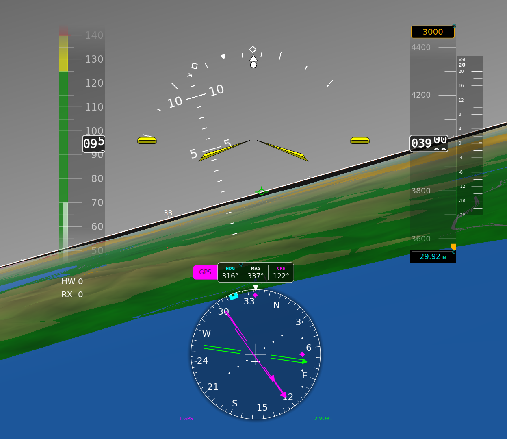
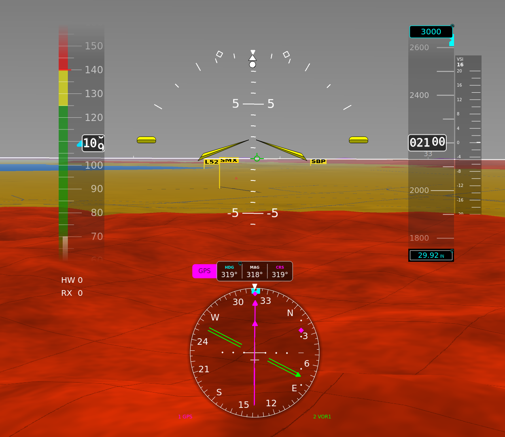
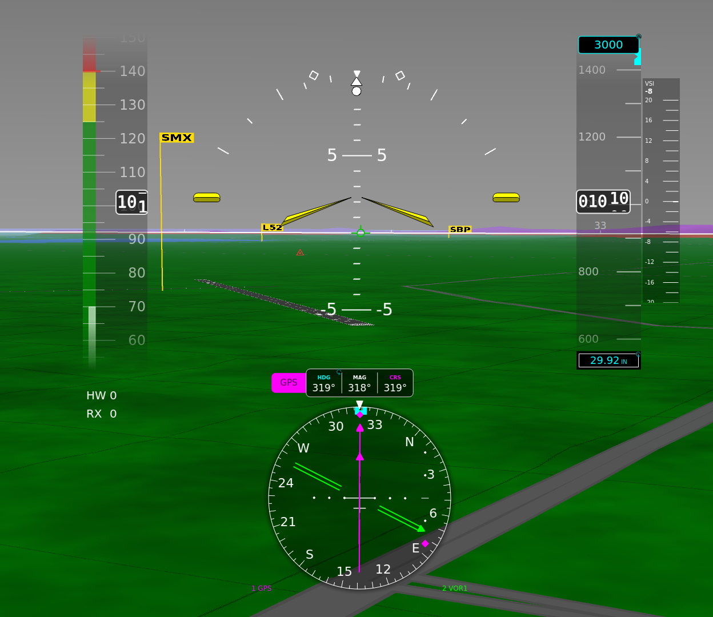
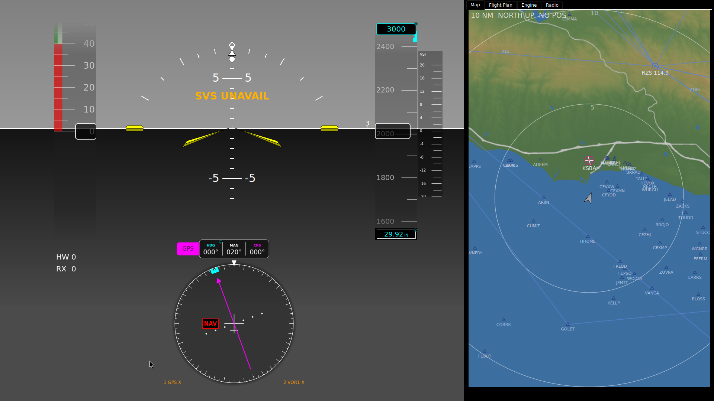

# Attitude and Synthetic Vision

The attitude display fills the background of the panel. It shows pitch, bank
and slip over a synthetic view of the terrain ahead, drawn from the aircraft's
position and the device's terrain data. The instrument type is `virtual_vfr`
with synthetic vision (SVS) turned on. The same attitude symbology without
terrain is `atitude_indicator`.

> pyEFIS is not certified. Do not use it as the sole source of attitude
> information in instrument meteorological conditions. Fly with independent
> standby attitude, airspeed and altitude instruments: ones that share no
> sensor, computer, software, power source or display with pyEFIS.



## Reading it

| Element | What it shows |
|---|---|
| **Aircraft symbol** | Fixed. On the bench panel it is the `garmin` style: a yellow two-tone bat wing with a short bar each side at horizon level. |
| **Horizon line** | White, drawn over the terrain at zero pitch. |
| **Pitch ladder** | Lines every few degrees, numbered every **Numbered division** (5° on the bench panel, 10° by default). Lines more than the **Pitch label range** from your pitch fade out. |
| **Bank scale** | An arc with marks at 10, 20, 30, 45 and 60 degrees, a fixed white datum at the top and a pointer that turns with the aircraft. Both turn amber past the **Excessive-bank caution** setting, 60° of bank by default, so a 45° or 50° steep turn does not light it. |
| **Bank bug** | Optional. A cyan arrow outside the bank scale at the target bank you set, on both sides, with a cyan band 5° either side of it over the scale. Hold the turn with the white pointer inside the band. Set it by touching the bank scale and turning the knob; 0 is off. Hidden past 65° of bank with the other de-clutter. See [below](#bank-bug). |
| **Standard-rate marks** | Two small diamonds on the arc at the bank for a standard-rate turn at your true airspeed, capped at **Max indicated bank** (25°). |
| **Slip/skid indicator** | The ball just under the bank pointer. It moves sideways with `ALAT` and turns amber at 0.25 g and beyond. |
| **Flight path marker** | A green circle with wings: where the aircraft is actually going, from GPS track, groundspeed and vertical speed. See [below](#flight-path-marker). |
| **Horizon heading marks** | Optional compass ticks along the horizon line, with labels: `N`, `E`, `S`, `W`, or the heading in tens (`33` is 330). |
| **Recovery chevrons** | Three amber chevrons pointing back to the horizon at an unusual attitude. |

### At an unusual attitude

Beyond 30° nose up, 20° nose down, or 65° of bank, or with the horizon off the
screen, the display declutters. The flight path marker, the standard-rate marks,
the bank bug and the horizon heading marks go, leaving what you need to recover.

### Bank bug

The bank bug holds a steep or standard-rate turn to a target bank. Touch the
bank scale: a cyan focus ring and a `BANK` readout appear under the slip ball.
Each knob detent moves the target 5°, from off up to 60° (or the
**Excessive-bank caution** setting, if that is lower). Push the knob, or wait
for the timeout, and the edit ends with the value kept.

A cyan arrow then marks the target outside the scale on both sides, so the
second turn of a steep-turn pair is already set. A cyan band covers the scale
from 5° under to 5° over the target (**Bank bug tolerance**). The scale turns
under the fixed white pointer as you bank: with the pointer inside the band,
you are within tolerance. If the band is off to one side, roll toward it.

The value is the FIX key `BANKBUG`, so every display on the bus shows the same
bug. If the gateway does not define `BANKBUG`, there is no bug and touching the
scale does nothing.

### Flight path marker

The marker sits where the aircraft is going, not where it points. Vertically,
it uses the flight path angle (`VPATH` when published, otherwise vertical speed
against groundspeed). Sideways, it shows drift: track against heading.

- It hides below 30 kt groundspeed, when the track is meaningless.
- It hides when `VS`, `GS`, `TRACK` or `HEAD` has failed or is missing.
- It turns amber when one of them is flagged bad.

## Synthetic vision

The terrain ahead is coloured by how far it is below you.



| Colour | Terrain is |
|---|---|
| **Green** | At least the **Safe clearance** below you (1,000 ft by default). With **Safe-band gradient** on, it shades from olive to deep green over the next 2,500 ft, so rising ground warms before it turns amber. |
| **Amber** | Between the **Caution clearance** (500 ft) and the safe clearance below you. |
| **Red** | Less than the caution clearance below you. |
| **Magenta** | At or above your altitude. |
| **Blue** | Water. |

The bench panel raises the two clearances to 1,500 ft (caution) and 2,500 ft
(safe), so it shows red where a default panel would show amber or green.

**Near an airport** the bands relax for the runway environment. Within 5 nm of
an airport, terrain lower than 400 ft above the nearest airport's field
elevation is drawn green, so a normal approach does not paint the whole pattern
red. Terrain higher than that keeps its amber and red, and magenta always
shows.



**What else is drawn**, each from its own navdata pack:

- **Water**: lakes, rivers and coastline, in blue.
- **Roads**: motorways and trunk roads as grey ribbons to scale, out to 20 nm.
  Beyond 8 nm only motorways show. Roads hidden behind a ridge are not drawn.
- **Obstacles**: charted towers and buildings at least 200 ft tall, out to
  15 nm. White or red by their lighting, grey if unlit, magenta if the top is
  at or above your altitude. Ones hidden behind terrain are dimmed.
- **Runways**: true size from the threshold positions and width. Within 3 nm
  they get their painted markings and numbers.
- **PAPI**: lit at its published glide path angle, where the airports pack
  lists one.
- **Airport flags**: a yellow flag on a pole with the identifier (a leading `K`
  is dropped: `SMX`). A flag behind terrain is dimmed.

Distance haze fades far terrain into the horizon. The haze distance grows with
altitude, from the **Haze distance** (40 nm by default) upwards. Close in, a
faint ground texture and a 300 m grid draped on the terrain give a sense of
slope and closure. Both fade out within a few miles.

**Synthetic vision is terrain awareness, not terrain clearance.** It draws only
what its data holds, in the arc ahead.

## When data is missing

| You see | It means |
|---|---|
| A grey sky and dark grey ground | An attitude input (`PITCH`, `ROLL`, `ALAT` or `TAS`) is old or bad. Terrain still draws over the ground. |
| A dark grey display with a red **XXX** | An attitude input has failed. |
| An amber **SVS UNAVAIL** and no terrain | Synthetic vision is on, but `LAT` or `LONG` is old, bad or failed, or the graphics could not start. |
| No terrain and no message | No terrain tiles were found at the **Terrain tile path**. |



If the graphics fail once at start-up, or three times while drawing, synthetic
vision stays off until pyEFIS restarts.

## Customizing

### In the configurator

Select the attitude display in the Panel Editor; its options are in
**Properties**. The editor preview shows a stylised backdrop (**Preview
scene**); only the device draws real terrain. Defaults are shown, with the
bench panel's value where it differs.

**Attitude**

| Option | Default | Bench | What it does |
|---|---|---|---|
| Aircraft symbol (`aircraft_symbol`) | `classic` | `garmin` | `classic` split bars and a dot; `garmin` bat wing with horizon bars; `brackets` L-brackets and a dot; `none` hides it. |
| Symbol colour (`symbol_color`) | `#ffff00` | | |
| Symbol scale (`symbol_scale`) | 1.0 | 0.6 | 0.3 to 3. |
| Horizon position (`horizon_position`) | 50 | 68 | Percent up the screen for level flight. Raise it to give the lower part of the screen to other instruments, such as the HSI. |
| Flight-path marker (`show_fpm`) | on | | |
| Pitch field of view (`pitchDegreesShown`) | 50 | 40 | Total pitch span shown, in degrees. |
| Numbered division (`numberedDiv`) | 10 | 5 | Degrees between numbered ladder lines. |
| Pitch label range (`visiblePitchAngle`) | 25 | 8 | Ladder lines further than this from your pitch fade out. |
| Pitch ladder opacity (`pitchOpacity`) | 0.6 | | 0 to 1. |
| Ladder stops below bank arc (`pitch_ladder_avoid_bank`) | off | on | Keeps the ladder out of the slip indicator. |
| Bank scale position (`bank_position`) | 50 | 63 | Percent up the screen for the bank arc's centre. |
| Bank scale radius (`bank_radius`) | 33.3 | 25 | Percent of the height. |
| Standard-rate bank markers (`drawBankMarkers`) | on | | |
| Max indicated bank (`bankAngleMaximum`) | 25 | | Cap for the standard-rate marks. |
| Excessive-bank caution (`excessiveBankDeg`) | 60 | | The bank scale turns amber past this. Set it per aircraft, above the steepest turn you fly on purpose. |
| Bank bug tolerance (`bankBugTolerance`) | 5 | | Half-width of the band around the bank bug. |
| Touch to set bank bug (`touch_edit`) | on | | Off makes the bank scale ignore touches. |
| Horizon heading marks (`horizon_heading_marks`) | off | on | |
| Heading label interval (`horizon_heading_label_interval`) | 20 | 30 | |

The full list, including the tick sizes and opacities, is on
[Attitude & SVS](Widgets-Attitude-and-SVS).

**Synthetic vision**

| Option | Default | Bench | What it does |
|---|---|---|---|
| Synthetic vision enabled (`svs_enabled`) | off | on | Off falls back to the legacy CIFP Virtual VFR overlay, which is deprecated. |
| Terrain tile path (`svs_tile_path`) | | `/data/makerplane-data/terrain/tiles` | Where the terrain pack is installed. |
| Obstacle / Water / Highway DB path | | the installed packs | Optional; leave one empty to drop that layer. |
| Range (`svs_range_nm`) | 50 nm | | How far ahead terrain is drawn. |
| Auto range by altitude (`svs_auto_range`) | on | | |
| Min auto range (`svs_min_range_nm`) | 8 nm | | |
| Safe clearance (`svs_clearance_green_ft`) | 1000 | 2500 | Green at and above this clearance. |
| Caution clearance (`svs_clearance_yellow_ft`) | 500 | 1500 | Amber above this; red below. |
| Safe-band gradient (`svs_safe_gradient`) | on | | |
| Terrain grid (`svs_terrain_grid`) | 0.35 | | 0 turns the grid off. |
| Terrain texture (`svs_terrain_texture`) | 0.35 | | 0 turns the texture off. |
| Earth curvature (`svs_earth_curvature`) | on | off | Drops distant terrain below the horizon as the earth does. |
| Distance haze (`svs_haze`) | on | | |
| Haze distance (`svs_haze_distance_nm`) | 40 nm | 32 nm | |
| PAPI lights (`svs_papi`) | on | | |
| Road colour, casing and width options (`svs_road_*`) | | | The road ribbons' look. |

Two options in the list do nothing on the device today: **Terrain palette**
(`svs_palette`, [#394](https://github.com/billmallard/pyEfis/issues/394)) and
**Fill terrain** (`svs_terrain_fill`,
[#395](https://github.com/billmallard/pyEfis/issues/395)).

The configurator does not offer the airport proximity rule. It is set in
the screen file's `svs:` block: `airport_proximity_nm` (5, and 0 turns it off)
and `airport_gate_agl_ft` (400). That block also takes `obstacle_min_agl_ft`
(200) and `detail_distance_nm` (3, the runway-marking range).

### In YAML

The configurator writes `svs_` options flat; pyEFIS strips the prefix and
merges them over any `svs:` block, so a flat option wins. Trimmed from the bench
panel:

```yaml
- type: virtual_vfr
  row: 0
  column: 0
  span: {rows: 110, columns: 130}
  options:
    horizon_position: 68
    aircraft_symbol: garmin
    symbol_scale: 0.6
    svs_enabled: true
    svs_clearance_green_ft: 2500
    svs_clearance_yellow_ft: 1500
    svs_tile_path: /data/makerplane-data/terrain/tiles
    svs_water_db_path: /data/makerplane-data/water/current/water.sqlite
    svs_highway_db_path: /data/makerplane-data/highways/current/highways.sqlite
    svs_dof_db_path: /data/makerplane-data/obstacles/current/obstacles.sqlite
    svs:
      nasr_db_path: /data/makerplane-data/navdata/current/airports.sqlite
      airport_provider_dir: /data/makerplane-data/airports
```

Runways, PAPI and airport flags need the airports pack (`nasr_db_path`). The
data paths are where `pyefis-data` installs each pack; see
[Setting Up a Device](Setting-Up-a-Device#6-install-navigation-data).

### Feeding it

| Key | Used for |
|---|---|
| `PITCH`, `ROLL` | Attitude |
| `ALAT` | Slip/skid; also one of the four attitude inputs whose flags grey the sky |
| `TAS` | Standard-rate marks; also one of the four attitude inputs |
| `LAT`, `LONG`, `ALT` | Where the terrain is drawn from |
| `HEAD`, `MAGVAR` | Which way the terrain faces, and the horizon heading marks |
| `VS`, `GS`, `TRACK`, `VPATH` | Flight path marker |
| `BANKBUG` | Bank bug (written when you set it) |

See [FIX Database Keys](FIX-Database-Keys).

## See also

- [The Panel at a Glance](The-Panel-at-a-Glance)
- [Airspeed, Altitude and Vertical Speed](Airspeed-Altitude-and-Vertical-Speed)
- [Attitude & SVS](Widgets-Attitude-and-SVS): every option
