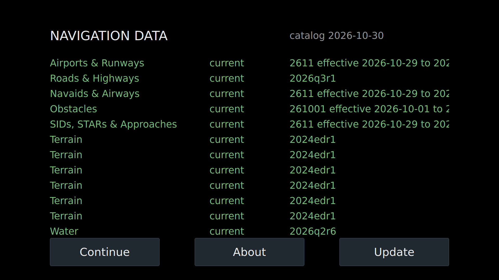
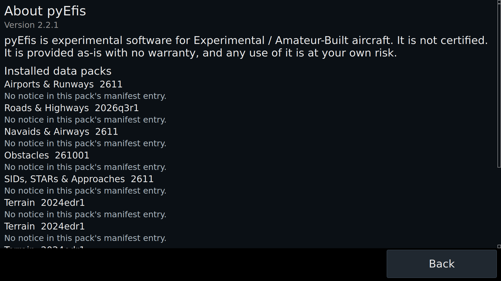
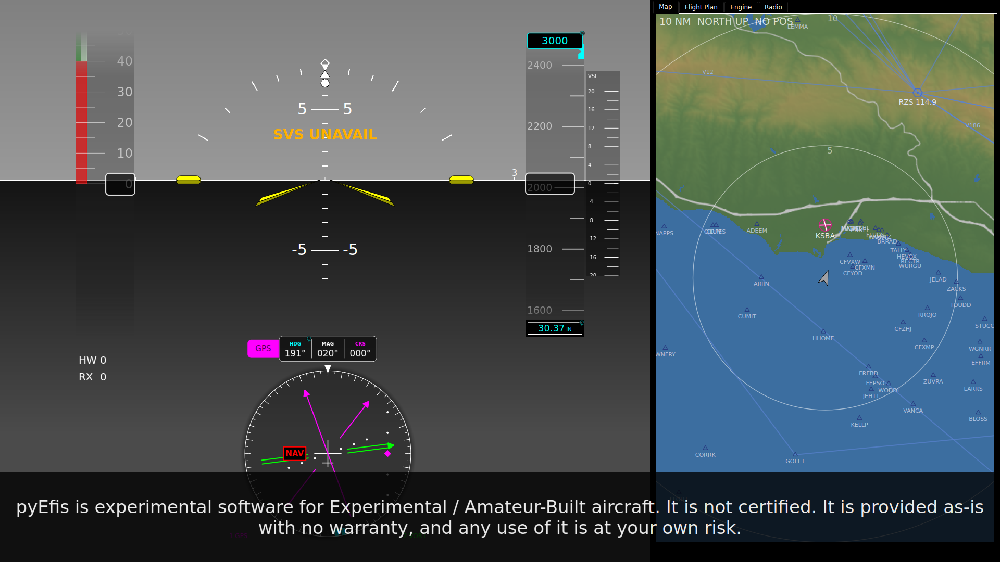

# Data Status, Updates and Notices

The device keeps its navigation data (airports, navaids, procedures, obstacles,
terrain, water, roads) in signed packs from the navdata service,
[navdata.aerocommons.org](https://navdata.aerocommons.org). The `pyefis-data`
updater installs them and records their state. pyEFIS shows that state in three
places: the **Data Status** screen, the **DATA** flag, and the **About**
screen. This page also covers the software notice shown at start-up.

How packs are built, signed and verified is in the makerplane-data wiki:
[Navigation Data Currency](https://github.com/billmallard/makerplane-data/wiki/Navigation-Data-Currency).
Installing `pyefis-data` and its daily timer is on
[Setting Up a Device](Setting-Up-a-Device#6-install-navigation-data).

## The Data Status screen

One row per installed pack: its name, its status, and a detail such as the
cycle and its effective dates. The row's colour is the updater's verdict:

| Colour | Means |
|---|---|
| Green | Current. |
| White | Expiring soon, or missing. |
| Amber | Expired, or outside its effective window. |

The words in each row come from the updater as it wrote them; pyEFIS only
colours them. `Data status unavailable — run an update to populate it.` means
the updater has not written a status yet.

| Button | What it does |
|---|---|
| **Continue** | Go to the panel's boot screen. |
| **About** | Open the About screen. |
| **Update** | Check for and install newer packs. |

**How you get here.** Touch the DATA flag where a screen carries one. The Data
Status screen is never the boot screen: a panel that names it as the default
boots to the screen behind Continue instead.

### Updating

Updating needs an internet connection or a USB drive with packs on it. Do it on
the ground.

1. Touch **Update**. pyEFIS asks the updater what sources it can see. With
   neither a connection nor a USB drive it says so, and nothing changes.
2. A list of packs opens, grouped as Navigation Data, Water, Roads, Terrain and
   Charts, with each pack's size and status. The packs already installed are
   ticked. The footer shows the total size, flagged if it exceeds the free
   space. **Use** switches source and **Change** picks the storage drive.
3. Touch **Install selected**. A progress bar shows each pack in turn.
   **Cancel** stops the install and goes back to the list.
4. If the data needs you to accept a notice first, it is shown with **Accept**
   and **Decline**. Decline installs nothing.
5. `Update complete.`, or `Update finished with problems — your previous data is
   still in place.` with the rows showing which pack failed. A pack that fails
   leaves the previous one in use.

The screen re-reads the status every minute and each time it is shown.

## The DATA flag

A small `DATA` outline, on screens that carry the **Data Annunciation**
instrument. It is hidden while every pack is current, white when one is
expiring soon or missing, and amber when one has expired. Touch it to open Data
Status.

The bench panel does not carry it. Add it from the configurator palette's
system category.

## The About screen

- The pyEFIS version and the software notice.
- **Installed data packs:** each pack with its cycle and any notice its
  publisher attached.
- **Notice acknowledgments:** each time the software notice was accepted on
  this device, newest first: when, by whom, how (typed at a terminal, accepted
  on screen, or auto-accepted on a bench unit, which is marked as not a
  person's accept), and the versions it covered.

**Back** returns to Data Status. pyEFIS adds the About screen to every
configuration, and the Data Status screen's **About** button opens it.

## The software notice at start-up

Each start, a strip across the bottom reads: *"pyEfis is experimental software
for Experimental / Amateur-Built aircraft. It is not certified. It is provided
as-is with no warranty, and any use of it is at your own risk."*

- It needs no tap. Touches go through it to the instruments underneath.
- It clears after **8 seconds** once the notice has been accepted for this
  pyEFIS version, and after **20 seconds** if not.
- The acceptance is a record in
  `~/.local/state/makerplane/acknowledgments.jsonl` (or
  `$XDG_STATE_HOME/makerplane/`, or the file named by `$MAKERPLANE_ACK_LOG`).
  pyEFIS reads it and never writes it.

**Accepting.** Run `pyefis-accept-notice` at a terminal on the device. It shows
the notice through `pyefis-data` and asks you to type `accept`; it exits 0 when
accepted. `pyefis-accept-notice --check` only reports. Accepting a data notice
during an update does not shorten the start-up strip, because that record names
the updater's version, not pyEFIS's. See
[Setting Up a Device](Setting-Up-a-Device#2-accept-the-software-notice).

## Customizing

None of the three screens has options in the configurator; pyEFIS adds Data
Status and About to every panel. By hand:

| Instrument | Option | Default | What it does |
|---|---|---|---|
| Data Status (`data_status`) | `update_command` | `pyefis-data` | The updater Update runs. The shipped screen uses `~/.local/bin/pyefis-data`. |
| | `continue_screen` | the boot screen | Where Continue goes. |
| | `about_screen` | `About` | Where About goes. |
| | `status_path` | `~/.makerplane/pyefis/status.json` | The updater's status file. |
| Data Annunciation (`data_annunciation`) | `target_screen` | `DataStatus` | Where a touch goes. |
| | `status_path` | as above | |
| About (`about`) | `back_screen` | `DataStatus` | Where Back goes. |

## See also

- [Setting Up a Device](Setting-Up-a-Device)
- [How the System Fits Together](How-the-System-Fits-Together)
