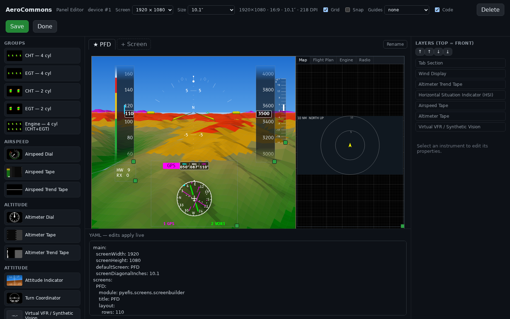
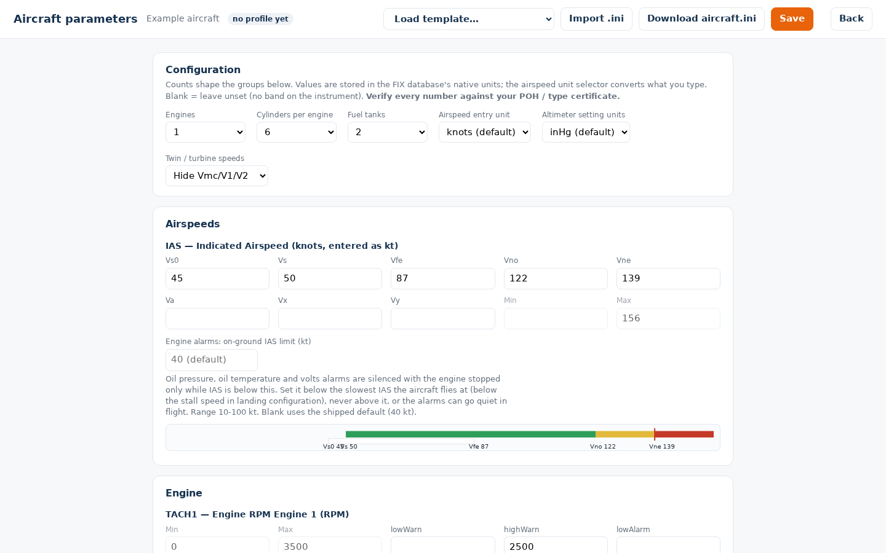

# Designing Your Panel

You design a panel on the configurator,
[pyefis.aerocommons.org](https://pyefis.aerocommons.org), and the device pulls
it. This page covers what you do there and what reaches the device. How the
configurator works inside is in the makerplane-data wiki:
[The Configurator](https://github.com/billmallard/makerplane-data/wiki/The-Configurator).

To edit screens by hand instead, see [Customizing Beyond the Configurator](Customizing-Beyond-the-Configurator). The
configurator writes the same screen YAML.

## Aircraft and devices

Sign in with Google or an emailed link. Everything you create is private to
your account.

- A **project** is one aircraft. Create one under **Your aircraft / designs**
  and **Open** it.
- A **device** is one display in that aircraft, for example `PFD` or `MFD`.
  Add each with **Add device**. Each device has its own panel and its own
  pairing.
- Each device row has **Pair** (or **Re-pair**) and **Edit panel**. The row
  shows whether the device is paired, when it last pulled, and
  `update pending` when you have saved a design it has not pulled yet.
- **Aircraft parameters** holds the aircraft's numbers, shared by all its
  devices. See [below](#aircraft-parameters).

Pairing and pulling are on [Setting Up a Device](Setting-Up-a-Device#4-pair-with-the-configurator).

## The Panel Editor

**Edit panel** opens the Panel Editor for one device.

| Area | What it does |
|---|---|
| **Toolbar** | **Screen** sets the device's resolution and **Size** its diagonal; the readout shows the aspect ratio and DPI. **Grid**, **Snap** and **Guides** (center, thirds, golden, basic-T, PFD + EMS) help alignment. **Code** shows the YAML pane. **Delete** removes the selected instrument. **Save** saves the design. **Done** returns to the dashboard without saving. |
| **Palette** (left) | Instruments by category (airspeed, altitude, attitude, navigation, gauges, text, controls, containers and more), and ready-made **groups**: CHT or EGT bars for 2 or 4 cylinders, and a 4-cylinder CHT + EGT engine cluster. Drag one onto the canvas. |
| **Canvas** (middle) | The screen as the device will draw it. The previews are built to match what pyEFIS renders, including the tapes, HSI, gauges and synthetic-vision terrain. Drag to move, drag a corner to resize. |
| **Screens bar** | One tab per screen. **+ Screen** adds one, **Rename** renames it, **Set default** makes it the boot screen (marked with a star), **Delete** removes it. |
| **Layers** (right) | Every instrument on the screen, front to back. The arrows change the order; a later instrument paints over an earlier one. |
| **Properties** (right) | With an instrument selected: its position and size on the grid, and every option the instrument has, with its default. |
| **YAML pane** | The screen YAML the device will receive. Edits in the pane apply to the canvas, and canvas edits appear in the pane. |

The palette and the option lists come from pyEFIS itself, published with each
pyEFIS branch. The production configurator follows pyEFIS's release branch,
so an instrument added to pyEFIS appears in its palette once that instrument
is released.

Positions are on the screen's grid. A new screen is 110 rows by 200 columns,
which suits a 16:9 display. Each instrument has a `row`, a `column` and a
`span` in grid cells, and can be nudged inside its cell with `move`. The
editor shows the same fields the YAML uses; their meaning is on
[Customizing Beyond the Configurator](Customizing-Beyond-the-Configurator#the-grid).

Every instrument accepts a font family (DejaVu Sans Condensed by default,
DejaVu Sans, DejaVu Sans Mono, B612, Inter, Roboto, Open Sans) and a font
size as a fraction of its height. The rest of the options depend on the
instrument; the [Widget Reference](Widget-Reference) lists them.

### Tab sections

A **Tab Section** holds several pages in one area of the screen, with a tab
bar to switch between them. The panel above uses one for its right-hand
column: **Map**, **Flight Plan**, **Engine** and **Radio**.

- Drop a Tab Section from the palette's container category. It starts with one
  tab.
- With it selected, the properties panel lists its tabs: add, rename, reorder
  and delete them. It always keeps at least one.
- Drop an instrument onto the selected Tab Section to place it in the active
  tab. Each tab has its own grid.
- The tab bar can sit on any edge (`tab_position`: top, bottom, left, right).
- A Tab Section cannot hold another Tab Section.

### Several screens

A device can have more than one screen. With more than one, the pulled panel
replaces the device's stock screen list, and each screen gets a **SCREEN >**
button so a touch-only panel can step through them. With one screen, the
panel replaces the device's default screen and the stock screens stay
available. See [Setting Up a Device](Setting-Up-a-Device#5-pull-your-panel).

## Getting the design to the aircraft

1. **Save** in the editor. The status line shows the saved version.
2. On the device, run `pyefis-data config-pull`, or power-cycle it: a device
   with the boot unit installed pulls once at boot.
3. The dashboard shows the device's last pull, and clears `update pending`.

A design is native pyEFIS screen YAML; nothing is compiled. The device
installs it alongside its shipped configuration, keeps a backup, and goes back
to the last working panel if the new one stops pyEFIS starting.

## Aircraft parameters

**Aircraft parameters** holds the numbers that make the instruments right for
your airframe and engine: V-speeds, gauge ranges and warning bands, fuel
tanks, electrical limits.

- **Configuration** sets the counts (engines, cylinders per engine, fuel
  tanks), which decide the groups below. It also sets the airspeed entry unit
  (knots, mph or km/h) and the altimeter setting units.
- **Airspeeds** takes Vs0, Vs, Vfe, Vno, Vne, Va, Vx and Vy (and Vmc, V1 and
  V2 for twins and turbines). The bar under them previews the arcs the airspeed
  tape will draw. Out-of-order speeds are flagged as you type.
- **Engine**, **Fuel** and the other groups take each gauge's range and its
  warning and alarm limits. A blank field means no band on that gauge.
- **Load template** fills in a starting point: Lycoming O-320 or O-360,
  Continental O-470, or a complete Cessna 170B. Check every number against
  your POH.
- **Import .ini** reads an existing FIX-Gateway initialization file.

These numbers belong to FIX-Gateway, not to the panel: every instrument reads
them from the FIX database. Today they reach the aircraft by hand:

1. **Download aircraft.ini**.
2. Copy it to `~/makerplane/fixgw/config/init_data/aircraft.ini` on the device.
3. List it last under `initialization files:` in FIX-Gateway's
   `config/default.yaml`, so it overrides the shipped defaults, and restart
   FIX-Gateway.

The altimeter setting units are the exception. They reach every paired device
of the aircraft with its next `config-pull`, and every unit-switching
instrument starts in them.

The profile's design and validation rules are on
[Aircraft Parameters](https://github.com/billmallard/makerplane-data/wiki/Aircraft-Parameters)
in the makerplane-data wiki.
