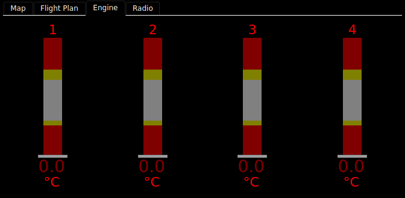

# Engine Monitoring

Engine readings are drawn by four gauge instruments: vertical bars, horizontal
bars, arcs and plain numbers. On the bench panel the **Engine** tab holds a
row of four CHT bars over a row of four EGT bars. The stock EMS screens use
the same gauges. The instrument types are `vertical_bar_gauge`,
`horizontal_bar_gauge`, `arc_gauge` and `numeric_display`.



The bench simulator sends no engine data, so the picture above shows every
gauge in its no-data state. With live data the bands are bright green, yellow
and red, and the readout is white.

## Reading a gauge

Each gauge shows one FIX value against its normal range and its limits.

| Part | What it shows |
|---|---|
| **Band** | The range, coloured green where normal, yellow inside the warning limits and red inside the alarm limits. |
| **Indicator** | A white line across a bar, or a pointer on an arc, at the current value. |
| **Readout** | The value, white when normal, yellow past a warning limit, red past an alarm limit. Units follow it when the gauge shows them. |
| **Name** | The label you gave it, such as `CHT`, `OIL P` or a cylinder number. |

A **segmented** gauge draws its band as blocks, like an LED bar, and dims the
part beyond the value instead of drawing an indicator line.

**Where the range and limits come from.** Not the panel: they are the
aircraft's numbers. Each gauge's range is its FIX item's minimum and maximum,
and its limits are the item's `lowAlarm`, `lowWarn`, `highWarn` and
`highAlarm` values. Enter them under
[Aircraft parameters](Designing-Your-Panel#aircraft-parameters) in the
configurator and copy the `aircraft.ini` to the device. A limit left blank
draws no band for it.

### When data is flagged

| You see | It means |
|---|---|
| Dark grey, dark yellow and dark red bands, grey text | The value is old or bad. |
| `xxx` (or `X` in every digit), with the indicator at zero | The value has failed. |
| A red name and units | The item is annunciating. |

## Cylinder groups

The configurator palette has ready-made groups in its engine category: **CHT —
4 cyl**, **EGT — 4 cyl**, **CHT — 2 cyl**, **EGT — 2 cyl**, and **Engine — 4
cyl (CHT+EGT)**, which is CHT over EGT as on the bench. A group drops in as one
unit, scales as one, and can be ungrouped. Its bars read `CHT11`..`CHT14` and
`EGT11`..`EGT14` and are named `1` to `4`.

## Leaning: EGT modes

A vertical bar set up for it (`egt_mode_switching: true`) responds to four EGT
buttons. The stock EMS screens carry them; a configurator panel gets them by
adding buttons with the action **Set EGT mode**.

| Button | What it does |
|---|---|
| **Normalize** | Takes each cylinder's present EGT as its reference and shows the change from there, across `normalize_range` (the shipped bars use 400). Use it to compare cylinders. |
| **Peak** | Tracks each cylinder's peak and draws a magenta mark at it. Once a cylinder has fallen 10° or more below its peak, its readout shows how far below, in magenta. |
| **Lean** | Resets the peaks and turns on Normalize and Peak together: the usual leaning view. |
| **Reset Peak** | Starts the peaks again from the present values. |

Choosing one clears the others, and the active button is green. In Normalize the
colour bands stay on the absolute scale. The indicator is meant to turn blue in
Normalize; today it stays white
([#399](https://github.com/billmallard/pyEfis/issues/399)).

**Hottest cylinder.** Give a bar a `highlight_key`, such as `EGTMAX1` or
`CHTMAX1`, and it draws a magenta ball at its foot while it is the hottest. The
palette groups do not set one.

## Alerts on the stock screens

On the stock screens, the **EMS** button turns red while any CHT or EGT is
annunciating, so you can see from the PFD that the engine wants a look. Touch it
to go to the EMS screen.

## Setting a value with a gauge

A gauge can also set the value it shows. Give it an `encoder_set_key` and select it with the knob: turn to change it, push to
keep it. Leave it and it goes back to where it was. With `touch_edit` on, a
touch selects it too. A selected bar or arc turns orange.

## Customizing

### In the configurator

| Option | Bar gauges | Arc | Numeric | What it does |
|---|---|---|---|---|
| FIX key (`dbkey`) | | | | The value shown. |
| Name (`name`) | | | — | The label. |
| Decimal places (`decimal_places`) | 1 | 1 | 1 | |
| Show units (`show_units`) | on | off | off | |
| Segments (`segments`) | 0 | 0 | — | 0 draws a solid band; more draws that many blocks. |
| Name location (`name_location`) | — | `top` | — | `top` or `right`. |
| Font mask (`font_mask`) | — | — | `000` | The widest value the readout makes room for. |

The configurator also shows each gauge's range and limits, read-only, because
they are set in the aircraft parameters, not on the panel.

The EGT mode, highlight and editing options (`egt_mode_switching`,
`normalize_range`, `highlight_key`, `encoder_set_key`, `touch_edit`) are not in
the configurator's list. Add them in the YAML pane; pyEFIS applies them and logs
that they are undeclared.

### In YAML

One bench CHT bar, and a leaning-ready EGT bar:

```yaml
- type: vertical_bar_gauge
  options:
    dbkey: CHT11
    name: '1'
- type: vertical_bar_gauge
  options:
    dbkey: EGT11
    name: '1'
    egt_mode_switching: true
    normalize_range: 400
    highlight_key: EGTMAX1
```

The stock screens build their cylinder rows from the shipped
`includes/bars/vertical/` files; see [Screen Builder](Screen-Builder).

### Feeding them

Each gauge reads its own FIX key, with the item's minimum, maximum and four
limits. `EGTMAX1` and `CHTMAX1` are needed only for the hottest-cylinder ball.
The EGT buttons write `EGTBTN1`..`EGTBTN4`. See
[FIX Database Keys](FIX-Database-Keys).

## See also

- [Engine & Data Gauges](Widgets-Engine-Gauges): every option
- [Designing Your Panel](Designing-Your-Panel#aircraft-parameters)
