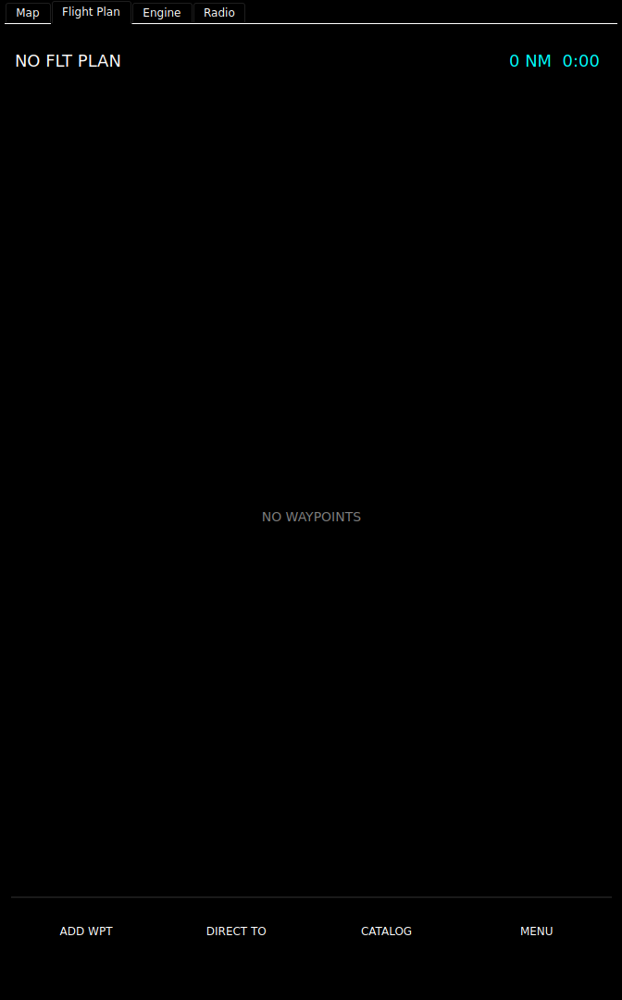
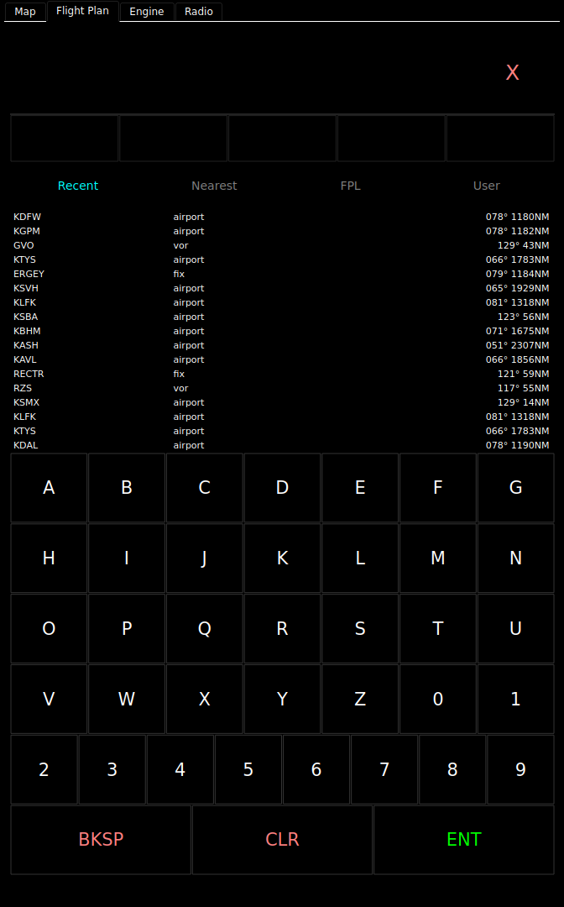
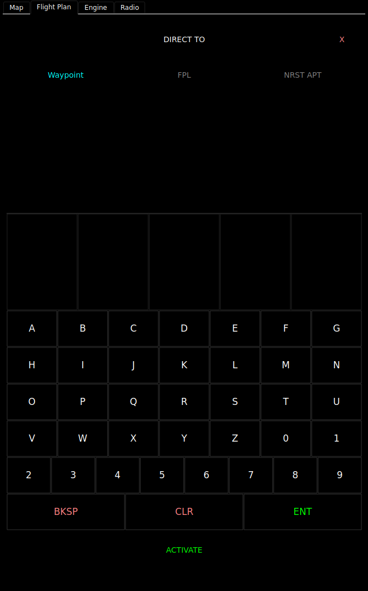
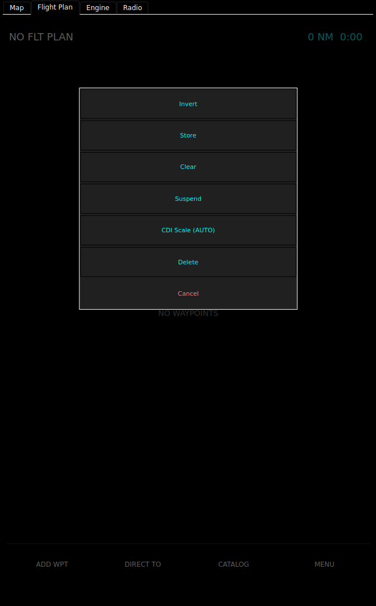
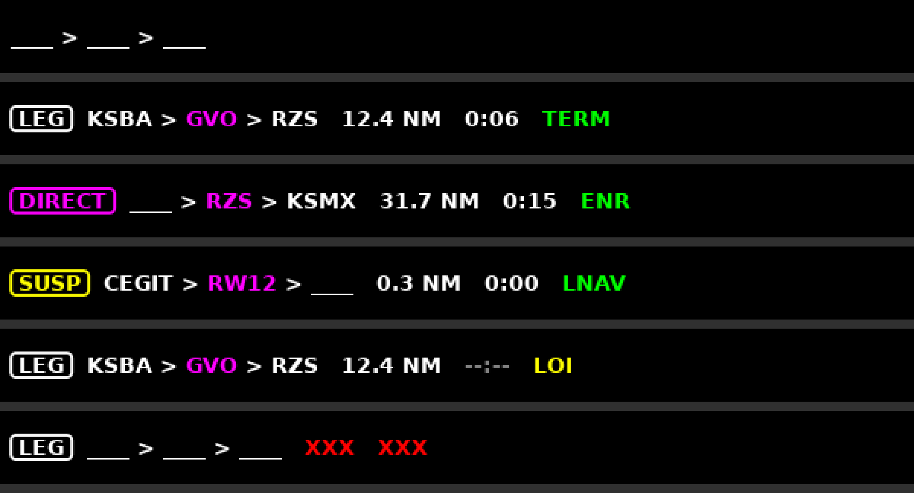

# Flight Plan

The flight plan page is where you build, edit, store and fly a route on the
device. On the bench panel it is the **Flight Plan** tab of the right-hand tab
column. The instrument type is `flight_plan`.

pyEFIS is the screen. fix-gateway's flight-plan engine flies the plan: it
sequences the legs, works out the course and deviation the HSI shows, and
handles Direct-To, holds and suspend. Every edit you make here is sent to the
engine at once. How the engine works is in the fix-gateway wiki:
[Flight Plan Engine](https://github.com/billmallard/fix-gateway/wiki/Flight-Plan-Engine).


## Reading the page

**Header, first line:** the plan's name (or `FIRST-LAST`, or `NO FLT PLAN`),
a state badge in orange, and the remaining distance and time in cyan.

| Badge | Means |
|---|---|
| `LEG` | Flying the plan leg by leg. |
| `DIRECT` | Flying a Direct-To. |
| `SUSP` | Sequencing is suspended: the engine holds the current leg and does not move on. |
| `OBS` | GPS OBS: you set the course through the waypoint you are flying to. See [the menu](#the-menu). |

**Header, second line**, in green: the approach state, `APR ARM`, `LNAV` or
`MISSED`. A red `LOI` means the GPS has lost integrity. On the right, in grey,
the type of the loaded approach and the AIRAC cycle its procedures came from,
for example `RNAV  AIRAC 2611`. Once that cycle has expired the text turns
amber and reads `RNAV  AIRAC 2609 EXPIRED`.

**The list.** Each row is a waypoint: a symbol for its type, the ident and any
procedure role (`IAF`, `FAF`, `MAP`, `MAHP`), then the columns.

| Column | Shows |
|---|---|
| `DTK` | The magnetic course of the leg into this waypoint. |
| `DIS` | The leg's length, in whole nm. |
| `CUM` | The distance from the start, in whole nm. |
| `ETE` | Time to go, on the active row only. Not shown by default. |

The active leg is magenta, the legs flown are grey, and the legs ahead white.
An airway is one row: its ident in bold, `entry → exit`, and the number of
fixes and the highest minimum en-route altitude. While you fly along it, the
row opens to show the fix you came from, the one you are going to, the next,
and how many more.

The list scrolls by drag, fling or wheel, and follows the active leg unless you
scrolled it in the last 20 seconds.

A strip reading **SUSP AT MAP**, with an orange **Fly the missed** button,
appears when the plan is suspended at the missed approach point. The button
starts the missed approach.

## Building a plan

 

1. Touch **ADD WPT**. The entry page opens.
2. Type the ident on the keypad, or pick it from a tab: **Recent**, **Nearest**,
   **FPL** (waypoints already in the plan) or **User**. As you type, the best
   match is completed in cyan, and the five best suggestions show above the
   tabs. Each row in a tab gives the bearing and distance from the point where
   it would go.
3. Touch **ENT**. The waypoint is added to the end of the plan and sent to the
   engine, and the page goes back to the list. `NO MATCHES` means nothing has
   that ident; `DUPLICATE FOUND` gives you a list to pick from, each row
   with the state (or the country) the place is in: `BR ndb TX Depoo`.
   The **Recent** tab remembers the place you picked, not just its ident.
   `<ident> IS ALREADY THE PREVIOUS FIX` (or `NEXT FIX`) means that fix is
   already right beside the place it would go.
4. Repeat. Touch **X** to leave the entry page without adding anything.

There is no separate step to activate a plan: each change is sent as you make
it.

If the engine refuses a change, a red strip above the soft keys reads
`EDIT REFUSED:` and the engine's reason in plain words, naming the waypoint
(for example `ARC AT RFFIX: NO TURN DIRECTION`), or `NO ENGINE ANSWER` when
none comes within 2 seconds, and the list goes back to the plan the engine is
flying. **Edit draft** brings the refused route back to correct; the strip then
reads `DRAFT - NOT LOADED:` and its button, **Flown plan**, goes back. The draft
ends when the engine loads a change. This needs an engine that publishes
`FPLLDSEQ`.

A plan sent from ForeFlight (*Send To*, then the panel's upload page or the
*Send to Panel* shortcut) does not replace your route. A cyan strip above the
soft keys reads `PLAN FROM EFB:` with its name and number of waypoints. Touch
**Review** to see every fix, then **Accept** to make it your route, **Reject**
to drop it, or **Later** to keep it waiting. Altitudes and speeds do not come
across from ForeFlight, and airways and procedures arrive as plain fixes; the
sheet says so. A user waypoint with a name longer than 6 characters loads with
the first 6, and the sheet shows the full name beside it. If a newer plan
arrives while you are reviewing, the sheet closes and the strip shows the new
one.

Other messages, such as `STORED`, `ROUTE FULL`, an OBS refusal, a refused
Activate (`ALREADY TURNED TOWARD FIX: USE DIRECT-TO`) or a change that left no
leg active (`ACTIVE WAYPOINT REMOVED: NO LEG ACTIVE`), show in a
strip just above the soft keys: yellow text and border on a dark yellow fill.
The strip clears after 4 seconds, or at your next tap anywhere. A tap on the
strip itself only clears it.

**Touch a waypoint row** for its menu:

| Item | What it does |
|---|---|
| Insert Before / Insert After | Open the entry page to add a waypoint there. |
| Load Airway | Pick an airway through this waypoint, then its exit fix. The whole airway is inserted. |
| Activate Leg | Fly the leg to this waypoint now. If the leg starts more than 500 NM from you, it asks first: `FROM <ident> <n> NM`, `ACTIVATE LEG?`. |
| Direct To | Fly direct to this waypoint. |
| Hold... | Build a hold here the way ATC gives it: the side of the fix, the radial or inbound course, the turns and the leg in minutes or miles. It is inserted right after the fix as a **HOLD** row. When the fix has a published hold, **PUBLISHED** at the top fills it in for you; with several, pick one from the list. A published hold with no leg time gets the standard time (1 minute at or below 14,000 ft, 1.5 above), marked **STD TIME** in amber: check the chart. See [Building a hold](#building-a-hold). |
| WPT Info | Its details: position, elevation, frequency, bearing and distance from you. |
| Set Role | Mark it `IAF`, `FAF`, `MAP`, `MAHP` or none. |
| Remove | Take it out of the plan. |

A fix inside an airway or procedure offers **Hold...** too, and a hold you
built there offers **Remove Hold**. While you fly a hold that ends only when
you end it (`HM`), whether you built it or it came with a procedure such as a
missed approach, the menu's Suspend item reads **Exit hold**: the hold ends at
the next pass over the fix. In the list and its menus, a hold you built reads
`<fix> HOLD`.

Touch an airway row for **Change Exit**, **Change Entry**, **Show Fixes**
(each fix with its course, distance and MEA), **Load Airway at** its exit
fix (to join another airway there), **Activate to** its entry, and **Remove
Airway**.

A plan holds up to 100 waypoints. An airway that will not fit is refused with
`ROUTE FULL`.

Touch a departure, arrival or approach row for **Show Fixes**, **Activate
to** its first fix, **Select** another of that kind (the item reads, for
example, **Select Departure**), and **Remove** it (**Remove Departure**). A
departure also offers **Load Airway at** its last fix. An approach and its
missed approach are removed together.

**Activate to** asks the same far-fix question as Activate Leg. The question
is not asked without a valid GPS position, or for the first waypoint. A tap
off the box, or a long push of the knob, is No.

### Building a hold

The hold editor opens as `HOLD AT <fix>`, set up to hold as you arrive:
inbound on the course of the leg into the fix, right turns, and a 1 minute
leg (1.5 minutes above 14,000 ft on `ALT`). Change any field by touching it:

- **SIDE:** the side of the fix the pattern lies on, on a compass rose around
  the fix.
- **RADIAL** / **INBOUND:** touch to switch which one the course is, then the
  course itself.
- **TURNS:** **LEFT** or **RIGHT**.
- **LEG:** the length, and **MIN** / **NM**. Switching the unit converts the
  length at the hold speed (`hold_speed_kt`).

The line above **Insert** shows the hold as it will be flown, or in red why it
cannot be, for example `RADIAL 130° IS NOT N OF THE FIX`. **Cancel** leaves
without a hold.

**PUBLISHED** shows only when the navaids pack carries published holds and
the fix has one; an older pack shows no such row. With several, the list
`PUBLISHED HOLDS AT <fix>` shows 8 a page.

## Departures, arrivals and approaches

Touch **PROC**. Choose **Departure**, **Arrival** or **Approach** at the top,
then touch each line to choose:

- **Departure:** the airport, the departure, the runway, then the
  transition.
- **Arrival:** the airport, the arrival, the transition, then the runway.
- **Approach:** the airport, the approach, then the transition. **VECTORS**
  loads the final approach alone, for vectors to final.

The airport starts as the plan's first airport for a departure and its last
one otherwise. Touch it to pick another. A line with only one choice is
filled in for you. Below the lines, the page lists every leg you are about
to load, with its altitude constraint. The missed approach is in cyan.

Touch **LOAD**. The procedure goes into the plan in the usual order:
departure, en route, arrival, approach. It replaces one of the same kind,
and the flight plan page opens. **REMOVE** takes it out again.

If the plan already has the procedure's first fix just before it, that fix
is used once, not twice.

The box flies the procedure as coded, or not at all. If it cannot fly one
of the legs, it keeps the plan it had and says why in red, for example
`EDIT REFUSED: CAN'T FLY FC LEG AT LOBER`. It never drops a leg to make a
procedure fit. The missed approach is loaded but not flown until you choose
**Fly the missed** at the missed approach point.

Procedures from an expired AIRAC cycle still load. The box does not refuse
them. The cycle is shown in amber with `EXPIRED`: on the page before you
load, in the header of the flight plan page, and on the nav status line.

## Direct-To



Touch **DIRECT TO**, choose the destination on one of three tabs, and touch
**ACTIVATE**:

- **Waypoint:** type an ident.
- **FPL:** a waypoint in the plan.
- **NRST APT:** the nearest airports, with bearing, distance and longest runway.

While a Direct-To is active the button reads **REMOVE**, in red, and cancels
it. With nothing chosen, `SELECT A WAYPOINT` reminds you.

On a panel with a knob, pushing it on the plain list opens Direct-To with the
active waypoint already chosen, so a second push flies direct to it.

You can also go direct from the map: touch the waypoint there and choose
**DIRECT TO** on its banner. See [Moving Map](Moving-Map#tap-something).

## Charts

With a plates pack set (`plates_path`), a **CHARTS** soft key sits between
**CATALOG** and **MENU**. It opens the loaded approach's chart when exactly
one chart matches that approach. Otherwise it opens the chart list for the
airport the approach serves, with `NO SINGLE PLATE FOR <approach>` in red.
With no approach loaded, the list is for the plan's last airport, or the
nearest airport when the plan has none.

The list starts with the airport diagram, then approaches, departures,
arrivals and the other charts. Each row gives the chart's name and its kind:
`DIAGRAM`, `APPROACH`, `DEPARTURE`, `OBST DP`, `ARRIVAL`, `MINIMUMS`,
`HOT SPOTS`, `LAHSO` or `ALT MIN`. **AIRPORT** picks another airport; an
airport with no ICAO ident is found by its FAA ident. The arrow keys page
through the list. `NO CHARTS FOR <airport>` means the pack has none for it;
`NO CHARTS DATABASE` means no pack could be opened.

Touch a chart to view it, fitted to the pane. The line under its name gives
the airport, the amendment and the AIRAC cycle, in amber with `EXPIRED` once
the cycle has expired; an expired chart still opens. **ZOOM -** and **ZOOM +**
step through 1, 1.5, 2 and 3 times the fitted size, **FIT** goes back to the
whole page, and when zoomed in you drag to pan. **LIST** returns to the list.
Your position is not drawn on any chart.

`PLATE RENDERER NOT INSTALLED (python3-pyqt6.qtpdf)` means the PDF renderer
is missing; see [Running from Source](Running-from-Source#troubleshooting).
`CHART CANNOT BE DRAWN` means the renderer is there but could not draw this
chart.

**X** at the top right goes back to the flight plan page. With the knob, a
long push goes from a chart to the list, then to the flight plan page.

## The menu



| Item | What it does |
|---|---|
| **Invert** | Reverse the plan. |
| **Store** | Save it to the catalog. |
| **Clear** | Empty the plan, after a confirmation. |
| **Hold at PPOS** | Hold where you are now. The hold editor opens on `PPOS`, inbound on your present track (with no track, on the 360 radial, north of the fix), right turns. **Insert** makes a waypoint named `PPOS` where you are at that moment and puts it, with its hold, ahead of the waypoint you were flying to (after the hold you are in, if any; at the start of the plan with no active leg), and starts the hold at once. Exiting the hold flies on to that waypoint. If the engine does not start the hold, the message strip gives its reason or `HOLD NOT ACTIVATED`. Without a GPS position it says `NO GPS POSITION`. |
| **Suspend** / **Resume** | Stop or restart sequencing. At the missed approach point, Resume reads **Fly the missed**; in a hold that ends only when you end it (`HM`), it reads **Exit hold**. |
| **OBS** / **OBS Off** | GPS OBS: fly a course of your choice through the waypoint you are flying to. **OBS** starts on the present desired track, so the needle does not move; then, with the HSI on GPS, turn CRS to set the course. See [The HSI](The-HSI). **OBS Off** goes back to the plan. If the engine refuses, the message strip says why, for example `OBS NOT AVAILABLE ON FINAL APPROACH`, or `OBS REFUSED`. The map draws the course; see [Moving Map](Moving-Map#the-flight-plan). |
| **CDI Scale** | Step the HSI's full-scale deflection through 0.3, 1.0 and 2.0 nm and back to **AUTO**, which scales by phase of flight. See [The HSI](The-HSI#how-far-off-course-cdi-scaling). |
| **Delete** | Delete the plan, after a confirmation. |

Confirmations put **Yes** in red and **No** in green, and the knob starts on No.

## Stored plans: the catalog

**CATALOG** lists the routes saved on the device, newest first: name, distance
to the first waypoint, number of waypoints and any comment. A lock marks a
route that is managed for you; it cannot be edited or deleted here.

Touch a route for **Activate**, **Invert & Activate**, **Edit** (load it
without flying it), **Copy** and **Delete**. **NEW** starts a new plan;
**DELETE ALL** removes every unlocked route. **Activate**, **Invert &
Activate** and **NEW** ask first if the current plan has unsaved edits, and
**Delete** and **DELETE ALL** always ask. **No** leaves everything as it was.

Routes live in `<flightplan_dir>/routes/` as JSON files, beside
`user_waypoints.json` and `recent.json`. With no directory set, the catalog
cannot store, and the Recent and User tabs are empty.

## User waypoints

Make your own waypoint from the entry page's **User** tab (**+ CREATE USER
WAYPOINT**), or from the map's **CREATE WPT**, which fills in the position you
touched. You are asked for an ident (blank picks one), a comment, and the
latitude and longitude. The waypoint is saved with the plans and shows on the
map as a filled diamond when it is in the plan. Open it with **WPT Info** to edit or delete it.

## The knob and a keyboard

- **Knob:** turning moves an orange outline through the same targets you can
  touch. In an ident field, turning steps the character through A-Z, 0-9 and
  space, and a push moves to the next character, or accepts on a blank. With an
  outer ring, the ring moves the cursor and a push always accepts. A long push
  (600 ms) goes back.
- **Keyboard** (with **Physical keyboard** on): type the ident, Backspace to
  delete, Enter to accept, Escape to cancel, Up and Down through the
  suggestions, Tab through the tabs.

## The nav status line

A panel can carry a one-line summary of the plan, the `nav_status` instrument.
The bench panel does not have one.



It reads `[BADGE] FROM > TO > NEXT   distance  time  PHASE`:

- The badge is `LEG` (white), `DIRECT` (magenta), `SUSP` (yellow) or `OBS`
  (white). With no
  plan there is no badge and the idents show as `____`.
- The waypoint you are flying to is magenta.
- Distance is in nm; time is `H:MM`, or a grey `--:--` when it is unknown.
- The phase is shown as fix-gateway publishes it (`ENR`, `TERM`, `LNAV` and so
  on) in green, and `LOI` in yellow.
- The loaded procedure: the approach type and AIRAC cycle, for example
  `RNAV 2611`, in white. With no approach loaded, the cycle shows alone. Once
  the cycle has expired, the cycle and `EXPIRED` show in amber.
- `TURN L` or `TURN R` while the box flies the turn coded at the start of a
  direct-to-fix leg, as fix-gateway publishes it.
- A red `XXX` replaces a failed field; the whole line greys when the plan state
  is stale.

Touching it opens the flight plan page.

## Customizing

### In the configurator

**Flight Plan**

| Option | Default | Bench | What it does |
|---|---|---|---|
| Flight plan directory (`flightplan_dir`) | | `~/makerplane/pyefis/flightplans` | Where routes and user waypoints are kept. |
| Airport db path (`nasr_db_path`) | | the installed pack | For idents, Nearest and NRST APT. |
| Navaid db path (`navaid_db_path`) | | the installed pack | For navaid and fix idents, and airways. |
| Procedures db path (`procedures_db_path`) | | the installed pack | |
| Plates pack path (`plates_path`) | | | FAA approach plates and airport diagrams for the Charts page. A pack file, or a folder of regional packs. Blank hides the CHARTS key. |
| Columns (`columns`) | `DTK,DIS,CUM` | | Any of `DTK`, `DIS`, `CUM`, `ETE`, `ETA`. `ETA` is accepted but left blank today. |
| On-screen keypad (`keypad`) | on | | |
| Physical keyboard (`keyboard`) | off | on | |
| Default page (`default_page`) | `fpl` | | `entry` opens on the entry page. |
| Hold speed (`hold_speed_kt`) | 90 kt | | A hold coded in minutes is flown as a distance: one minute at this speed. |
| List row height (`row_height_mm`) | 14 mm | | Taller rows are easier to touch; shorter ones show more legs. Needs the screen size set right. |
| Active / future / past leg colour | `#ff00ff` / `#ffffff` / `#808080` | | |
| HMI group (`hmi_group`) | | | The name screen buttons use to open this page. |

On a panel with a knob, give it an `encoder_order` to put it in the knob's
order.

**Nav Status**

| Option | Default | What it does |
|---|---|---|
| Show distance / Show ETE / Show phase | on | |
| Tap screen (`tap_screen`) | | Screen to show before opening the flight plan page; blank stays put. |
| HMI group (`hmi_group`) | | Which flight plan page a tap opens. |
| Active waypoint colour / Text colour | `#ff00ff` / `#ffffff` | |

### In YAML

From the bench panel:

```yaml
- type: flight_plan
  options:
    flightplan_dir: ~/makerplane/pyefis/flightplans
    nasr_db_path: /data/makerplane-data/navdata/current/airports.sqlite
    navaid_db_path: /data/makerplane-data/navaids/current/navaids.sqlite
    procedures_db_path: /data/makerplane-data/procedures/current/procedures.sqlite
    keyboard: true
    encoder_order: 1
```

A screen button can open the page with the action `flightplan page` (`fpl`,
`dto`, `proc`, `catalog` or `charts`), or start a Direct-To with `flightplan direct to <ident>`.
An ident that names more than one place opens the Direct To page on the
duplicate list instead; pick one and the Direct-To starts.

### Feeding it

The page needs fix-gateway's flight-plan engine. It writes the whole route
(`FPL1ID`..., `FPLCOUNT`, `FPLNAME`, then `FPLSEQ` last) on every edit, the
Direct-To target (`DTOID`, `DTOLAT`, `DTOLON`, `DTOTYPE`), and commands to
`FPLCMD`: `ACT`, `DTO`, `DTOX`, `SUSP`, `RESUME`, `SCALE` and `OBS` (`OBS
<course>` to enter GPS OBS, `OBS OFF` to leave it). It reads the
engine's state back (`FPLSTATE`, `FPLACTLEG`, `FPLAPR`, `FPLINTEG`, `FPLCRS`,
`FPLREMDIS`, `FPLREMETE`, `WPETE`, `FPLSUSPMAP`, `FPLLDSEQ`, `FPLMSG`). Without the engine's keys the
page shows the plan read-only, with `FPL: GATEWAY KEYS MISSING` in red. See
[FIX Database Keys](FIX-Database-Keys).

## See also

- [Moving Map](Moving-Map)
- [The HSI](The-HSI#flying-a-flight-plan)
- [Flight Plan Engine](https://github.com/billmallard/fix-gateway/wiki/Flight-Plan-Engine) (fix-gateway wiki)
