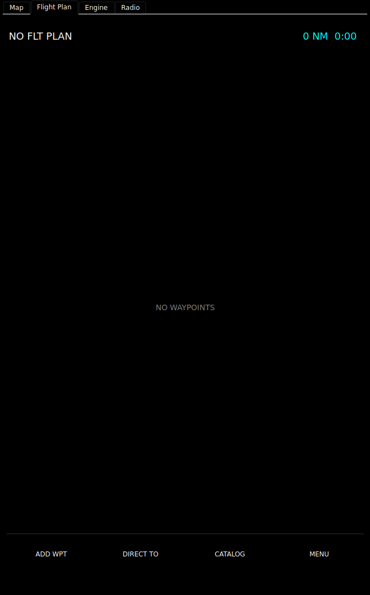
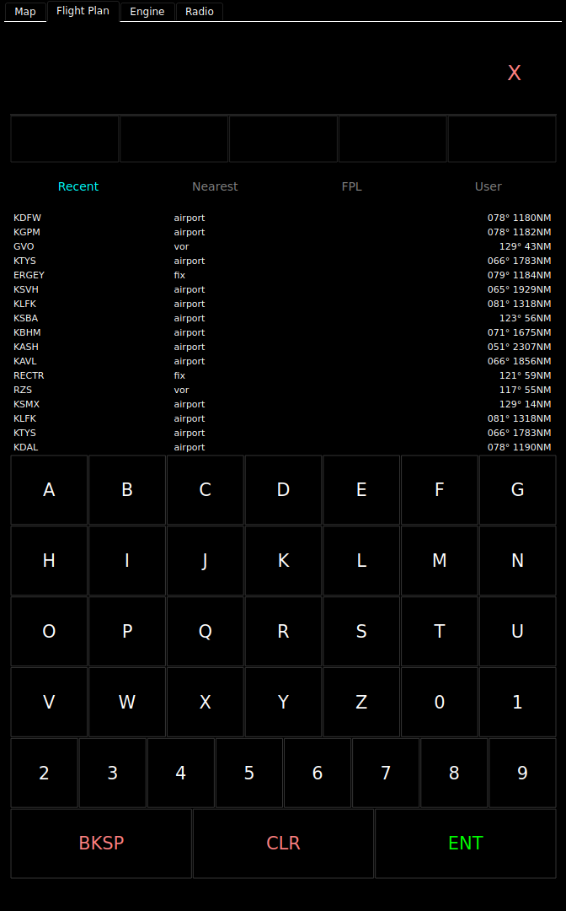
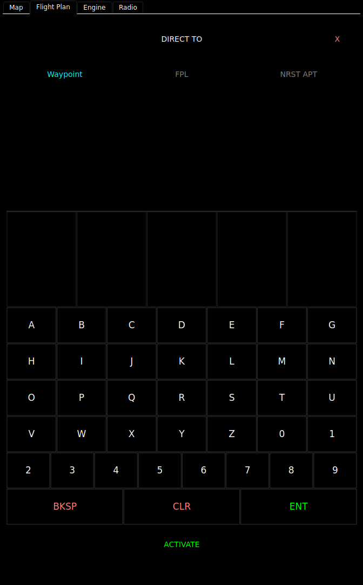
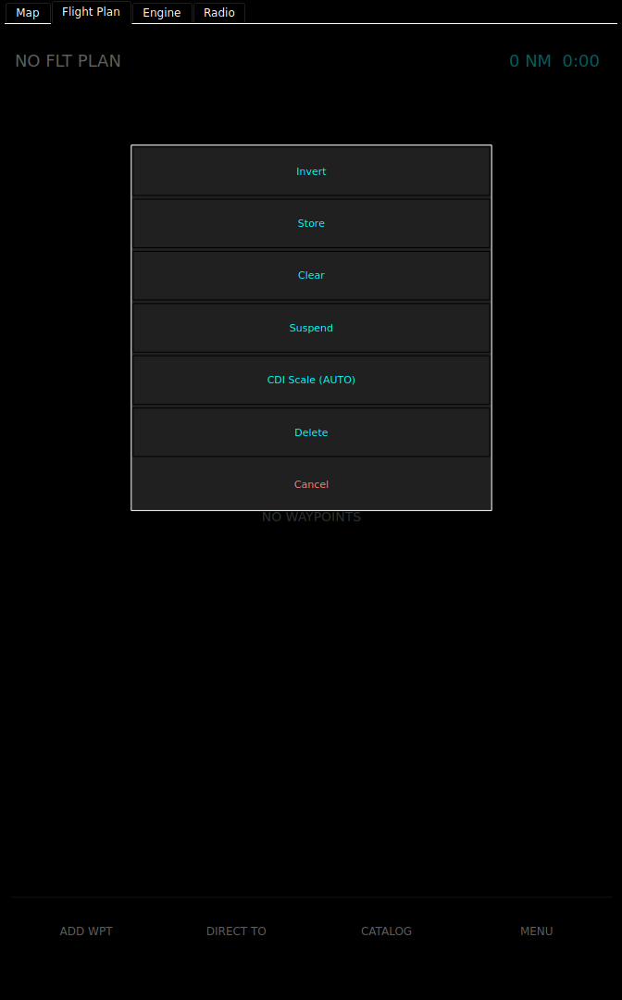
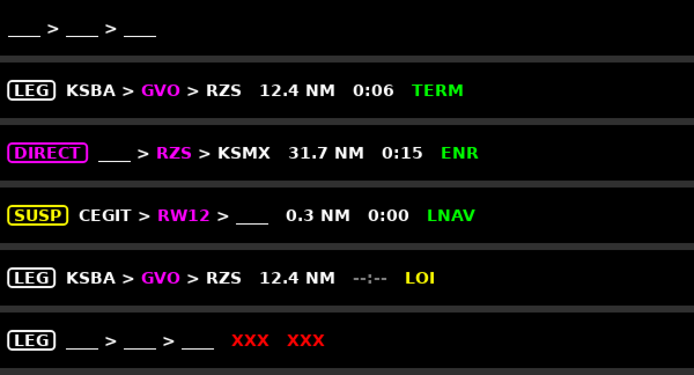

# Flight Plan

The flight plan page is where you build, edit, store and fly a route on the
device. On the bench panel it is the **Flight Plan** tab of the right-hand tab
column. The instrument type is `flight_plan`.

pyEFIS is the screen. fix-gateway's flight-plan engine flies the plan: it
sequences the legs, works out the course and deviation the HSI shows, and
handles Direct-To, holds and suspend. Every edit you make here is sent to the
engine at once. How the engine works is in the fix-gateway wiki:
[Flight Plan Engine](https://github.com/billmallard/fix-gateway/wiki/Flight-Plan-Engine).


## Reading the page

**Header, first line:** the plan's name (or `FIRST-LAST`, or `NO FLT PLAN`),
a state badge in orange, and the remaining distance and time in cyan.

| Badge | Means |
|---|---|
| `LEG` | Flying the plan leg by leg. |
| `DIRECT` | Flying a Direct-To. |
| `SUSP` | Sequencing is suspended: the engine holds the current leg and does not move on. |

**Header, second line**, in green: the approach state, `APR ARM`, `LNAV` or
`MISSED`. A red `LOI` means the GPS has lost integrity.

**The list.** Each row is a waypoint: a symbol for its type, the ident and any
procedure role (`IAF`, `FAF`, `MAP`, `MAHP`), then the columns.

| Column | Shows |
|---|---|
| `DTK` | The magnetic course of the leg into this waypoint. |
| `DIS` | The leg's length, in whole nm. |
| `CUM` | The distance from the start, in whole nm. |
| `ETE` | Time to go, on the active row only. Not shown by default. |

The active leg is magenta, the legs flown are grey, and the legs ahead white.
An airway is one row: its ident in bold, `entry → exit`, and the number of
fixes and the highest minimum en-route altitude. While you fly along it, the
row opens to show the fix you came from, the one you are going to, the next,
and how many more.

The list scrolls by drag, fling or wheel, and follows the active leg unless you
scrolled it in the last 20 seconds.

A strip reading **SUSP AT MAP**, with an orange **Fly the missed** button,
appears when the plan is suspended at the missed approach point. The button
starts the missed approach.

## Building a plan

 

1. Touch **ADD WPT**. The entry page opens.
2. Type the ident on the keypad, or pick it from a tab: **Recent**, **Nearest**,
   **FPL** (waypoints already in the plan) or **User**. As you type, the best
   match is completed in cyan, and the five best suggestions show above the
   tabs. Each row in a tab gives the bearing and distance from the point where
   it would go.
3. Touch **ENT**. The waypoint is added to the end of the plan and sent to the
   engine, and the page goes back to the list. `NO MATCHES` means nothing has
   that ident; `DUPLICATE FOUND` gives you a list to pick from.
4. Repeat. Touch **X** to leave the entry page without adding anything.

There is no separate step to activate a plan: each change is sent as you make
it.

If the engine refuses a change, a red strip above the soft keys reads
`EDIT REFUSED:` and the engine's reason (`FPLMSG`), or `NO ENGINE ANSWER` when
none comes within 2 seconds, and the list goes back to the plan the engine is
flying. **Edit draft** brings the refused route back to correct; the strip then
reads `DRAFT - NOT LOADED:` and its button, **Flown plan**, goes back. The draft
ends when the engine loads a change. This needs an engine that publishes
`FPLLDSEQ`.

**Touch a waypoint row** for its menu:

| Item | What it does |
|---|---|
| Insert Before / Insert After | Open the entry page to add a waypoint there. |
| Load Airway | Pick an airway through this waypoint, then its exit fix. The whole airway is inserted. |
| Activate Leg | Fly the leg to this waypoint now. |
| Direct To | Fly direct to this waypoint. |
| WPT Info | Its details: position, elevation, frequency, bearing and distance from you. |
| Set Role | Mark it `IAF`, `FAF`, `MAP`, `MAHP` or none. |
| Remove | Take it out of the plan. |

Touch an airway row for **Change Exit**, **Change Entry**, **Show Fixes**
(each fix with its course, distance and MEA), **Activate to** its entry, and
**Remove Airway**.

A plan holds up to 100 waypoints. An airway that will not fit is refused with
`ROUTE FULL`.

The page does not load departures, arrivals or approaches yet. A procedure
reaches the engine only as a route written to it from elsewhere; that is how
the approach in the picture at the top was loaded.

## Direct-To



Touch **DIRECT TO**, choose the destination on one of three tabs, and touch
**ACTIVATE**:

- **Waypoint:** type an ident.
- **FPL:** a waypoint in the plan.
- **NRST APT:** the nearest airports, with bearing, distance and longest runway.

While a Direct-To is active the button reads **REMOVE**, in red, and cancels
it. With nothing chosen, `SELECT A WAYPOINT` reminds you.

On a panel with a knob, pushing it on the plain list opens Direct-To with the
active waypoint already chosen, so a second push flies direct to it.

You can also go direct from the map: touch the waypoint there and choose
**DIRECT TO** on its banner. See [Moving Map](Moving-Map#tap-something).

## The menu



| Item | What it does |
|---|---|
| **Invert** | Reverse the plan. |
| **Store** | Save it to the catalog. |
| **Clear** | Empty the plan, after a confirmation. |
| **Suspend** / **Resume** | Stop or restart sequencing. At the missed approach point, Resume reads **Fly the missed**. |
| **CDI Scale** | Step the HSI's full-scale deflection through 0.3, 1.0 and 2.0 nm and back to **AUTO**, which scales by phase of flight. See [The HSI](The-HSI#how-far-off-course-cdi-scaling). |
| **Delete** | Delete the plan, after a confirmation. |

Confirmations put **Yes** in red and **No** in green, and the knob starts on No.

## Stored plans: the catalog

**CATALOG** lists the routes saved on the device, newest first: name, distance
to the first waypoint, number of waypoints and any comment. A lock marks a
route that is managed for you; it cannot be edited or deleted here.

Touch a route for **Activate**, **Invert & Activate**, **Edit** (load it
without flying it), **Copy** and **Delete**. **NEW** starts a new plan, asking first if the current one has unsaved edits;
**DELETE ALL** removes every unlocked route.

Routes live in `<flightplan_dir>/routes/` as JSON files, beside
`user_waypoints.json` and `recent.json`. With no directory set, the catalog
cannot store, and the Recent and User tabs are empty.

## User waypoints

Make your own waypoint from the entry page's **User** tab (**+ CREATE USER
WAYPOINT**), or from the map's **CREATE WPT**, which fills in the position you
touched. You are asked for an ident (blank picks one), a comment, and the
latitude and longitude. The waypoint is saved with the plans and shows on the
map as a filled diamond when it is in the plan. Open it with **WPT Info** to edit or delete it.

## The knob and a keyboard

- **Knob:** turning moves an orange outline through the same targets you can
  touch. In an ident field, turning steps the character through A-Z, 0-9 and
  space, and a push moves to the next character, or accepts on a blank. With an
  outer ring, the ring moves the cursor and a push always accepts. A long push
  (600 ms) goes back.
- **Keyboard** (with **Physical keyboard** on): type the ident, Backspace to
  delete, Enter to accept, Escape to cancel, Up and Down through the
  suggestions, Tab through the tabs.

## The nav status line

A panel can carry a one-line summary of the plan, the `nav_status` instrument.
The bench panel does not have one.



It reads `[BADGE] FROM > TO > NEXT   distance  time  PHASE`:

- The badge is `LEG` (white), `DIRECT` (magenta) or `SUSP` (yellow). With no
  plan there is no badge and the idents show as `____`.
- The waypoint you are flying to is magenta.
- Distance is in nm; time is `H:MM`, or a grey `--:--` when it is unknown.
- The phase is shown as fix-gateway publishes it (`ENR`, `TERM`, `LNAV` and so
  on) in green, and `LOI` in yellow.
- A red `XXX` replaces a failed field; the whole line greys when the plan state
  is stale.

Touching it opens the flight plan page.

## Customizing

### In the configurator

**Flight Plan**

| Option | Default | Bench | What it does |
|---|---|---|---|
| Flight plan directory (`flightplan_dir`) | | `~/makerplane/pyefis/flightplans` | Where routes and user waypoints are kept. |
| Airport db path (`nasr_db_path`) | | the installed pack | For idents, Nearest and NRST APT. |
| Navaid db path (`navaid_db_path`) | | the installed pack | For navaid and fix idents, and airways. |
| Procedures db path (`procedures_db_path`) | | the installed pack | |
| Columns (`columns`) | `DTK,DIS,CUM` | | Any of `DTK`, `DIS`, `CUM`, `ETE`, `ETA`. `ETA` is accepted but left blank today. |
| On-screen keypad (`keypad`) | on | | |
| Physical keyboard (`keyboard`) | off | on | |
| Default page (`default_page`) | `fpl` | | `entry` opens on the entry page. |
| List row height (`row_height_mm`) | 14 mm | | Taller rows are easier to touch; shorter ones show more legs. Needs the screen size set right. |
| Active / future / past leg colour | `#ff00ff` / `#ffffff` / `#808080` | | |
| HMI group (`hmi_group`) | | | The name screen buttons use to open this page. |

On a panel with a knob, give it an `encoder_order` to put it in the knob's
order.

**Nav Status**

| Option | Default | What it does |
|---|---|---|
| Show distance / Show ETE / Show phase | on | |
| Tap screen (`tap_screen`) | | Screen to show before opening the flight plan page; blank stays put. |
| HMI group (`hmi_group`) | | Which flight plan page a tap opens. |
| Active waypoint colour / Text colour | `#ff00ff` / `#ffffff` | |

### In YAML

From the bench panel:

```yaml
- type: flight_plan
  options:
    flightplan_dir: ~/makerplane/pyefis/flightplans
    nasr_db_path: /data/makerplane-data/navdata/current/airports.sqlite
    navaid_db_path: /data/makerplane-data/navaids/current/navaids.sqlite
    procedures_db_path: /data/makerplane-data/procedures/current/procedures.sqlite
    keyboard: true
    encoder_order: 1
```

A screen button can open the page with the action `flightplan page` (`fpl`,
`dto` or `catalog`), or start a Direct-To with `flightplan direct to <ident>`.

### Feeding it

The page needs fix-gateway's flight-plan engine. It writes the whole route
(`FPL1ID`..., `FPLCOUNT`, `FPLNAME`, then `FPLSEQ` last) on every edit, the
Direct-To target (`DTOID`, `DTOLAT`, `DTOLON`, `DTOTYPE`), and commands to
`FPLCMD`: `ACT`, `DTO`, `DTOX`, `SUSP`, `RESUME` and `SCALE`. It reads the
engine's state back (`FPLSTATE`, `FPLACTLEG`, `FPLAPR`, `FPLINTEG`,
`FPLREMDIS`, `FPLREMETE`, `WPETE`, `FPLSUSPMAP`, `FPLLDSEQ`, `FPLMSG`). Without the engine's keys the
page shows the plan read-only, with `FPL: GATEWAY KEYS MISSING` in red. See
[FIX Database Keys](FIX-Database-Keys).

## See also

- [Moving Map](Moving-Map)
- [The HSI](The-HSI#flying-a-flight-plan)
- [Flight Plan Engine](https://github.com/billmallard/fix-gateway/wiki/Flight-Plan-Engine) (fix-gateway wiki)
