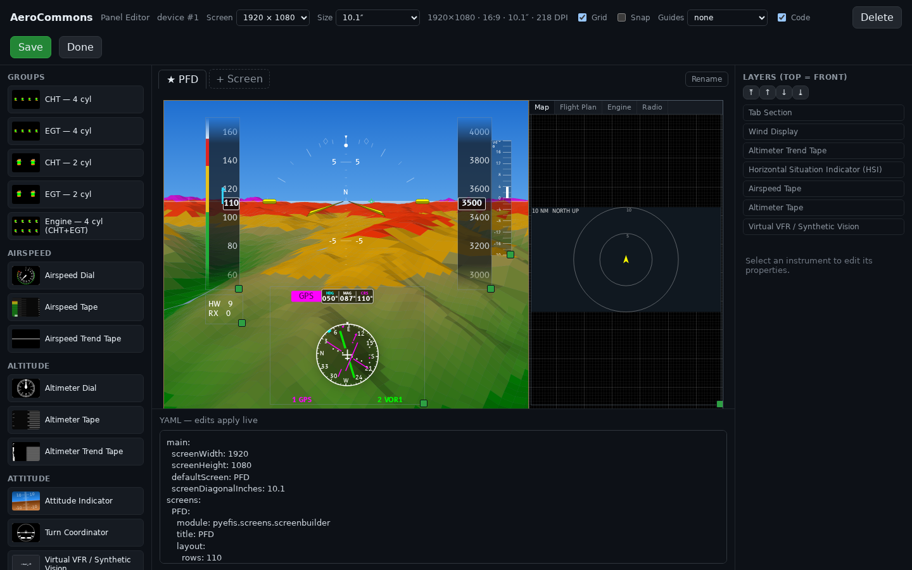

# pyEFIS Manual

pyEFIS is an open-source EFIS for Experimental / Amateur-Built aircraft. It draws
the flight, navigation and engine instruments on a touchscreen, from live data
supplied by FIX-Gateway.

> pyEFIS is experimental software. It is not certified. It is provided as-is
> with no warranty, and any use of it is at your own risk.
>
> Do not use pyEFIS as the sole source of attitude information in instrument
> meteorological conditions. Fly with independent standby attitude, airspeed
> and altitude instruments: ones that share no sensor, computer, software,
> power source or display with pyEFIS.

## The system in three parts

You meet the system in this order:

1. **The configurator**, [pyefis.aerocommons.org](https://pyefis.aerocommons.org).
   You design your panel there (screens, instruments, their options) and enter
   your aircraft's numbers (V-speeds, gauge bands). The device pulls the panel.
2. **The navdata service**, [navdata.aerocommons.org](https://navdata.aerocommons.org).
   It publishes signed data packs: airports, navaids, airways, procedures,
   obstacles, terrain, water, roads. The `pyefis-data` updater on the device
   keeps them current.
3. **The device.** FIX-Gateway collects data from sensors, radios, GPS or a
   simulator, and computes navigation. pyEFIS draws the screens.

[How the System Fits Together](How-the-System-Fits-Together) shows how the
parts connect.

## Start here

| If you want to... | Read |
|---|---|
| Understand how the configurator, the navdata service and the device connect | [How the System Fits Together](How-the-System-Fits-Together) |
| Install the software and bring a device up | [Setting Up a Device](Setting-Up-a-Device) |
| Lay out your panel and enter your aircraft's numbers | [Designing Your Panel](Designing-Your-Panel) |
| Operate the display in the cockpit | [The Panel at a Glance](The-Panel-at-a-Glance), then a page per instrument: [Attitude and Synthetic Vision](Attitude-and-Synthetic-Vision), [Airspeed, Altitude and Vertical Speed](Airspeed-Altitude-and-Vertical-Speed), [The HSI](The-HSI), [Moving Map](Moving-Map), [Flight Plan](Flight-Plan), [Engine Monitoring](Engine-Monitoring) |
| Keep the navigation data current | [Data Status, Updates and Notices](Data-Status-Updates-and-Notices) |
| Edit screens and preferences by hand | [Customizing Beyond the Configurator](Customizing-Beyond-the-Configurator) |
| Look up an instrument and its options | [Widget Reference](Widget-Reference) |
| Look up the data keys pyEFIS reads and writes | [FIX Database Keys](FIX-Database-Keys) |
| Run pyEFIS from a source checkout on a desktop | [Running from Source](Running-from-Source) |
| See the original stock screens, which still ship | [Legacy](Legacy) |

## The other manuals

This wiki is the system manual. Two companion wikis go deeper on their parts:

- **[makerplane-data wiki](https://github.com/billmallard/makerplane-data/wiki)**:
  how the configurator works inside, the aircraft parameter profile, and how
  data packs are built, signed, published and verified.
- **[fix-gateway wiki](https://github.com/billmallard/fix-gateway/wiki)**: the
  FIX database, its configuration, and every plugin (CAN-FIX, GPS, simulators,
  the flight-plan engine).

## Maintaining this manual

The pages live in the pyEFIS repository under `docs/wiki/`, and their images
under `docs/images/`. A merge to `dev` publishes them to this wiki
automatically. Do not edit pages in the GitHub wiki UI: the next publish
overwrites them. Change `docs/wiki/` by pull request instead.
