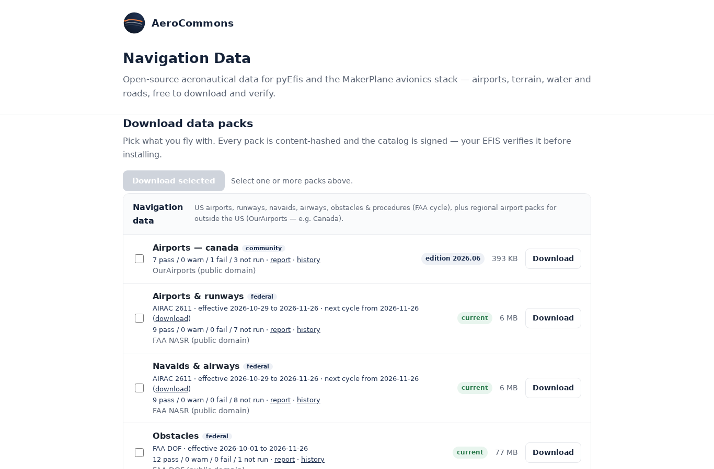

# How the System Fits Together

Three parts make up the system: two websites and the device in the aircraft.
Each connection between them is described below, so you know what the device
needs from each part and what still works when it is offline.

```
  pyefis.aerocommons.org            navdata.aerocommons.org
  (configurator)                    (navdata service)
  panel design, aircraft numbers    signed data packs
          |                                  |
          | pyefis-data config-pull          | pyefis-data update
          | (paired device, at boot)         | (daily timer, or on demand)
          v                                  v
  +--------------------------- the device ----------------------------+
  |  ~/makerplane/pyefis/config   ~/makerplane-data/<kind>/current    |
  |               \                  /                                |
  |                 pyEFIS (screens)  <--- NetFIX, port 3490 ---      |
  |                                                            \      |
  |                                     FIX-Gateway (FIX database)    |
  |                                     sensors, CAN-FIX, GPS, sim    |
  +--------------------------------------------------------------------+
```

## The device: FIX-Gateway and pyEFIS

**FIX-Gateway** holds the FIX database: a set of named values ("FIX keys")
such as `IAS`, `ALT`, `PITCH`, `TACH1` and `COURSE`. Its plugins fill the database from
whatever the aircraft has (CAN-FIX, serial GPS and navigators, engine monitors,
X-Plane or FlightGear on the bench). Some plugins compute values instead:
`compute` derives values and selects the navigation source, and `flightplan`
sequences the active flight plan and produces the course and deviation the
HSI shows. See the
[fix-gateway wiki](https://github.com/billmallard/fix-gateway/wiki/Plugins) for
each plugin.

**pyEFIS** draws the screens. It connects to FIX-Gateway over NetFIX, by
default at `127.0.0.1:3490` (`FixServer` and `FixPort` in
`config/main/default.yaml`). It reads the keys its instruments need, and
writes back the few that the pilot sets from the panel, such as the
altimeter setting (`BARO`) and the heading bug (`HEADBUG`). Every key carries
quality flags, and the instruments show them: a failed key reads `X` or `XXX`
in place of digits. See [Customizing Beyond the Configurator](Customizing-Beyond-the-Configurator#the-data).

A fresh FIX-Gateway install has its `demo` plugin enabled
(`DEMO: true` in its `config/preferences.yaml`), so the instruments come alive
with simulated values before any hardware is connected.

## The configurator: your panel

You design the panel on [pyefis.aerocommons.org](https://pyefis.aerocommons.org)
and pair the device to it once. After that, `pyefis-data config-pull` fetches
the device's latest panel and installs it under `~/makerplane/pyefis/config`.
The shipped screen files are not modified. The pull keeps a backup and rolls
back automatically if pyEFIS fails to start on the new panel.

The pull runs once at boot, and whenever you run it by hand. Nothing pulls a
panel in flight, and a device with no network keeps the panel it has.

The configurator also holds your aircraft's numbers: V-speeds, gauge ranges and
warning bands, fuel tanks. These live in FIX-Gateway, not in the panel, because
every instrument reads them from the FIX database. Today you download them as
`aircraft.ini` and install it in FIX-Gateway by hand; only the altimeter
setting units travel with `config-pull`. See
[Designing Your Panel](Designing-Your-Panel).

## The navdata service: your data

[navdata.aerocommons.org](https://navdata.aerocommons.org) publishes the data
the map, the flight plan, synthetic vision and the HSI draw on. Every pack is
listed in a signed catalog with its SHA-256. The `pyefis-data` updater checks
the catalog's signature before trusting it and each pack's hash before
installing it, then switches it into place atomically. A failed or tampered
download never replaces good data.

Packs install under `~/makerplane-data/<kind>/`. By default the updater tracks
the core navigation kinds (`navdata`, `navaids`, `obstacles`, `cifp`,
`procedures`). Bulk packs such as terrain, water and roads are opt-in by
region, chosen on the device's Data Status screen or in
`~/.makerplane/pyefis/data.yaml`. A daily systemd timer runs the update; a USB
stick can carry packs to a hangar without a network.

pyEFIS reads the updater's status file, `~/.makerplane/pyefis/status.json`, to
show data currency on the Data Status screen and to annunciate out-of-date
data.



See the makerplane-data wiki for
[how packs are built and verified](https://github.com/billmallard/makerplane-data/wiki/Navigation-Data-Currency)
and the [overall architecture](https://github.com/billmallard/makerplane-data/wiki/Architecture).

## What works offline

| Part | Needs a network? |
|---|---|
| Flying: FIX-Gateway and pyEFIS | No. Everything runs on the device. |
| Changing the panel | Only to pull it. The installed panel stays until the next successful pull. |
| Updating data | Network or a USB stick. Installed packs stay in use until replaced. |
