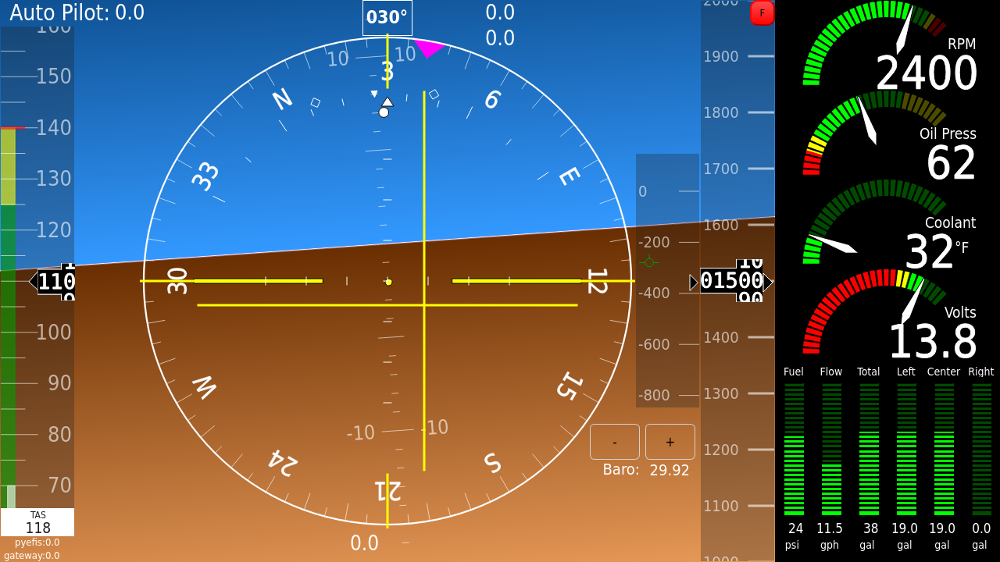
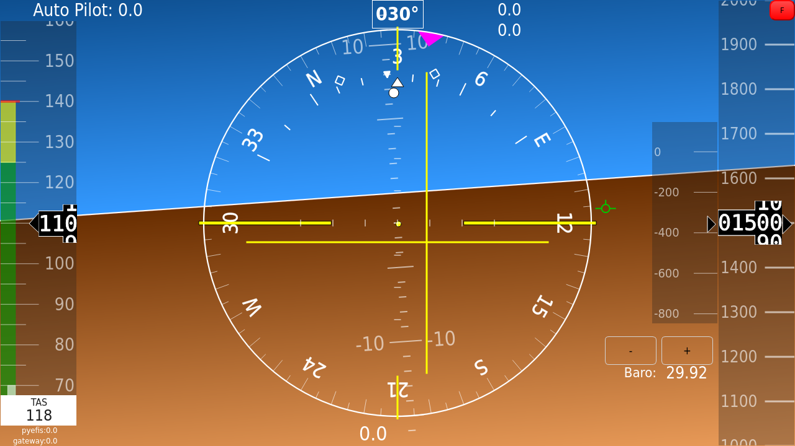
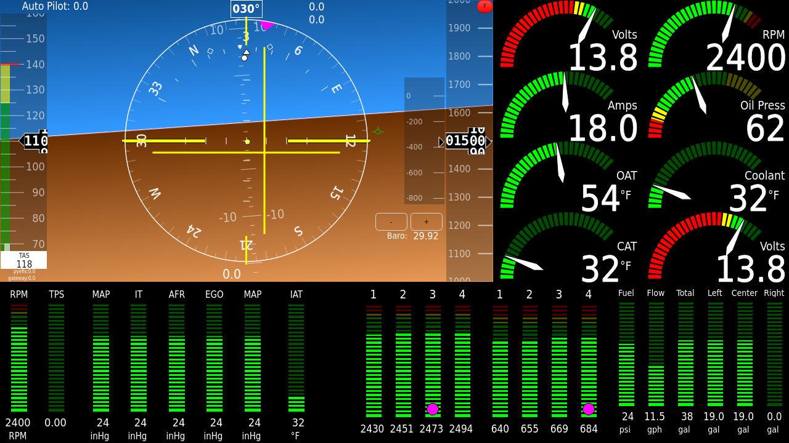
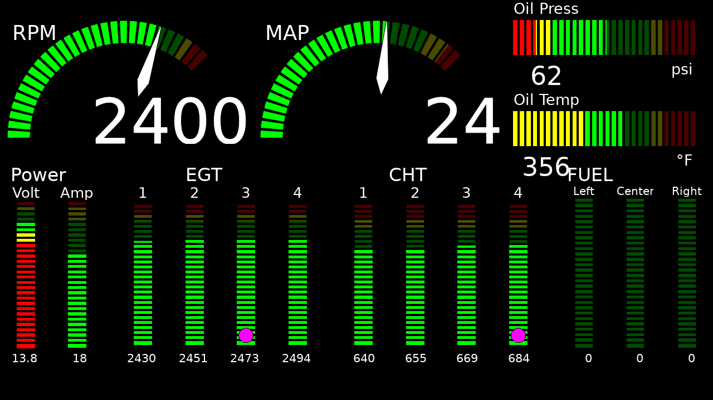
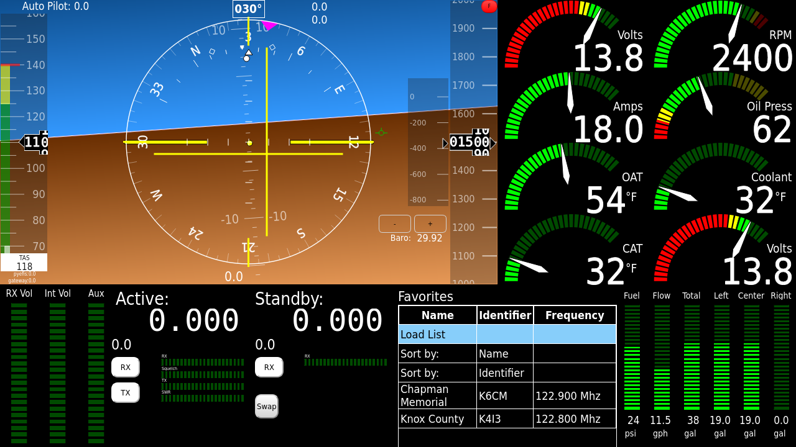

# Legacy: the stock screens

> **This page describes the original system.** These screens still ship and
> still load, but they are no longer the recommended way to set up a panel.
> Design your panel in the configurator instead
> ([Designing Your Panel](Designing-Your-Panel)); the rest of this manual
> describes that system.

Before the configurator, pyEFIS shipped a fixed set of screens, laid out in YAML
and adapted through the preferences. They are what a device shows until a panel
is pulled, and what stays loaded beside a one-screen configurator panel.

The pictures on this page come from the original documentation and show those
screens with sample data.

## Which stock screens load

`screens/default_list.yaml` lists them, in this order:

| Name | File | What it is |
|---|---|---|
| `DataStatus` | `screens/datastatus.yaml` | The navdata status screen; see [Data Status, Updates and Notices](Data-Status-Updates-and-Notices). Loaded, never booted. |
| `PFD` | `screens/pfd.yaml` | The stock primary flight display. The default boot screen (`defaultScreen: PFD` in `main/default.yaml`). |
| `PFD_AI_ONLY` | `screens/pfd_ai_only.yaml` | The attitude bundle across the full width, with no engine or radio column. |
| `RADIO` | `screens/radio.yaml` | Radio tuning. |
| `EMS` | `screens/ems.yaml` | Engine monitoring beside the attitude bundle. |
| `EMS2` | `screens/ems2.yaml` | A full engine page, no attitude. |
| `FLIGHTPLAN` | `screens/flightplan.yaml` | The moving map and nav status line on the left, the flight plan page on the right. |

pyEFIS also adds the About screen to every configuration. `screens/android.yaml`
ships too, but is not in the list; add `SCREEN_ANDROID` to load it. A
configurator panel replaces `PFD` (one screen) or the whole list (several
screens); see
[Customizing Beyond the Configurator](Customizing-Beyond-the-Configurator#what-the-configurator-owns).

## The attitude bundle

Most stock flight screens share one include, `includes/ahrs/virtual_vfr.yaml`:
the `virtual_vfr` attitude display with the HSI over it, airspeed and altitude
tapes, a vertical-speed indicator (`vsi_pfd` or a VS tape, chosen by the
`VSI_BALL` and `VSI_TAPE` flags), `heading_display`, `wind_display`, readouts
for the altimeter setting, pressure and density altitude, OAT, time, autopilot
status and aircraft ID, trim controls and a dimmer. Most parts are switched by
an `enabled:` flag. Synthetic vision is off in this include; with it off, the
attitude display draws the legacy Virtual VFR view (below).

## The screens

### PFD

The attitude bundle, a column of four engine arcs on the right (RPM, oil,
coolant, volts), the side button bar, and a lower-right panel that alternates
every 3 seconds between a fuel bar strip and an MGL V16 radio display. A `DATA`
flag sits at the top left.



### AI-only PFD

The attitude bundle across the full width, keeping only the `DATA` flag. Set
`defaultScreen: PFD_AI_ONLY` to boot it.



### EMS

The attitude bundle, narrower, with two arc columns and the engine strips along
the bottom: EGT and CHT bars, a fuel strip, a power group, and the EGT mode
buttons ([Engine Monitoring](Engine-Monitoring#leaning-egt-modes)).



### EMS2

A full engine page with no attitude: RPM and manifold-pressure arcs, oil bars,
and rows of power, EGT, CHT and fuel bars, with the EGT mode buttons.



### Radio

The attitude bundle and the arc columns, with the combined MGL V16 radio panel
(active and standby frequencies, volumes and a frequency list). A second radio
entry is present but `disabled: true`, as an example.



### Flight Plan

The moving map with the nav status line under it, and the flight plan page on
the right half. See [Moving Map](Moving-Map) and [Flight Plan](Flight-Plan).

### Android

The `weston` instrument showing an Android app under waydroid, with an engine
arc column, the side buttons and the fuel/radio panel. Not loaded by default.
See [System & Containers](Widgets-System#weston).

## Moving between the stock screens

Most stock screens carry a side button bar (`BUTTON_GROUP1`; `BUTTON_GROUP2`
for a horizontal bar). It shows while the `BUTTONS` flag is on, as shipped; with it off, the arc column moves into its place. Each button switches
between the PFD and one other screen: on the EMS screen the EMS button reads
`PFD` and goes back.

| Button file | Goes to | FIX key |
|---|---|---|
| `screen-ems-pfd.yaml` | EMS | `TSBTN{id}12` |
| `screen-ems2-pfd.yaml` | EMS2 | `TSBTN{id}20` |
| `screen-radio-pfd.yaml` | Radio | `TSBTN{id}14` |
| `screen-android-pfd.yaml` | Android | `TSBTN{id}19` |
| `screen-map-pfd.yaml` | the map screen | `TSBTN{id}13` |
| `units.yaml` | toggles units; reads **Show Menu** while the buttons are hidden | `TSBTN{id}15` |

The EMS and EMS2 buttons turn red while a CHT or EGT is annunciating. A second
bar, `screen_changing_PFD-EMS-MAP-RADIO-AP-Units.yaml`, offers PFD, EMS, Map,
Radio, Autopilot and Units instead. With a keyboard, `S`, `A` and `P` step
through the screens.

## Layout variants

Most stock screens ship in two more layouts with the same screen name. Select
one by pointing its `SCREEN_*` include at the file in `preferences.yaml.custom`:

- `*-portrait.yaml`: for tall displays (`pfd-portrait.yaml` and so on).
- `*-left-buttons.yaml`: the button bar and columns on the left.

```yaml
includes:
  SCREEN_PFD: screens/pfd-left-buttons.yaml
```

## The legacy Virtual VFR view

With synthetic vision off, `virtual_vfr` draws its original view: airports and
runways from the FAA's CIFP data, drawn over the plain sky-and-ground attitude.
The data paths (`dbpath`, `indexpath`) come from `screens/virtualvfr_db.yaml`,
included by the stock flight screens, and the CIFP data is a separate download.
This view is deprecated: the configurator's synthetic vision replaces it and
needs no CIFP data. See [Attitude and Synthetic Vision](Attitude-and-Synthetic-Vision).


## The six-pack

pyEFIS no longer ships a six-pack screen. A configuration that still maps
`SCREEN_SIXPACK` to the removed file fails to load with an error. Build one in
the configurator, or from the example on
[Customizing Beyond the Configurator](Customizing-Beyond-the-Configurator#example-a-classic-six-pack-screen).
