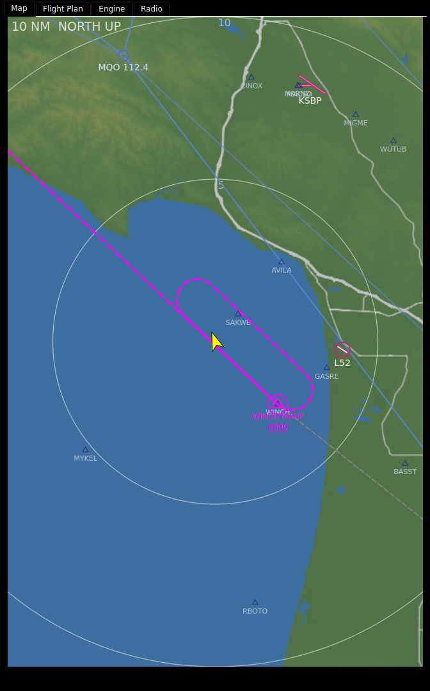
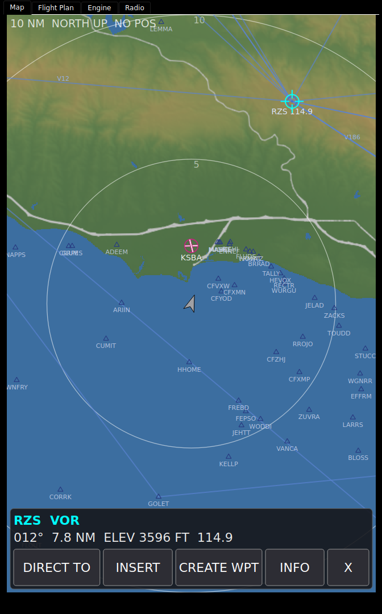

# Moving Map

The moving map shows where you are over terrain, water, roads, airports, navaids
and the flight plan. On the bench panel it fills the **Map** tab of the
right-hand tab column. The instrument type is `moving_map`.


## Reading it

| Element | What it shows |
|---|---|
| **Status chip** (top left) | The range and orientation: `10 NM  NORTH UP` or `10 NM  TRK UP`. `NO POS` is added when the position is stale. |
| **Ownship** | An arrow pointing along your ground track, yellow by default. It turns grey when the position is stale. |
| **Range rings** | Rings at half and full range by default, labelled with their distance in nm. |
| **Terrain** | Shaded relief coloured by elevation, from green at sea level to white at 14,000 ft, lit from the north-west. Water is blue. |
| **Roads** | Grey, wider and bolder for bigger roads. |
| **Rivers** | Thin blue lines. |
| **Airports** | Magenta. A hard-surface airport is a circle with its runways drawn inside at their real orientation. A field with a runway over 8,069 ft shows the runways alone, and a soft field is a plain circle. Zoomed in far enough, runways draw to true size. |
| **Navaids** | A VOR is a hexagon with a centre dot, an NDB a stippled disc. The label is the ident, with the frequency at 40 nm and below. |
| **Waypoints** | Open triangles with idents, at 20 nm and below, when the layer is on. |
| **Airways** | Blue lines, with each airway's ident at 80 nm and below, when the layer is on. |

Towered and untowered airports look the same today; there is no airspace or
obstacle layer on the map.

### The flight plan

| Drawn as | Means |
|---|---|
| Magenta line | The active leg. The waypoint you are flying to is ringed in magenta. |
| White line | Legs ahead. |
| Grey line | Legs already flown. |
| Dashed line | Missed-approach legs. |
| Dotted line | Vector legs. |
| Racetrack | A hold or procedure turn, drawn as its pattern. |
| Magenta line from where you were | An off-route Direct-To. |
| Dashed magenta line past the runway | The extended final course, 5 nm, while the plan is suspended at the missed approach point. |

Waypoint symbols follow their type: hexagon for a VOR, stippled disc for an
NDB, triangle for a fix, circle for an airport, filled diamond for a user
waypoint and filled square for a point made on the map. Labels carry `IAF`,
`FAF`, `MAP` or `MAHP` where the procedure says so, and altitude constraints
are drawn with chart-style bars: a bar above for at-or-below, below for
at-or-above, both for at. Where the airport, navaid or waypoint layer already
shows the place, the plan keeps that layer's symbol and ident and adds only
the ring and the role.



### What hides as you zoom out

| Item | Shown at or below |
|---|---|
| Waypoints | 20 nm |
| Airport idents, navaid frequencies | 40 nm |
| Airport symbols, airway labels, flight-plan labels and constraints | 80 nm |
| Navaids, airways, flight-plan symbols | 160 nm |
| Roads | 5 nm for secondary roads up to 80 nm for motorways |

Where airports crowd together, the two with the longest runways in each patch
of the map are kept.

### ND mode: EXPANDED MAP

With `nd_mode: expanded` the map is drawn as a navigation display. It is
always track up, whatever `orientation` says, and ownship sits 82% of the way
down, whatever `ownship_position` says. The selected range reaches the compass
arc instead of the top edge.


| Element | What it shows |
|---|---|
| **Compass arc** | At the selected range, ticks every 5°, a numeral every 30° in tens (`6` is 060). |
| **TRK box** | `TRK`, the magnetic track and `MAG` over the top of the arc, with a pointer under it. Grey when `TRACKM` is stale. |
| **Top left** | `GS` and `TAS`, then the wind as direction°/speed with an arrow pointing the way it blows. |
| **Top right** | The active waypoint in magenta, its ETA in UTC (`HHMM.Mz`, now plus `WPETE`) and its distance in NM. Only while a plan is active (`FPLSTATE` not 0); ETA and distance are left out in the `VECTORS` phase. |
| **Bottom left** | The map layers that are on, in cyan: `ARPT` (airports), `WPT` (waypoints), `STA` (navaids). |
| **Vertical deviation scale** | Right edge, from `GSI`, with a magenta diamond pointer. Hidden when `GSV` is published and below 0.5 (no glidepath). A red `GS` flag shows when `GSV` says a glidepath is present and `GSI` is bad or failed. |

A failed value in a data block reads red `XXX`; an old or bad one is grey. A
key fix-gateway does not define is left out.

## Using it

- **Zoom:** pinch, or the mouse wheel on a desktop. Zoom is continuous between
  the smallest and largest range on the **range ladder**. Buttons or a knob
  bound to the map step through the ladder's ranges instead.
- **Pan and rotate:** drag to pan; twist two fingers to rotate. Shift- or
  Ctrl-drag rotates with a mouse.
- **Back to your position:** double-tap, or tap the amber **CTR** chip in the
  top right. The map re-centres by itself 30 seconds after the last gesture.
- **Orientation** is track up or north up. It is set in the configurator, or
  switched by a key bound to the map.

### Tap something

Tap a symbol and the map puts a pointer on it and opens a banner along the
bottom: the ident and type, then the bearing and distance from you, the
terrain elevation and any frequency. Tap where several symbols overlap and you
get a list to choose from; tap open ground and you get a **MAP POINT** at that
position.



| Key | What it does |
|---|---|
| **DIRECT TO** | Fly direct to it. A toast says `DIRECT TO <ident>`, or `REJECTED:` and the reason. |
| **INSERT** | Insert it into the flight plan, in the nearest leg. |
| **CREATE WPT** | Make a user waypoint here, on the Flight Plan tab. |
| **INFO** | Open its details on the Flight Plan tab. |
| **X** | Close the banner. |

**DIRECT TO** and **INSERT** need fix-gateway's flight-plan engine; without it
they are greyed. **CREATE WPT** and **INFO** bring the Flight Plan tab forward.
See [Flight Plan](Flight-Plan).

## When data is missing

- **`NO POS`** and a grey ownship: `LAT` or `LONG` is stale. The map stays at
  the last position it had.
- **A layer is empty:** its navdata pack is not installed, or its path is not
  set. The map does not say which; check
  [Data Status](Data-Status-Updates-and-Notices).

## Customizing

### In the configurator

Select the map in the Panel Editor; its options are in **Properties**. The most
used, with defaults and the bench panel's value where it differs:

| Option | Default | Bench | What it does |
|---|---|---|---|
| Range (`range_nm`) | 10 nm | | Distance from the ownship to the top edge at start; to the compass arc in ND mode. |
| Range ladder (`range_ladder`) | `2,5,10,20,40,80,160` | `2,10,50,200,500,2000` | The ranges the buttons step through; also the zoom limits. |
| Range control key (`range_key`) | | | A FIX key that steps the range. |
| Zoom rail (`zoom_rail`) | off | | A one-finger zoom strip down one edge. |
| Orientation (`orientation`) | `track_up` | `north_up` | |
| Orientation control key (`orientation_key`) | | | A FIX key: 0 track up, 1 north up. |
| ND mode (`nd_mode`) | `off` | | `expanded` draws the [ND EXPANDED MAP](#nd-mode-expanded-map). |
| ND mode control key (`nd_mode_key`) | | | A FIX key: 0 off, 1 expanded. |
| Touch gestures (`touch_gestures`) | on | | Off ignores every touch and the wheel. |
| Gesture auto-revert (`gesture_timeout`) | 30 s | | 0 stays where you leave it. |
| Ownship position (`ownship_position`) | 50 | | Percent up from the bottom; 30 shows more ahead. |
| Map style (`map_style`) | `standard` | | `nav_only` drops the relief for a black background. |
| Terrain mode (`terrain_mode`) | `relief` | | `caution` colours terrain amber within 1,000 ft below you and red within 100 ft or above. |
| Layer: terrain / roads / rivers / airports / navaids / flight plan / range rings | on | | |
| Layer: waypoints (`layer_fixes`) | off | on | |
| Layer: airways (`layer_airways`) | off | on | |
| Range ring fractions (`range_ring_fractions`) | `0.5,1` | | |
| Terrain tile path, Airport db path, Navaid db path, Roads db path, Water db path | | the installed packs | Where each navdata pack is installed. |

Ring colour, width and label position, road and river colours, the water
rendering options and the gesture thresholds are in the same Properties list.

### In YAML

Trimmed from the bench panel:

```yaml
- type: moving_map
  options:
    orientation: north_up
    range_ladder: 2,10,50,200,500,2000
    layer_airways: true
    layer_fixes: true
    terrain_mode: relief
    tile_path: /data/makerplane-data/terrain/tiles
    nasr_db_path: /data/makerplane-data/navdata/current/airports.sqlite
    navaid_db_path: /data/makerplane-data/navaids/current/navaids.sqlite
    water_db_path: /data/makerplane-data/water/current/water.sqlite
    highway_db_path: /data/makerplane-data/highways/current/highways.sqlite
```

### Feeding it

The map reads `LAT`, `LONG`, `TRACKM`, `ALT` and `MAGVAR`, and the flight-plan
keys fix-gateway's flight-plan engine publishes. ND mode also reads `GS`, `TAS`,
`WINDDIR`, `WINDSPD`, `WPDIS`, `WPETE`, `GSI` and `GSV`. It writes `DTOID`, `DTOLAT`,
`DTOLON`, `DTOTYPE` and `FPLCMD` for a Direct-To, the route block for an
insert, and the range index to `range_key` when one is set. See
[FIX Database Keys](FIX-Database-Keys).

## See also

- [Flight Plan](Flight-Plan)
- [The HSI](The-HSI)
- [Flight Plan Engine](https://github.com/billmallard/fix-gateway/wiki/Flight-Plan-Engine) (fix-gateway wiki)
