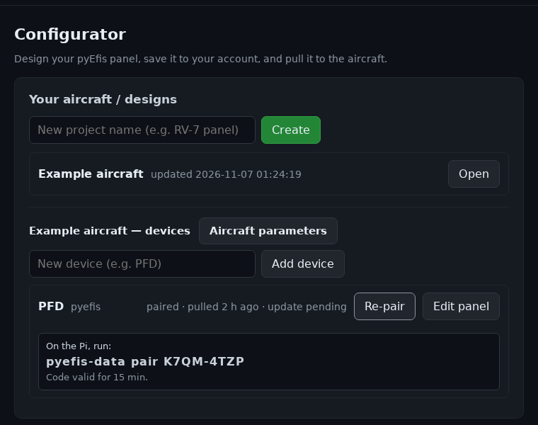

# Setting Up a Device

This page takes a Linux box with a touchscreen from a fresh install to a panel
designed on the configurator, with current navigation data. The steps run in
order. Hardware details (display backends, GPU access, boot services) are on
[Headless Linux Appliance](Headless-Linux-Appliance).

| Step | What it gives you |
|---|---|
| [1. Install the software](#1-install-the-software) | FIX-Gateway, pyEFIS and the `pyefis-data` updater |
| [2. Accept the software notice](#2-accept-the-software-notice) | Permission for the updater to install anything |
| [3. First start](#3-first-start) | Instruments drawing demo data |
| [4. Pair with the configurator](#4-pair-with-the-configurator) | The device knows its panel |
| [5. Pull your panel](#5-pull-your-panel) | Your panel on the glass |
| [6. Install navigation data](#6-install-navigation-data) | Map, flight plan, synthetic vision and HSI data |
| [7. Boot to the EFIS](#7-boot-to-the-efis) | Power on straight to the panel |

## 1. Install the software

Three packages, from three repositories. The commands below put FIX-Gateway
and pyEFIS in one virtual environment and the updater in its own, which is the
layout pyEFIS looks for.

```bash
mkdir -p ~/src && cd ~/src
git clone -b dev https://github.com/billmallard/fix-gateway.git
git clone -b dev https://github.com/billmallard/pyEfis.git
git clone -b dev https://github.com/billmallard/makerplane-data.git

python3 -m venv ~/pyefis-venv
~/pyefis-venv/bin/pip install --upgrade pip setuptools wheel
~/pyefis-venv/bin/pip install -e ~/src/fix-gateway
~/pyefis-venv/bin/pip install -e "$HOME/src/pyEfis[qt,svs]"

python3 -m venv ~/pyefis-data-venv
~/pyefis-data-venv/bin/pip install -e ~/src/makerplane-data
mkdir -p ~/.local/bin
ln -sf ~/pyefis-data-venv/bin/pyefis-data ~/.local/bin/pyefis-data
```

- The `[qt]` extra installs PyQt6 6.8.0. The `[svs]` extra (numpy, PyOpenGL)
  is needed for synthetic vision; without it the attitude indicator shows SVS
  as unavailable.
- System packages, the Ubuntu 24.04 notes and the Raspberry Pi differences are
  on [Headless Linux Appliance](Headless-Linux-Appliance#what-installs-cleanly-dont-over-prepare).
- Log in again if `pyefis-data` is not found: `~/.local/bin` is only on `PATH`
  once it exists when the login shell starts.

## 2. Accept the software notice

Installation is not finished until the notice is accepted at a terminal:

```bash
~/pyefis-venv/bin/pyefis-accept-notice
```

It shows the notice and asks you to type `accept`. Anything else exits with
code 3 and records nothing. The accept is recorded by the updater, so install
it first (step 1). Accept again after every pyEFIS update: a new version needs
a new accept. `pyefis-data update` asks for its own accept the first time, and
after an updater upgrade. Details:
[Headless Linux Appliance](Headless-Linux-Appliance#accept-the-software-notice-install-and-every-update).

## 3. First start

Start FIX-Gateway, then pyEFIS:

```bash
~/pyefis-venv/bin/fixgw &
~/pyefis-venv/bin/pyefis
```

On first run each program copies its default configuration to your home
directory: `~/makerplane/fixgw/config` and `~/makerplane/pyefis/config`. Your
changes go there; the copies in the source tree are never edited.

pyEFIS connects to FIX-Gateway at `127.0.0.1:3490` (`FixServer` and `FixPort`
in `~/makerplane/pyefis/config/main/default.yaml`). A fresh FIX-Gateway runs its
`demo` plugin, so the instruments draw simulated values straight away. Turn
`DEMO` off and your real sources on under `enabled:` in
`~/makerplane/fixgw/config/preferences.yaml.custom`; the
[fix-gateway wiki](https://github.com/billmallard/fix-gateway/wiki/Plugins)
covers each source.

Until you pull a panel, pyEFIS shows its stock screens. They are described on
[Legacy](Legacy).

## 4. Pair with the configurator

Pairing tells the configurator which device is which. You do it once per
device.

1. Sign in at [pyefis.aerocommons.org](https://pyefis.aerocommons.org) with
   Google or an emailed link.
2. Under **Your aircraft / designs**, create a project for the aircraft and
   **Open** it.
3. Add a device (for example `PFD`) and press **Pair**. The page shows a claim
   code, valid for 15 minutes.
4. On the device:

   ```bash
   pyefis-data pair <claim-code>
   ```



The device stores its device token, device id and configurator address in
`~/.makerplane/pyefis/data.yaml`. The server keeps only a hash of the token.
**Re-pair** on the dashboard issues a new code for the same device, for example
after reinstalling it.

## 5. Pull your panel

Design the panel first ([Designing Your Panel](Designing-Your-Panel)), press
**Save** in the editor, then on the device:

```bash
pyefis-data config-pull
```

It fetches the device's latest saved panel, installs it and restarts pyEFIS.
What it prints:

| Message | Meaning |
|---|---|
| `panel config up to date (vN)` | Nothing changed since the last pull. |
| `no panel config published for this device yet` | Save a design for this device in the editor first. |
| `not paired -- run pyefis-data pair <code> first` | Step 4 has not been done on this device. |
| `config pull failed: ...` | The network or the server failed. The current panel stays. |

What it changes, all under `~/makerplane/pyefis/config`:

- A one-screen panel becomes `screens/managed.yaml`, installed in place of the
  device's default screen. The other stock screens stay loaded.
- A panel with several screens becomes `screens/managed_<name>.yaml` for each
  screen, plus `screens/managed_list.yaml`, which replaces the stock screen
  list. A **SCREEN >** button is added to each screen so a touch-only panel can
  move between them.
- The aircraft's altimeter setting units, if set in the configurator, are
  merged into `preferences.yaml.custom`. A unit you set by hand is never
  removed.

The shipped configuration files are never modified. Before installing, the
current panel is saved to `.panel_backup/`. If pyEFIS does not come back up on
the new panel, the pull restores the last working one.

On the dashboard each device shows its state: `unpaired`, `paired`, when it
last pulled, and `update pending` when a saved design has not reached it yet.

## 6. Install navigation data

```bash
pyefis-data status      # what is installed, and how current it is
pyefis-data update      # download, verify and install what is out of date
```

By default the updater tracks the core navigation kinds: `navdata`,
`navaids`, `obstacles`, `cifp` and `procedures`. Terrain, water and roads are
large regional packs and are opt-in. Choose them on the device's
**Data Status** screen (**Update**), which lists the catalog and the storage
drive, or list them under `packs:` in `~/.makerplane/pyefis/data.yaml`. Every
pack is checked against the signed catalog before it replaces what is
installed. Packs live under `~/makerplane-data/<kind>/`.

To keep data current without a terminal, install the updater's systemd user
units. They ship in `makerplane-data/pyefis_data/systemd/`:

| Unit | What it does |
|---|---|
| `pyefis-data.timer` | Runs `pyefis-data.service` once a day (midnight plus a random delay of up to an hour), and catches up on a run missed while the device was off. |
| `pyefis-data.service` | Runs `pyefis-data update`, then writes `~/.makerplane/pyefis/status.json` for the Data Status screen. |
| `pyefis-config-pull.service` | Runs `pyefis-data config-pull --wait-online 60` once at boot. |

```bash
mkdir -p ~/.config/systemd/user
cp ~/src/makerplane-data/pyefis_data/systemd/pyefis-data.service \
   ~/src/makerplane-data/pyefis_data/systemd/pyefis-data.timer \
   ~/src/makerplane-data/pyefis_data/systemd/pyefis-config-pull.service \
   ~/.config/systemd/user/
systemctl --user daemon-reload
systemctl --user enable --now pyefis-data.timer
systemctl --user enable pyefis-config-pull.service
sudo loginctl enable-linger $USER    # user units run without a login session
```

At boot, the config pull waits up to 60 seconds for the network. An aircraft
parked with no network keeps its current panel, and the unit still exits
cleanly. There is no periodic panel pull, so a panel never changes in flight.

A hangar without a network can import packs from a USB stick. See
[Navigation Data Currency](https://github.com/billmallard/makerplane-data/wiki/Navigation-Data-Currency)
in the makerplane-data wiki.

The Data Status screen runs the updater from `~/.local/bin/pyefis-data` (its
`update_command` option), which is why step 1 links it there. If nothing is at
that path, the screen reports `Updater unavailable on this device.`

## 7. Boot to the EFIS

For a device that powers on straight to the panel, run FIX-Gateway and pyEFIS
as services. The unit files, the display backend (X with `xcb`, or `eglfs`) and
GPU permissions are on
[Headless Linux Appliance](Headless-Linux-Appliance#boot-to-efis-systemd-services).

pyEFIS boots to the screen named by `defaultScreen` in
`~/makerplane/pyefis/config/main/default.yaml` (`PFD` as shipped). A pulled
panel takes that name, so the device boots to your panel. The Data Status
screen stays loaded; its annunciation opens it.

## Check it works

- [ ] `ss -ltn | grep :3490` shows FIX-Gateway listening.
- [ ] `~/pyefis-venv/bin/pyefis-accept-notice --check` exits 0.
- [ ] `pyefis-data config-pull` prints `panel config up to date`.
- [ ] `pyefis-data status` shows your packs as current.
- [ ] After a cold boot the panel comes up on its own, drawing live data.
