# The HSI

The horizontal situation indicator (HSI) shows heading, the selected course and
how far you are off it, for whichever nav source you have selected: the GPS
flight plan or a NAV radio. On the bench panel it sits bottom centre, under the
synthetic vision. The instrument type is `horizontal_situation_indicator`.


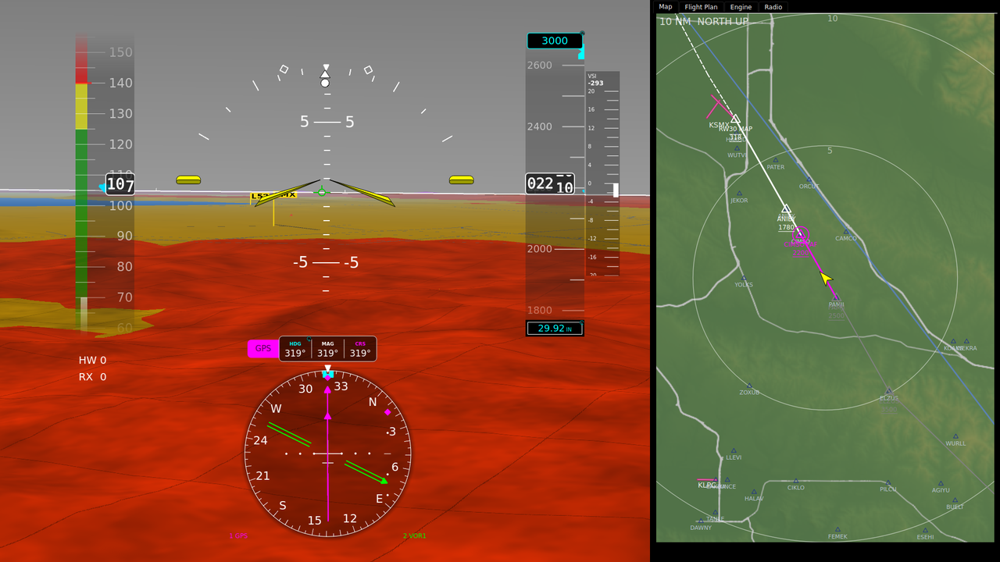

The `bench_` pictures on this page come from the simulator bench, flying the
KSMX RNAV (GPS) RWY 30 with its missed approach and hold on pyEFIS's own flight
plan. The rest are the bench panel's HSI rendered from pyEFIS against a running
fix-gateway, for scenes that flight did not fly. The
[README](../images/hsi/README.md) beside them says how each was made. In the
bench pictures, the diamond right of the rose is a glidepath from the
simulator's own GPS, which should not show while pyEFIS's flight plan is the
source ([fix-gateway#137](https://github.com/billmallard/fix-gateway/issues/137)).

## Reading it

| Element | What it shows |
|---|---|
| **Source tab** (left of the readouts) | The selected nav source: `GPS` (magenta) or `VLOC1` / `VLOC2` (green). Tap it to change source. |
| **HDG** (cyan) | The selected heading, the heading bug's value (`HEADBUG`). |
| **MAG** (white) | Your magnetic heading (`HEAD`). |
| **CRS** (source colour) | The selected course of the selected source (`COURSE`). |
| **Rose** | A compass card that turns so your heading is under the lubber mark at the top. The numerals stay upright as it turns. |
| **Aircraft symbol** | Fixed at the centre of the rose. |
| **Course pointer** | The arrow through the centre, pointing at the selected course. Magenta for GPS, green for a NAV radio. |
| **Deviation bar** | The middle section of the course pointer. It moves sideways to show where the course is: a bar left of centre means the course is to your left. |
| **Deviation dots** | Three white dots each side. The outer dot is full-scale deflection. |
| **TO / FROM triangle** | On the course pointer: pointing towards its head for TO, towards its tail for FROM. Hidden when the source gives neither, for example on a localizer. |
| **Heading bug** (cyan) | On the rim, at the selected heading. |
| **Track diamond** (magenta) | On the rim, at your GPS ground track. Shown at or above `track_min_speed` (20 kt on the bench panel, 5 kt by default). |
| **Bearing pointers** | Pointer 1 is a single bar, pointer 2 a double bar. Each points at a station or waypoint: magenta for GPS, green for a VOR. |
| **Bearing labels** (bottom corners) | `1 GPS`, `2 VOR1` and so on, coloured like the pointer. Tap one to change that pointer's source. |
| **Glideslope scale** (right of centre) | Shown only when the source has vertical guidance. The diamond is your glidepath. |

## Nav sources

Tap the source tab to cycle **GPS, then VLOC1, then VLOC2**, and back to GPS.
The tap writes `NAVSRC` (`0` NAV1, `1` NAV2, `2` GPS). fix-gateway's
`compute` plugin then routes that source's course, deviation, TO/FROM and
glideslope into the keys the HSI draws (`COURSE`, `CDI`, `TOFROM`, `GSI`,
`GSV`, `CDIV`).

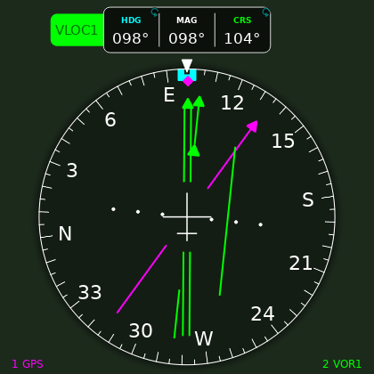

- **GPS** is the flight plan. Which navigator supplies it is set by `GPSSRC`:
  `0` is pyEFIS's own flight plan, flown by fix-gateway's flight-plan engine,
  and `1` is an external navigator such as a GNX 375 or X-Plane's GPS. The HSI
  draws either the same way. See
  [Internal plan or external navigator](https://github.com/billmallard/fix-gateway/wiki/Flight-Plan-Engine#internal-plan-or-external-navigator).
- **VLOC1 / VLOC2** are the NAV radios. The tab reads `VOR1` or `LOC1` instead
  only where a source publishes a `NAVTYPE` key. fix-gateway does not define
  one today, so expect `VLOC1` and `VLOC2`.
- **Colour follows the source** (`source_auto_color`, on by default): the
  course pointer, deviation bar, CRS readout and glideslope diamond are
  magenta for GPS and green for a NAV radio.
- With a NAV radio selected, the course is yours to set (below). On GPS it is
  the desired track of the active leg, and CRS cannot be edited.

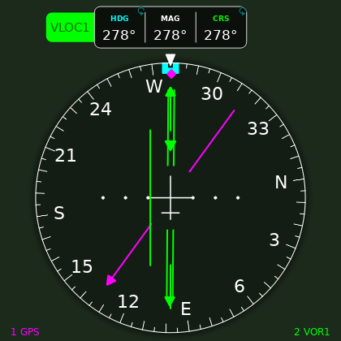

## How far off course: CDI scaling

The deviation bar always reads the same way: the outer dot is full scale. What
full scale means in miles depends on the source.

- **A NAV radio** gives the deviation the receiver measures.
- **GPS from pyEFIS's own flight plan** scales with the phase of flight,
  following RTCA DO-229:

  | Phase | When | Full scale |
  |---|---|---|
  | `ENR` | en route | 2.0 nm |
  | `TERM` | within 30 nm of the departure or destination airport, or with an approach armed | 1.0 nm |
  | `LNAV` | from 2 nm before the final approach fix, tightening over those 2 nm | 1.0 to 0.3 nm |
  | `LNAV` | from the final approach fix to the missed approach point | 0.3 nm |

  The `nav_status` annunciator shows the phase, on panels that have one. To
  hold a tighter scale, use **CDI Scale** in the flight-plan page menu: each
  press steps to the next of 0.3, 1.0, 2.0 and AUTO. A manual scale can only
  tighten the automatic one, never widen it. The rules in full, including loss of integrity, are on
  [Flight Plan Engine: Flight phase and CDI scale](https://github.com/billmallard/fix-gateway/wiki/Flight-Plan-Engine#flight-phase-and-cdi-scale).
- **GPS from an external navigator** gives whatever deviation that navigator
  computes.

The internal flight plan gives lateral guidance only, so on GPS a glideslope
scale appears only when an external navigator publishes a glidepath.

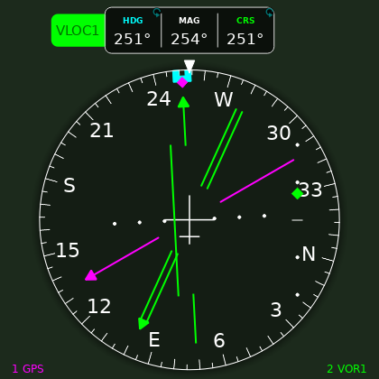

## Flying a flight plan

With GPS selected and a plan active, the course pointer is the desired track
of the active leg, and it moves to the next leg as the engine sequences. What
you see on the HSI:

**On a leg.** The course pointer is the leg's course and the triangle shows TO
the waypoint. Bearing pointer 1, when it is set to GPS, points at that waypoint.
Near the leg it lies close to the course pointer.

**Fly-by turns.** The engine starts the turn early, so you roll out on the next
leg instead of overshooting it. The turn starts about `R tan(Δ/2)` before the
waypoint, where Δ is the course change and R is a 15 degree bank turn at your
groundspeed. At 120 kt and a 61 degree turn that is about half a mile. From that
point:

1. The course pointer swings towards the next leg's course, and the deviation
   bar measures from the curved path joining the two legs.
2. Bearing pointer 1 still points at the waypoint you are turning abeam, so it
   swings out to the side.
3. Halfway round, at the turn's bisector, the engine sequences to the next
   waypoint, and bearing pointer 1 jumps to it.
4. You roll out on the next leg with the bar centred.

| Before the turn | In the turn | Sequenced | On the next leg |
|---|---|---|---|
| 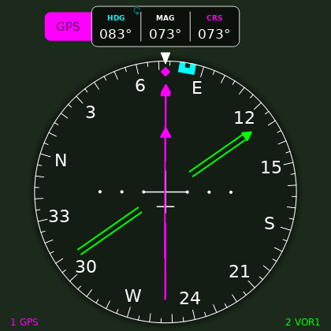 | 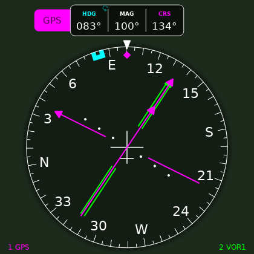 | 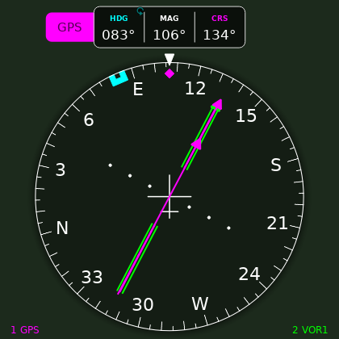 | 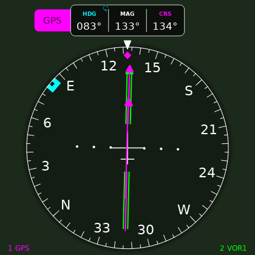 |

A waypoint flagged fly-over, or a course change of more than 120 degrees, is not
anticipated. There, the engine sequences abeam the waypoint and the pointer
swings then.

**Holds.** On a published hold the phase reads `HOLD` and the course pointer
follows the racetrack: the outbound course on the outbound leg, then round the
turn to the inbound course. Entries are flown as AIM 5-3-8 describes:
teardrop, parallel or direct, chosen by your track arriving at the fix.

| Past the fix | Entry turn | Outbound | Turning inbound |
|---|---|---|---|
| 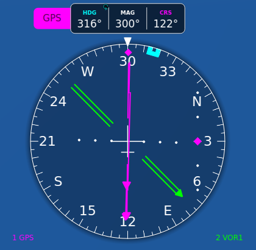 | 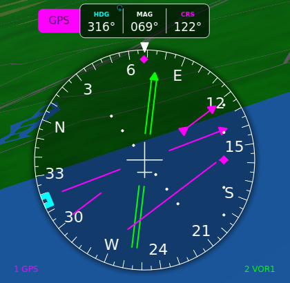 | 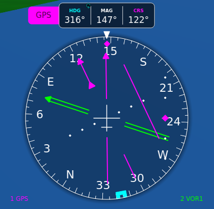 | 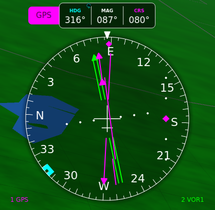 |

**Suspend.** **SUSP** on the flight-plan page stops sequencing. The HSI keeps
guiding to the current waypoint, and the triangle turns to FROM once you pass
it. **RESUME** picks up the plan again. A suspend in a fly-by turn takes the
course back to the leg you were on. At the missed approach point the engine
suspends on its own, and RESUME flies the missed approach.

| Suspended at the missed approach point | After RESUME |
|---|---|
| 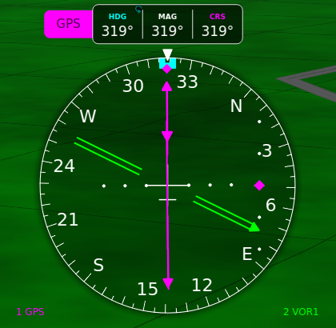 | 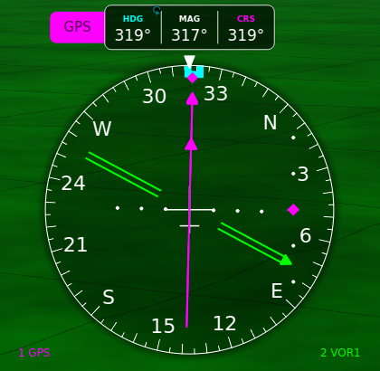 |

For every leg type, sequencing rule and Direct-To behaviour, see
[Flight Plan Engine](https://github.com/billmallard/fix-gateway/wiki/Flight-Plan-Engine).
Building and editing a plan is under
[`flight_plan`](Widgets-Text-and-Interactive#flight_plan).

## Setting heading and course

Touch **HDG** or **CRS**, then turn the knob. The inner knob steps 1 degree and
the outer ring 10 degrees.

- **HDG** sets the heading bug. Push syncs it to your current heading.
- **CRS** sets the course on the selected NAV radio (`NAV1CRS` or `NAV2CRS`).
  Push sets it to the bearing to the station, which centres the bar with a TO
  indication. On GPS, CRS cannot be selected.
- Every step takes effect as you turn. Leaving the knob alone ends the edit and
  keeps the value.

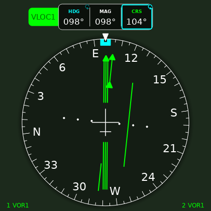

The knob, the ring and the timeout work the same on every value you can set:
see [Touch a value, then turn the knob](Pilots-Guide#touch-a-value-then-turn-the-knob)
and [Heading bug and course on the HSI](Pilots-Guide#heading-bug-and-course-on-the-hsi).
On the X-Plane bench, X-Plane also drives `HEADBUG`, `NAV1CRS` and `NAV2CRS`,
so it can overwrite a value you set here.

## When data is missing

The HSI never shows a needle it cannot trust.

| Flag (red) | Shown when | What else changes |
|---|---|---|
| `HDG` | the heading is failed or bad | The bearing pointers are hidden. |
| `NAV` | the selected source's deviation is failed or bad, or the radio is receiving no lateral signal (`CDIV` 0) | With a bad deviation or no signal, the deviation bar and TO/FROM triangle go. |
| `GS` | the source has a glidepath but its deviation is failed or bad | The diamond goes. |

- The rose numerals are hidden while the heading or course is bad, or the
  deviation or glidepath has failed.
- A deviation that is only **old** (not refreshed in time) hides the bar
  without a flag.
- Treat a `NAV` flag as no guidance, whatever the course pointer shows.
- A bearing pointer whose source is invalid is hidden, and its label turns
  orange with an `X`: `2 VOR1 X`.
- The track diamond hides when the track is invalid or you are below the
  speed gate.

| Localizer tuned, no signal | No valid data at all (bench, simulator not running) |
|---|---|
| 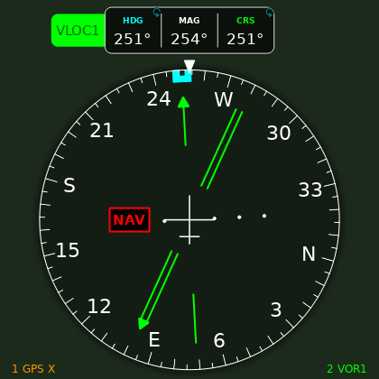 | 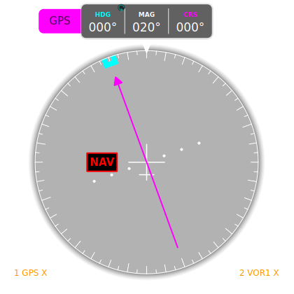 |

## Arc view

`orientation: arc` shows the forward 120 degrees of the rose spread across the
instrument, for finer heading resolution. The course pointer, deviation bar,
bug, track diamond and bearing pointers all draw on the arc, and the deviation
bar stays on the course pointer, as on a G1000 or G3X arc HSI.

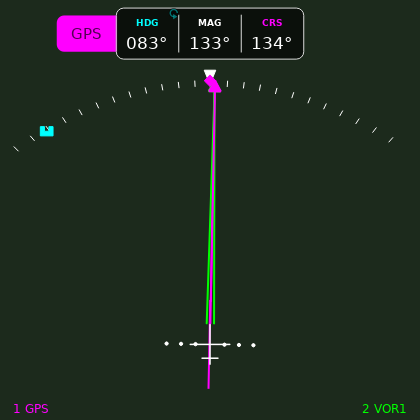

`heading_up`, `north_up` and `track_up` are all offered, but today all three
draw the same heading-up rose.

## Customizing

### In the configurator

Select the HSI in the Panel Editor; its options are in the **Properties**
panel on the right ([Designing Your Panel](Designing-Your-Panel)).
These are the options with their defaults. The bench panel's values are in the
last column where it differs.

| Option | Default | Bench panel | What it does |
|---|---|---|---|
| CDI (`cdi_enabled`) | on | | Draw the deviation bar. |
| Glideslope (`gsi_enabled`) | on | | Draw the glideslope scale and diamond. |
| Readout layout (`readout_layout`) | `top_panel` | | `top_panel`: one HDG / MAG / CRS panel above the rose, with the source tab. `corners`: HDG and CRS boxes in the top corners. `split`: MAG above the rose, CRS and HDG in the bottom corners. `none`: no readouts. Without `top_panel` the source label is plain text in the top-left. |
| Orientation (`orientation`) | `heading_up` | | `arc` for the [arc view](#arc-view). |
| Heading bug (`heading_bug_enabled`) | off | on | Draw the cyan bug at `HEADBUG`. Turn it on once something publishes a selected heading. |
| Heading bug color (`heading_bug_color`) | `#00ffff` | | |
| Touch to set HDG / CRS (`touch_edit`) | on | | The [knob edit](#setting-heading-and-course). |
| Track diamond (`track_indicator_enabled`) | on | | Draw the diamond at `TRACKM`. |
| Track diamond color (`track_color`) | `#ff00ff` | | |
| Track min speed (`track_min_speed`) | 5 kt | 20 kt | Hide the diamond below this groundspeed. |
| Bearing pointer 1 (`bearing1_enabled`) | off | on | Draw pointer 1 (`BRG1`) and its label. |
| Bearing pointer 2 (`bearing2_enabled`) | off | on | Draw pointer 2 (`BRG2`) and its label. |
| Bearing pointer color (`bearing_color`) | `#00ffff` | | Used only while a pointer's source is unknown. |
| Source label (`source_label_enabled`) | on | | Show the source tab or label. |
| Source auto-color (`source_auto_color`) | on | | Colour by source. Off: always `course_color`. |
| Course pointer color (`course_color`) | `#ff00ff` | | GPS colour, and the colour when auto-colour is off. |
| VOR/LOC color (`vloc_color`) | `#00ff00` | | NAV radio colour. |
| Needle color (`needle_color`) | `#ffff00` | | Glideslope diamond colour when source auto-color is off. The deviation bar is drawn in the course pointer colour. |
| Needle width (`needle_width`) | 3 px | 2 px | Width of the course pointer, bar and bearing pointers. |
| Center symbol (`center_symbol`) | `aircraft` | | `none` hides the aircraft symbol. |
| Numeral size (`numeral_scale`) | 1.5 | | Rose numeral size, 0.5 to 3.0. |
| Foreground (`fg_color`) | `#ffffff` | | Rose, ticks and text. |
| Background (`bg_color`) | `#000000` | | Rose face fill. |
| Background opacity (`bg_opacity`) | 100 | 30 | Rose face opacity in percent. Lower lets the synthetic vision show through. |
| Depth rings (`depth_rings`) | off | | Faint rings inside the rose. |
| Drop shadow (`shadow_enabled`) | off | on | A soft shadow under the rose and the readout panel. |

The colour options can also follow the panel's colour tokens; see
[Preferences & Styling](Preferences-and-Styling).

### In YAML

The configurator writes these same options into the screen file. By hand:

```yaml
- type: horizontal_situation_indicator
  row: 65
  column: 38
  span: {rows: 41, columns: 55}
  options:
    heading_bug_enabled: true
    track_min_speed: 20
    bearing1_enabled: true
    bearing2_enabled: true
    bg_opacity: 30
    shadow_enabled: true
```

The HSI keeps its aspect ratio, so give it a roughly square cell. A cell that
is too small for its `font_percent` can crowd the source tab: see
[Screen Builder](Screen-Builder).

### Feeding it

The HSI needs fix-gateway's `compute` plugin to turn the per-source keys into
the ones it draws. The shipped `connections/compute.yaml` already does this:
`GPSSRC` picks the GPS source, `NAVSRC` picks the source the HSI shows, and
`BRG1SRC` / `BRG2SRC` pick what each bearing pointer points at. A sensor or
radio plugin only has to write the per-source keys:

| To show | Write |
|---|---|
| Heading | `HEAD` (magnetic) |
| Track diamond | `TRACK` (true) and `MAGVAR`; `compute` makes `TRACKM`. `GS` for the speed gate. |
| NAV1 / NAV2 | `NAV1CRS`, `NAV1CDI`, `NAV1TF`, `NAV1DH` (localizer or VOR received), `NAV1GSI`, `NAV1GSF` (glideslope flag), and the same for `NAV2` |
| VOR bearing (pointers, push-to-centre) | `VOR1BRG`, `VOR2BRG` (magnetic, to the station) |
| External GPS navigator | `EXTCRS`, `EXTCDI`, `EXTTF`, with `GPSSRC` 1 |
| Selected heading | `HEADBUG` |

The internal flight plan writes its own guidance (`FPLCRS`, `FPLCDI`, `FPLTF`)
and the active waypoint (`WPLAT`, `WPLON`), from which `compute` makes the GPS
bearing (`GPSBRG`). The full key list is on [FIX Database Keys](FIX-Database-Keys).

## See also

- [Pilot's Guide](Pilots-Guide): flying the panel, the knob, the flight plan.
- [Flight Instruments](Widgets-Flight-Instruments): the other heading
  instruments, `heading_display` and `heading_tape`.
- [Flight Plan Engine](https://github.com/billmallard/fix-gateway/wiki/Flight-Plan-Engine)
  (fix-gateway wiki): how the guidance the HSI shows is computed.
