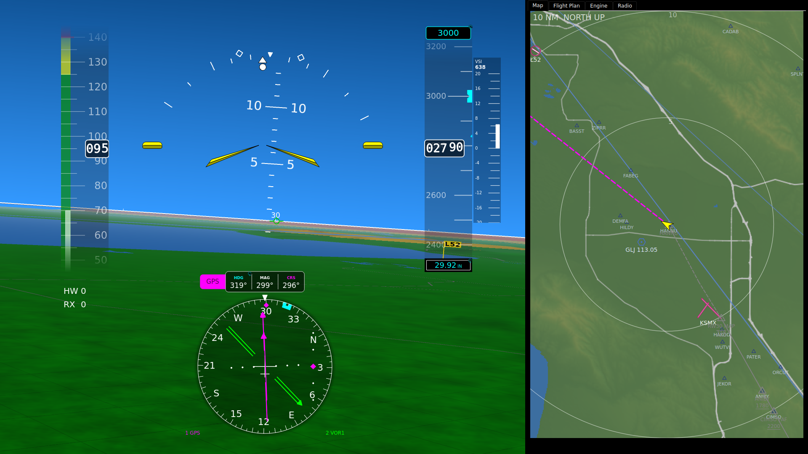

# The Panel at a Glance

This page is about flying a panel built in the configurator. It covers what is
where, how you move around it, and how you change a value with touch and the
knob. The instruments each have their own page, linked below.

> **Advisory use.** pyEFIS is experimental software for Experimental /
> Amateur-Built aircraft. Use it alongside the aircraft's required
> instruments, not in place of them. It shows what fix-gateway feeds it. When
> a source is lost it flags the value, but it cannot invent data.

## What is where

The picture is the simulator bench's panel: one screen, 200 columns by 110
rows, as the configurator lays it out. Yours may differ, because every
position and option is yours to set in the
[Panel Editor](Designing-Your-Panel#the-panel-editor).

| Area | Instrument | Page |
|---|---|---|
| Background, left two-thirds | Synthetic vision: attitude, terrain, runways, the flight path marker | [Attitude and Synthetic Vision](Attitude-and-Synthetic-Vision) |
| Left edge | Airspeed tape | [Airspeed, Altitude and Vertical Speed](Airspeed-Altitude-and-Vertical-Speed) |
| Right of centre | Altitude tape, with the selected altitude at the top and the altimeter setting at the bottom, and the VSI beside it | [Airspeed, Altitude and Vertical Speed](Airspeed-Altitude-and-Vertical-Speed) |
| Under the airspeed tape | Wind: `HW`/`TW` and `RX`/`LX` | [below](#wind) |
| Bottom centre | The HSI | [The HSI](The-HSI) |
| Right-hand third | A tab column: **Map**, **Flight Plan**, **Engine**, **Radio** | [below](#the-tab-column) |

## Start-up

pyEFIS opens straight on its boot screen, the one marked as the default in the
configurator. A strip across the bottom reads *"pyEfis is experimental software
for Experimental / Amateur-Built aircraft. It is not certified. It is provided
as-is with no warranty, and any use of it is at your own risk."* It needs no
tap. Touches pass through it to the instruments, and it clears by itself: after
8 seconds once the notice has been accepted on this install, after 20 seconds
if not. Nothing at start-up waits for a tap, so a restart in flight puts you
back on the instruments at once. How the notice is accepted is on
[Data Status, Updates and Notices](Data-Status-Updates-and-Notices#the-software-notice-at-start-up).

## The tab column

A **tab section** puts several pages in one area of the screen. Touch a tab
to show its page. On the bench panel:

- **Map:** the [moving map](Moving-Map).
- **Flight Plan:** the [flight plan](Flight-Plan), where you build and edit the route.
- **Engine:** the [engine instruments](Engine-Monitoring); on the bench, four CHT and four EGT bars.
- **Radio:** empty on the bench panel.

Things to know:

- **Only touch changes tabs.** The knob does not step through them. It works
  the instruments on the page that is showing, and skips the hidden pages.
- **The panel opens on the same tab every time:** the section's **Default
  tab**, not the last one you picked.
- **pyEFIS can change the tab for you.** **Info** or **Create WPT** on the
  map opens its page on the flight plan instrument, so the Flight Plan tab
  comes up.

The tab bar can sit on any edge of the section. See
[Designing Your Panel](Designing-Your-Panel#tab-sections).

## Moving between screens

A panel can have several screens. How you move between them depends on how the
panel was built:

- **A configurator panel with more than one screen** gets a **SCREEN >** button
  on each screen. Touch it to step to the next screen.
- **A configurator panel with one screen**, like the bench's, replaces the
  device's default screen. The stock screens stay loaded behind it. See
  [Setting Up a Device](Setting-Up-a-Device#5-pull-your-panel).
- **The stock screens** carry a bar of buttons to jump between them. The button
  for the screen you are on takes you back to the PFD.
- **With a keyboard attached**, `S` is the next screen, `A` the previous one and
  `P` the PFD.

Changing screens ends any edit in progress (below).

## Touch a value, then turn the knob

Some values can be set by touching them: on the bench panel, the HSI's **HDG**
and **CRS**, the **selected altitude** and the **altimeter setting**. A touched
value gets a **cyan ring**, with a small **circular-arrow icon** on its corner.
That means the knob now changes it.

- **Inner knob:** small steps. **Outer ring:** big steps.
- **Push the knob:** each value has its own push action, listed below.
- **Leave it alone for about 10 seconds** and the ring goes away by itself, so a
  knob bumped later cannot change anything.
- **Touching anywhere else** also clears it, and that touch still acts on
  whatever it lands on. Changing screens clears it too.
- Only one value is selected at a time. Touching another value moves the ring.

| Value | Inner knob | Outer ring | Push |
|---|---|---|---|
| HSI **HDG** (heading bug) | 1° | 10° | Bug to current heading |
| HSI **CRS** (NAV radio only) | 1° | 10° | Course to the station, TO |
| **Selected altitude** | 100 ft | 1000 ft | Current altitude, rounded to 100 ft |
| **Altimeter setting** | 0.01 inHg / 1 hPa | 0.10 inHg / 10 hPa | Standard; push again to undo |

The details are on [The HSI](The-HSI#setting-heading-and-course) and
[Airspeed, Altitude and Vertical Speed](Airspeed-Altitude-and-Vertical-Speed).

While nothing is selected, the same icon shows **dimmed** on every value you can
select, so you can see where the knob can go. A panel turns this off with
`editIconAtRest: false` in its `main:` settings.

**With a mouse instead of a knob** (a bench unit or a desktop run), point at
the selected value:

| Mouse, pointer on the selected value | Same as |
|---|---|
| Scroll wheel, one click | Inner knob, one step |
| Shift + scroll wheel, or tilting the wheel sideways | Outer ring, one step |
| Middle-click (press the wheel) | Pushing the knob |

The wheel only edits the selected value, and only while the pointer is on it.
Anywhere else the wheel works as usual, so the map still zooms.

### The knob without touch

On a panel with an encoder, turning the knob while nothing is selected moves an
**orange** highlight between the instruments that take part, in the order the
panel gives them (`encoder_order`). Push to start editing the highlighted one;
from then on a push is that instrument's own push action. The knob's FIX keys come from the `HMI_ENCODER_BUTTONS`
include: `ENC3` (inner), `ENC4` (outer) and `BTN3` (push), with a 10-second
timeout.

## Wind

The wind readout shows two components, as whole knots:

- `HW` headwind or `TW` tailwind, from `HWIND`.
- `RX` crosswind from the right or `LX` from the left, from `XWIND`.

A grey `---` means the wind has failed or is not published; an orange `X` means
it is flagged bad.

## When a value is flagged

Every value carries fix-gateway's quality flags, and each instrument shows them.

| You see | It means |
|---|---|
| A grey **sky** on the attitude display | An attitude input (pitch, roll, lateral acceleration or true airspeed) is old or bad. |
| A dark grey attitude display with a red **XXX** | An attitude input has failed. |
| A blank tape readout, the box outline left | The airspeed or altitude value is old or bad. |
| A red **XXX** in a readout | That value has failed. |
| A grey selected altitude, altimeter setting or bug | That value is old or bad. |
| An amber **SVS UNAVAIL** | Synthetic vision is on but has no usable position, so the ground is drawn plain brown. |
| A red value on a gauge | That item is annunciating. See [Engine Monitoring](Engine-Monitoring). |

These come from the data, not from the display: check the sensor or its
fix-gateway plugin.

## Units and brightness

Neither is on the bench panel; both come with the stock screens.

- **Units** toggles temperature (°C / °F), pressure (inHg / hPa) and altitude
  (ft / m) together, on the instruments set to switch. While the buttons are
  hidden it reads **Show Menu**, and touching it brings them back.
- The **dimmer** steps `DIM` up and down, repeating while held. pyEFIS only
  writes the key; the backlight change is up to whatever reads it.

## See also

- [Designing Your Panel](Designing-Your-Panel): building the panel.
- [Legacy](Legacy): the stock screens.
- [Widget Reference](Widget-Reference): every instrument's options.
