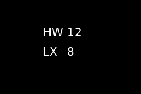

# Flight Instruments

Airspeed, altitude, vertical speed, heading, the HSI, the turn coordinator and
wind. The tapes and the HSI each have a page on how they read and fly, linked
under their headings; this page is the full option list, with the older dials
too. Each table is generated from pyEFIS's instrument registry; see
[Widget Reference](Widget-Reference#how-to-read-these-pages).

| `type:` | What it is |
|---|---|
| `airspeed_tape` | Scrolling airspeed tape with V-speed bands and a trend arrow. |
| `airspeed_dial` | Round airspeed dial. |
| `airspeed_box` | Airspeed readout switching TAS / GS / IAS (hidden). |
| `airspeed_trend_tape` | Standalone airspeed-trend bar. |
| `altimeter_tape` | Scrolling altitude tape with selected altitude and altimeter setting. |
| `altimeter_dial` | Round altimeter. |
| `altimeter_trend_tape` | Vertical-speed scale for beside the altitude tape. |
| `vsi_dial` | Round vertical-speed dial. |
| `vsi_pfd` | Compact vertical-speed strip. |
| `horizontal_situation_indicator` | The HSI. |
| `heading_tape` | Scrolling heading tape. |
| `heading_display` | Boxed digital heading (hidden). |
| `turn_coordinator` | Rate-of-turn and slip. |
| `wind_display` | Head/tail and cross wind components. |

The altitude tape's altimeter-setting and selected-altitude boxes can be
selected with the knob; give the tape an `encoder_order`. The other flight
instruments are not on the knob.

---

## `airspeed_tape`

<!-- generated:airspeed_tape -->

**Airspeed Tape** · palette category `airspeed`

How it reads and flies: [Airspeed, Altitude and Vertical Speed](Airspeed-Altitude-and-Vertical-Speed).

FIX keys it reads by default: `IAS`.

| Option | Configurator label | Default | Values | What it does |
|---|---|---|---|---|
| `edge_fade` | Fade tape edges | off | on / off | alpha-fade the top and bottom of the scrolling scale into the background (SVS shows through) |
| `show_tas` | Show TAS box | on | on / off | show the true-airspeed readout box (from TAS) |
| `show_trend` | Show trend arrow | on | on / off | show the acceleration trend vector along the tape |
| `trend_lookahead` | Trend look-ahead (s) | `6` |  | seconds ahead the trend vector projects current accel |

Values it reads from the FIX item, set in fix-gateway (the aircraft parameters), not on the panel:

| Value | From | Meaning |
|---|---|---|
| `Vs` | aux | Stall, clean (Vs) (kt) |
| `Vs0` | aux | Stall, landing (Vs0) (kt) |
| `Vno` | aux | Max cruise (Vno) (kt) |
| `Vne` | aux | Never-exceed (Vne) (kt) |
| `Vfe` | aux | Flaps-extended (Vfe) (kt) |

<!-- /generated -->

The green band starts at Vs0, not Vs
([#396](https://github.com/billmallard/pyEfis/issues/396)).

## `airspeed_dial`

A round airspeed dial, 0 to 140 kt, with its arcs drawn from the same V-speeds
as the tape. `XXX` on failure; a grey needle when old or bad.

<!-- generated:airspeed_dial -->

**Airspeed Dial** · palette category `airspeed`

FIX keys it reads by default: `IAS`.

| Option | Configurator label | Default | Values | What it does |
|---|---|---|---|---|
| `bg_opacity` | Background opacity (%) | `100` | 0 to 100, step 1 | 0 = transparent (show what's behind), 100 = solid |

Values it reads from the FIX item, set in fix-gateway (the aircraft parameters), not on the panel:

| Value | From | Meaning |
|---|---|---|
| `Vs` | aux | Stall, clean (Vs) (kt) |
| `Vs0` | aux | Stall, landing (Vs0) (kt) |
| `Vno` | aux | Max cruise (Vno) (kt) |
| `Vne` | aux | Never-exceed (Vne) (kt) |
| `Vfe` | aux | Flaps-extended (Vfe) (kt) |

<!-- /generated -->

## `airspeed_box`

A readout that shows TAS, GS or IAS. The **Set airspeed mode** action steps
through them (empty argument) or picks one (`0` TAS, `1` GS, `2` IAS). `XXX` on
failure, blank when old or bad. Replaced in the palette by `value_text`.

<!-- generated:airspeed_box -->

**Airspeed Box** · palette category `airspeed` · hidden from the palette, still loads in existing panels

FIX keys it reads by default: `IAS`, `GS`, `TAS`.

No options in the configurator beyond the ones every instrument takes.

<!-- /generated -->

## `airspeed_trend_tape`

A bar meant to grow up or down with the airspeed trend. It reads no FIX key
today, so the bar does not move
([#403](https://github.com/billmallard/pyEfis/issues/403)). Use the trend arrow
on `airspeed_tape`.

<!-- generated:airspeed_trend_tape -->

**Airspeed Trend Tape** · palette category `airspeed`

FIX keys it reads by default: `IAS`.

No options in the configurator beyond the ones every instrument takes.

<!-- /generated -->

---

## `altimeter_tape`

<!-- generated:altimeter_tape -->

**Altimeter Tape** · palette category `altitude`

How it reads and flies: [Airspeed, Altitude and Vertical Speed](Airspeed-Altitude-and-Vertical-Speed).

FIX keys it reads by default: `ALT`.

| Option | Configurator label | Default | Values | What it does |
|---|---|---|---|---|
| `edge_fade` | Fade tape edges | off | on / off | alpha-fade the top and bottom of the scrolling scale into the background (SVS shows through) |
| `dbkey` | FIX key | `ALT` | FIX key | FIX key driving the tape (default ALT) |
| `maxalt` | Max altitude | `50000` |  | top of the tape's altitude range (ft) |
| `majorDiv` | Major division | `200` |  | altitude between labelled tape ticks (ft) |
| `minorDiv` | Minor division | `100` |  | altitude between the small tape ticks (ft) |
| `total_decimals` | Total digits | `5` |  | number of digits in the altitude readout |
| `font_mask` | Font mask | `00000` |  | widest string the readout reserves space for (sizing) |
| `round_to` | Round readout to | `0` |  | round the readout to this increment (0 = none) |
| `numeric_box` | Show numeric box | on | on / off | show the boxed numeric altitude over the tape |
| `font_scale` | Scale-number font scale | `1` |  | multiplier on the tape scale-number font size |
| `show_baro` | Baro setting box | on | on / off | touch-selectable altimeter setting box at the bottom of the tape (on for an ALT tape unless the screen has its own BARO readout; off for a VS tape) |
| `altsel_box` | Selected-altitude box | on | on / off | touch-settable ALTSEL box at the top of the tape (on for an ALT tape, off for a VS tape) |
| `alt_bug_enabled` | Altitude bug | on | on / off | draw the selected-altitude bug on the scale (follows the box unless set) |
| `alt_bug_color` | Altitude bug color | `#00ffff` | colour | colour of the selected-altitude box text and bug |
| `alt_bug_alert_color` | Altitude alert color | `#ffb000` | colour | box text and bug colour while fix-gateway flags an altitude deviation (the key's annunciate flag) |
| `alt_bug_dbkey` | Selected-altitude key | `ALTSEL` | FIX key | FIX key holding the selected altitude (default ALTSEL) |

<!-- /generated -->

With `altitude: true` the **Units** button switches it between ft and m. The
same type draws a vertical-speed tape when its `dbkey` is `VS`; the trend
arrow, altimeter setting and selected-altitude box are then off unless set.

## `altimeter_dial`

A round three-pointer altimeter.

<!-- generated:altimeter_dial -->

**Altimeter Dial** · palette category `altitude`

FIX keys it reads by default: `ALT`.

| Option | Configurator label | Default | Values | What it does |
|---|---|---|---|---|
| `bg_opacity` | Background opacity (%) | `100` | 0 to 100, step 1 | 0 = transparent (show what's behind), 100 = solid |

<!-- /generated -->

## `altimeter_trend_tape`

<!-- generated:altimeter_trend_tape -->

**Altimeter Trend Tape** · palette category `altitude`

How it reads and flies: [Airspeed, Altitude and Vertical Speed](Airspeed-Altitude-and-Vertical-Speed).

FIX keys it reads by default: `VS`.

| Option | Configurator label | Default | Values | What it does |
|---|---|---|---|---|
| `maxvs` | Range (ft/min) | `2500` | 500 to 10000, step 100 | full scale, plus and minus; pick to suit the airplane's climb/descent performance (AC 23.1311-1C 8.11) |
| `minorDiv` | Tick interval (ft/min) | `100` | 25 to 1000, step 25 | minor tick mark every N ft/min |
| `numberedDiv` | Numbered interval (ft/min) | `200` | 50 to 2000, step 50 | numbered graduation every N ft/min (labels print in hundreds: 2400 ft/min prints as 24) |
| `bg_color` | Background | `#000000` | colour | tape face colour |
| `bg_opacity` | Background opacity (%) | `100` | 0 to 100, step 1 | 0 = transparent (show what's behind), 100 = solid |

<!-- /generated -->

---

## `vsi_dial`

A round vertical-speed dial. The needle sweeps 170 degrees each way for 2,000
ft/min. `XXX` on failure; a grey needle when old or bad.

<!-- generated:vsi_dial -->

**VSI Dial** · palette category `vertical_speed`

FIX keys it reads by default: `VS`.

No options in the configurator beyond the ones every instrument takes.

Values it reads from the FIX item, set in fix-gateway (the aircraft parameters), not on the panel:

| Value | From | Meaning |
|---|---|---|
| `Min` | min | Range minimum (ft/min) |
| `Max` | max | Range maximum (ft/min) |

<!-- /generated -->

## `vsi_pfd`

A narrow strip with a dot that rides up and down with the rate, on a scale that
spreads out the low rates. The dot is grey when old or bad; a red X replaces it
on failure.

<!-- generated:vsi_pfd -->

**VSI (PFD)** · palette category `vertical_speed`

FIX keys it reads by default: `VS`.

No options in the configurator beyond the ones every instrument takes.

<!-- /generated -->

---

## `horizontal_situation_indicator`

<!-- generated:horizontal_situation_indicator -->

**Horizontal Situation Indicator (HSI)** · palette category `navigation`

How it reads and flies: [The HSI](The-HSI).

FIX keys it reads by default: `COURSE`, `CDI`, `GSI`, `HEAD`, `BRG1`, `BRG2`, `BRG1SRC`, `BRG2SRC`.

| Option | Configurator label | Default | Values | What it does |
|---|---|---|---|---|
| `cdi_enabled` | CDI | on | on / off | show the lateral course-deviation needle (CDI) |
| `gsi_enabled` | Glideslope | on | on / off | show the vertical glideslope needle (GSI) |
| `fg_color` | Foreground | `#ffffff` | colour | compass card, ring and text colour |
| `bg_color` | Background | `#000000` | colour | compass-disc fill colour |
| `bg_opacity` | Background opacity (%) | `100` | 0 to 100, step 1 | 0 = transparent (show what's behind), 100 = solid |
| `needle_color` | Needle color | `#ffff00` | colour | colour of the CDI/GSI deviation needles |
| `needle_width` | Needle width | `3` | 1 to 10, step 1 | width of the CDI/GSI deviation needles (px) |
| `course_color` | Course pointer color | `#ff00ff` | colour | selected-course pointer (the magenta CRS triangle) |
| `source_auto_color` | Source auto-color | on | on / off | colour the course pointer and CDI by nav source -- magenta for GPS, the VOR/LOC colour for a VOR/LOC source (from NAVSRC) |
| `vloc_color` | VOR/LOC color | `#00ff00` | colour | course pointer / CDI colour for a VOR or localizer source when source auto-color is on |
| `source_label_enabled` | Source label | on | on / off | show the nav-source annunciation (GPS / VLOC1 / VLOC2, or VOR/LOC when NAVTYPE is available) on the rose face |
| `heading_bug_enabled` | Heading bug | off | on / off | show the cyan heading bug at the selected heading (HEADBUG) |
| `heading_bug_color` | Heading bug color | `#00ffff` | colour | heading-bug colour |
| `touch_edit` | Touch to set HDG / CRS | on | on / off | touch the HDG or CRS readout, then turn the knob to set it: HDG sets HEADBUG, CRS sets NAV1CRS or NAV2CRS for the selected VLOC source (not editable on GPS). Inner ring 1 deg, outer ring 10 deg; push syncs HDG to the heading or centres the CDI on CRS |
| `track_indicator_enabled` | Track diamond | on | on / off | show the magenta GPS ground-track diamond (TRACK), above the speed gate |
| `track_color` | Track diamond color | `#ff00ff` | colour | GPS ground-track diamond colour |
| `track_min_speed` | Track min speed (kt) | `5` | 0 to 50, step 1 | hide the track diamond below this groundspeed (kt) |
| `center_symbol` | Center symbol | `aircraft` | `aircraft`, `none` | fixed ownship symbol at the rose centre; 'aircraft' is a silhouette (deliberately not a triangle -- a triangle reads as the TO/FROM / course indicator) |
| `readout_layout` | Readout layout | `top_panel` | `top_panel`, `corners`, `split`, `none` | placement of the integral actual-heading (HEAD), selected-heading (HEADBUG) and course (COURSE) readouts. top_panel = one sectioned panel across the top (outside the rose); corners = selected-heading + course boxes in the top corners; split = heading box above the rose, course/bug in the bottom corners |
| `numeral_scale` | Numeral size | `1.5` | 0.5 to 3, step 0.1 | compass-rose numeral/letter size as a multiple of the base tick font (larger = bigger rose numbers) |
| `depth_rings` | Depth rings | off | on / off | faint concentric rings inside the rose (a light structural cue; real depth comes from the translucent face over the map, so these are off by default) |
| `shadow_enabled` | Drop shadow | off | on / off | soft drop shadow on the static elements -- the rose disc and the readout panel -- for a raised, layered look; off by default |
| `orientation` | Orientation | `heading_up` | `heading_up`, `north_up`, `track_up`, `arc` | compass presentation. heading_up/north_up/track_up show the full 360 rotating rose (today's look); arc shows an expanded forward ~120 sector (finer resolution on the tracked heading, decluttered of the rear rose) |
| `bearing1_enabled` | Bearing pointer 1 | off | on / off | show the single-bar RMI bearing needle (BRG1), pointing to the pointer-1 source (VOR1/VOR2/GPS via BRG1SRC) |
| `bearing2_enabled` | Bearing pointer 2 | off | on / off | show the double-bar RMI bearing needle (BRG2), pointing to the pointer-2 source (VOR1/VOR2/GPS via BRG2SRC) |
| `bearing_color` | Bearing pointer color | `#00ffff` | colour | generic bearing-needle colour used when the source is unknown; a needle with a known source is coloured by it (magenta GPS / green VOR) |

<!-- /generated -->

The HSI needs fix-gateway's `compute` plugin to route the selected nav source
into the keys it draws; see [The HSI](The-HSI#feeding-it).

## `heading_tape`

A scrolling compass tape, cardinal letters in cyan and numbers in white. A red
boxed `XXX` on failure; greyed with an amber `HDG` box when old or bad.

<!-- generated:heading_tape -->

**Heading Tape** · palette category `navigation`

FIX keys it reads by default: `HEAD`.

No options in the configurator beyond the ones every instrument takes.

<!-- /generated -->

## `heading_display`

A boxed heading, three digits and a degree sign (`003°`). Blank when old or bad,
`XXX` on failure. Replaced in the palette by `value_text` with a `HDG` prefix.

<!-- generated:heading_display -->

**Heading Display** · palette category `navigation` · hidden from the palette, still loads in existing panels

FIX keys it reads by default: `HEAD`.

| Option | Configurator label | Default | Values | What it does |
|---|---|---|---|---|
| `fg_color` | Foreground | `#aaaaaa` | colour | heading-text colour |
| `bg_color` | Background | `#000000` | colour | background-box fill colour |
| `bg_opacity` | Background opacity (%) | `100` | 0 to 100, step 1 | 0 = transparent (show what's behind), 100 = solid |

<!-- /generated -->

---

## `turn_coordinator`

A small aircraft banks with the rate of turn (`ROT`, held to +/-5) over a
slip/skid ball driven by `ALAT`. The ball turns amber near the end of its
travel. Each element shows `XXX` if its key fails and greys if it is old or bad.

<!-- generated:turn_coordinator -->

**Turn Coordinator** · palette category `attitude`

FIX keys it reads by default: `ROT`, `ALAT`.

No options in the configurator beyond the ones every instrument takes.

<!-- /generated -->

The ball's gain and smoothing are screen settings, not instrument options:
`alat_multiplier` and `alat_filter_depth` at the screen level.

---

## `wind_display`

<!-- generated:wind_display -->

**Wind Display** · palette category `wind`

How it reads and flies: [The Panel at a Glance](The-Panel-at-a-Glance#wind).

FIX keys it reads by default: `HWIND`, `XWIND`.

No options in the configurator beyond the ones every instrument takes.

<!-- /generated -->

| Row | Positive | Negative |
|---|---|---|
| Top, from `HWIND` | `HW`, headwind | `TW`, tailwind |
| Bottom, from `XWIND` | `RX`, from the right | `LX`, from the left |

Values are whole knots without a sign. The label changes only past +/-0.5 kt, so
noise around zero does not flicker it. An orange `X` means bad; a grey `---`
means failed or not published. To make it optional, give the entry
`disabled: WIND_DISPLAY` and set that preference.
